# Batida de componentes · Lote C (AlignUI, HorizonX, Kobra, Hanging Team)

Fecha: 2026-10-12 · Linear: SKI2-252 (sub-issue de SKI2-249) · Agente del lote C · Criterio de «trasladable»: [00_base_interfaz.md](../00_base_interfaz.md)
Capturas: [`capturas/C/`](capturas/C/) (1366 × 900, la 20 a 1920 × 1000; tomadas de la fuente con Playwright el 12 oct; 22 de 23 filas, la 21 no se pinta sin interfaz)

## Cabecera

| Fuente | Cómo la he recorrido | Vistos | Licencia | Stack |
|---|---|---|---|---|
| **AlignUI** ([pro.alignui.com](https://pro.alignui.com/) · [alignui.com](https://www.alignui.com/) · [GitHub `alignui`](https://github.com/alignui)) | Las 55 páginas de documentación de los componentes base (`/docs/v1.2/ui/*`). Clon del starter `alignui-nextjs-typescript-starter`, con 51 componentes en `components/ui` leídos en código. Las 41 categorías de Pro Blocks con sus 312 variantes, contadas por id y vistas en vista previa. La descripción de las 4 plantillas sectoriales. | 51 base + 312 bloques Pro + 4 plantillas | Base, starters y CLI: **MIT** (© 2024 Doğukan Çavuş, [LICENSE](https://github.com/alignui/alignui-nextjs-typescript-starter/blob/master/LICENSE)). Pro Blocks, plantillas y Figma: **propietaria de pago** ([AlignUI License Agreement](https://pro.alignui.com/license), 299–399 $) | Next 14, React 18, Tailwind 3.4, tailwind-variants, Radix UI, react-day-picker, react-otp-input, Remix Icon |
| **HorizonX** ([horizonx.so](https://horizonx.so/)) | Sitemap completo (786 URL). Las 236 fichas de `/tools` descargadas y clasificadas por familia y stack. Leídos terms, pricing, faqs y docs. 8 fichas de `/explore` (las de salud y calendario). `/textures`, `/shaders` y `/collections` clasificadas por tipo. | 236 tools (+ 265 plantillas `/explore`, 45 texturas, 34 shaders y 39 colecciones, que no son componentes) | **Propietaria de pago** (suscripción de 19–40 $/mes; prohíbe redistribuir; [terms](https://horizonx.so/terms)). 7 tools dicen adaptar piezas de Uiverse.io (MIT) y 3 de React Bits (hoy MIT + Commons Clause). El GitHub enlazado (`horizonx-so`) da 404. | Web en SvelteKit. Tools: HTML/CSS/Vanilla JS (~160), React (40), GSAP (60), Three.js/WebGL (~34) |
| **Kobra** ([kobra.systems](https://kobra.systems/); `http://` redirige a `/components/input-otp`) | Sitemap completo: las 81 páginas de componentes descargadas, descripción y composición de cada una, y unas 20 capturas de revisión. Leídos pricing y terms. | 81 | **Propietaria de pago** (199–599 $, [terms](https://kobra.systems/terms)). Los 10 componentes «Free» son solo para uso personal. Prohíbe redistribuir el código y usarlo para entrenar modelos. **Sin repo público.** | React, Tailwind, Base UI, Motion (framer-motion), cva |
| **Hanging Team** ([Framer Marketplace](https://www.framer.com/marketplace/components/hanging-team/)) | Ficha del marketplace y [vista previa en vivo](https://diverse-unicorn-464220.framer.app/). Es un único componente, publicado el 12 oct 2026 por hayriye akgüller. | 1 | **De pago, de uso único** (12 $, licencia «Single-Use» de Framer) | Componente de código de Framer (React y motion) |

**Total visto: 685 componentes o variantes** (51 + 312 + 4 de AlignUI, 236 de HorizonX, 81 de Kobra y 1 de Hanging Team), además de 383 páginas de HorizonX que no son componentes. Ninguna fuente estaba caída. Lo que pide pago o cuenta es el código de casi todos los bloques Pro de AlignUI, la exportación de HorizonX y el código de Kobra: de todo eso solo he usado la vista previa pública.

**Antes de puntuar he comprobado lo que ya existe**, en `epi10-ui.css`, en las islas y en las capturas `99-demo`. Por eso he descartado como duplicados: los chips de filtro de la lista de clientas (ya existen), los badges con punto de estado (ya existen), la cabecera de ficha con avatar, la entrada por enlace mágico del login (hace innecesario el OTP), los adjuntos del chat, los toasts, el `<details>` de «Historial y otras opciones», el vacío y el calendario (cally).

**Conclusión del lote.** Solo AlignUI base es MIT; el resto del lote es de pago. Lo útil para HOY es poco y pequeño: seis piezas S o M que pulen vistas ya renovadas. No hay nada que vendorizar: todo se reescribe en CSS `epi-` o en las islas existentes.

## Inventario

Leyenda de traslado: **CSS** = CSS `epi-` puro en `epi10-ui.css` (con macro Twig si procede) · **Isla** = cambio en una isla Preact existente o nueva · **INSPIRACIÓN** = código de pago o propietario: se describe el patrón y se reescribe desde cero, sin copiar código.

| # | Fuente | Componente (enlace) | Qué es | Licencia | Stack original | Vista(s) EPI10 | Traslado a EPI10 UI | Esfuerzo | Dependencias que arrastra | Belleza | Utilidad | Recomendación | Notas |
|---|---|---|---|---|---|---|---|---|---|---|---|---|---|
| 01 | AlignUI | [File Format Icon](https://alignui.com/docs/v1.2/ui/file-upload) | Icono de documento con la pestaña del formato en color (PDF rojo, DOC azul, XLS verde, IMG…) | MIT | React + tailwind-variants, SVG | Portal: mi informe, mis documentos, mensajes (adjuntos) · BO: ficha de clienta (Documentos) | CSS: `epi-fichero` (silueta SVG en `iconos.svg` + etiqueta `::after` con `data-formato="pdf"`) y macro `ui.fichero('pdf')` | S | Ninguna (la silueta SVG con aviso MIT en `vendor/LICENSE-alignui.txt`) | 4 | 4 | **HOY** | Sustituye el icono genérico de «Informe EPI10» y de los adjuntos del chat. 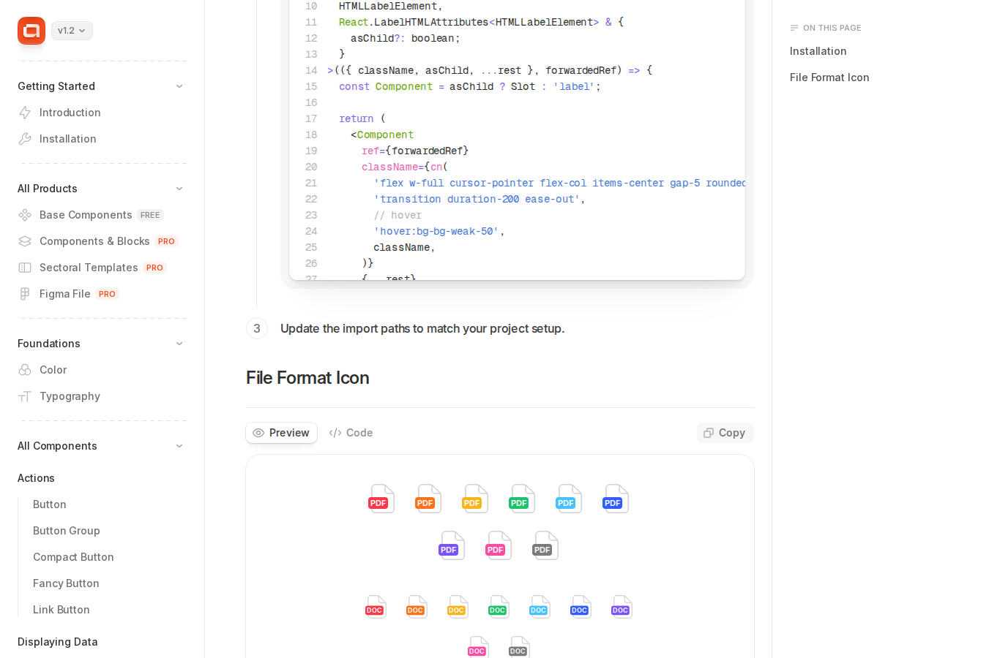 |
| 02 | HorizonX (+ Kobra) | [Profile Skeleton Loader](https://horizonx.so/tools/loader-profile-skeleton) · [Kobra Skeleton](https://kobra.systems/components/skeleton) | Bloques grises con brillo que dibujan la forma del contenido mientras carga | Propietaria → INSPIRACIÓN | HTML/CSS/Vanilla JS · React + Tailwind | Transversal (cargas): mensajes, citas, mi informe · BO: panel «Hoy», lista de clientas | CSS: `epi-skeleton` (`--linea`, `--circulo`, `--tarjeta`) con `@keyframes` de brillo y `prefers-reduced-motion`. Las islas lo pintan en lugar de `epi-spinner` mientras llega el JSON | S | Ninguna | 4 | 5 | **HOY** | Hoy no hay skeleton: las islas de chat y calendario enseñan un spinner o nada. Es lo que más «app moderna» transmite al cargar. 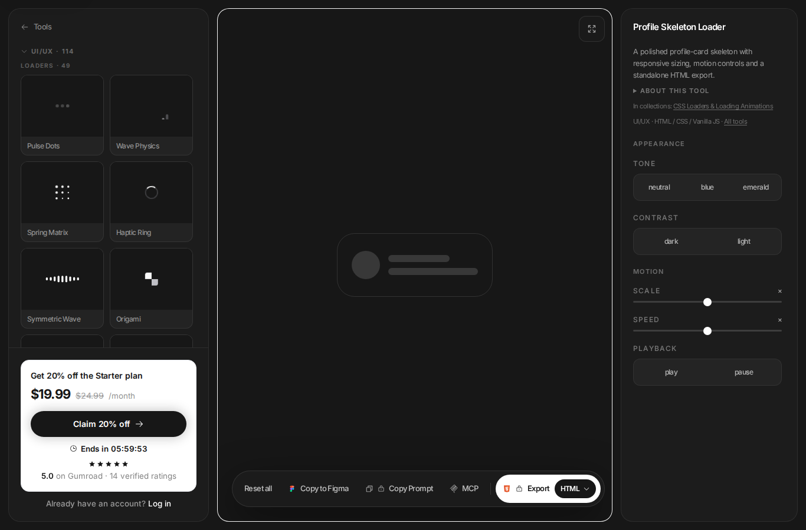 |
| 03 | AlignUI | [Vertical Stepper](https://alignui.com/docs/v1.2/ui/vertical-stepper) | Pasos en vertical con número, check al completar y el paso actual resaltado | MIT | React + Radix Tabs + tailwind-variants | Portal: tarea firmable (Leer → Aceptar → Firmar → Enviar), cuestionario por pasos | CSS: modificador `epi-steps--vertical` sobre el `epi-steps` actual (mismo `data-epi10-estado`) | S | Ninguna | 4 | 5 | **HOY** | Responde a la crítica de Raúl de que el consentimiento no da sensación de firmar: «pasos claros». En escritorio, columna lateral del visor; en móvil, vuelve al horizontal. 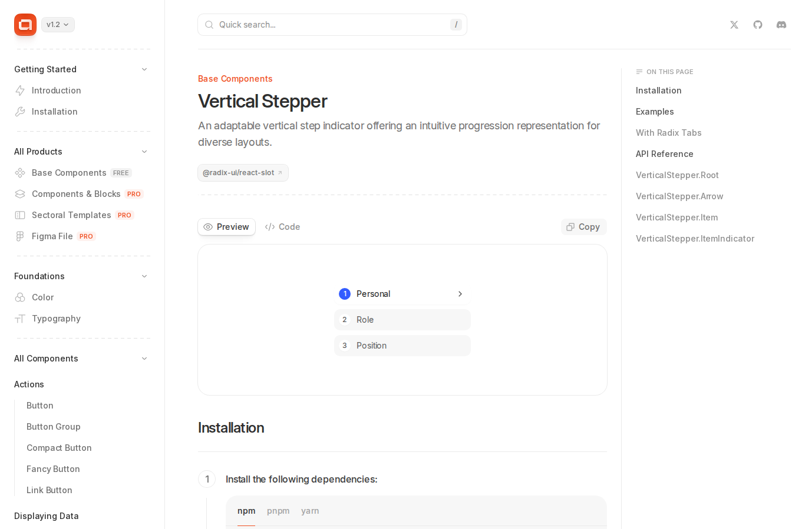 |
| 04 | AlignUI | [Progress Circle](https://alignui.com/docs/v1.2/ui/progress-circle) | Anillo de progreso con el % en el centro (tamaños 48–80 px) | MIT | React, SVG sin dependencias | Portal: inicio (fase del caso), mis documentos · BO: ficha de clienta (cabecera), panel «Hoy» | CSS + SVG: `epi-anillo` con `--valor` y `stroke-dashoffset: calc(...)`; macro `ui.anillo(80, '4 de 5')` | S | Ninguna | 4 | 4 | **HOY** | En el inicio, junto a «Paso 5 de 5», da lectura instantánea de la fase. No sustituye a la barra de 5 tramos: la acompaña. 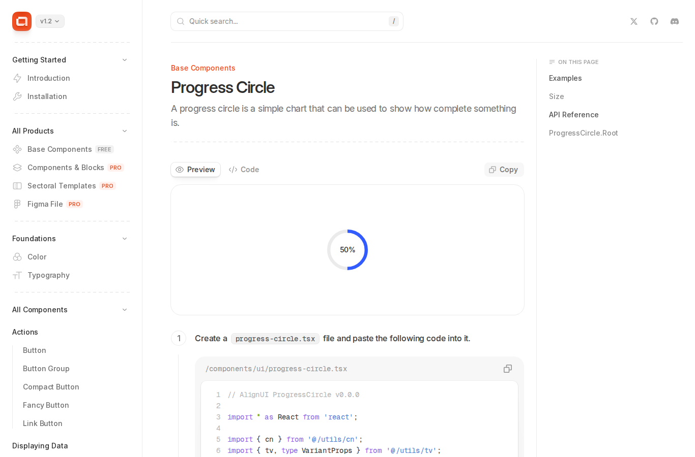 |
| 05 | Kobra | [Question Card](https://kobra.systems/components/question-card) | Pregunta con opciones etiquetadas A, B, C…, campo «Otra cosa…» y botones «Omitir / Siguiente» con atajo de teclado | Propietaria → INSPIRACIÓN | React + Tailwind + Motion | Portal: cuestionario por pasos | CSS: letra en `epi-choice` (`epi-choice__tecla`) + atajos A–E y Intro en la isla `tareas.mjs` | S | Ninguna | 4 | 4 | **HOY** | Hace que el cuestionario de hábitos se sienta guiado. La letra es decorativa: el control sigue siendo un `radio` accesible. 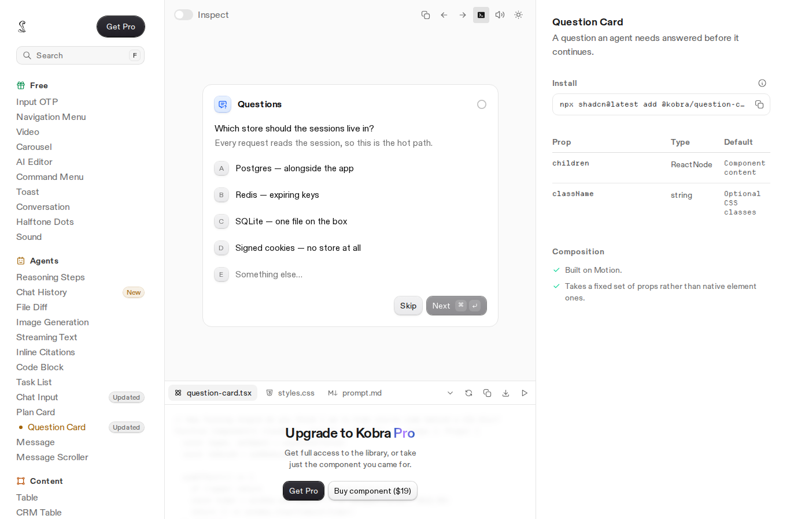 |
| 06 | HorizonX | [Stepper](https://horizonx.so/tools/stepper) | Asistente con transición direccional entre pasos (entra por la derecha al avanzar y por la izquierda al volver), altura adaptativa y conectores de progreso | Propietaria → INSPIRACIÓN (el original, de React Bits, es hoy MIT + Commons Clause) | HTML/JS (original en React) | Portal: cuestionario por pasos, tarea firmable | Isla: clase `epi-paso--entra-dcha` / `--entra-izq` en el paso al cambiar (CSS `@keyframes`, 200 ms, `prefers-reduced-motion`), en `tareas.mjs` y `ejemplo-pasos.mjs` | M | Ninguna | 4 | 4 | **HOY** | Es la transición entre pantallas que pide la lista de vistas. Se reescribe sin mirar el código: el patrón es trivial. 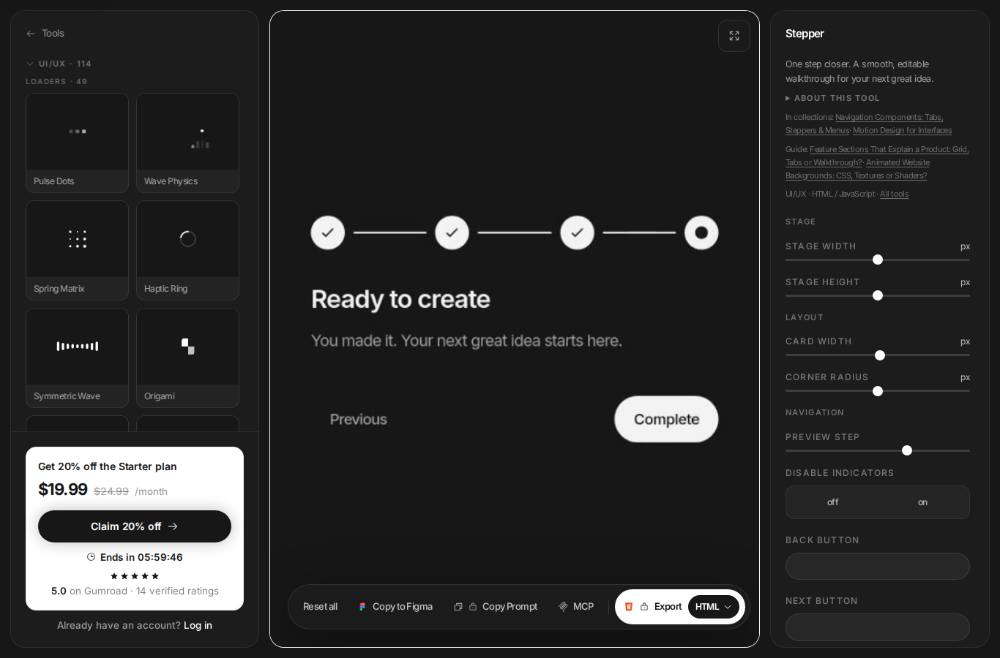 |
| 07 | HorizonX | [Task Checkbox](https://horizonx.so/tools/task-checkbox) | Casilla que se rellena, hace «saltar» el tick y tacha la etiqueta al completar | Propietaria → INSPIRACIÓN | HTML/CSS | Portal: mis documentos (al volver con la tarea hecha) · BO: panel «Hoy» | CSS: animación del círculo de `hecho` en `epi-list` (reutiliza `epi10-aparece`) | S | Ninguna | 4 | 3 | DESPUÉS | Detalle bonito, pero en la demo el cambio de estado ocurre fuera de la vista. Variante con ráfaga ([Firework Todo](https://horizonx.so/tools/firework-todo-checkbox)): poco sobria. 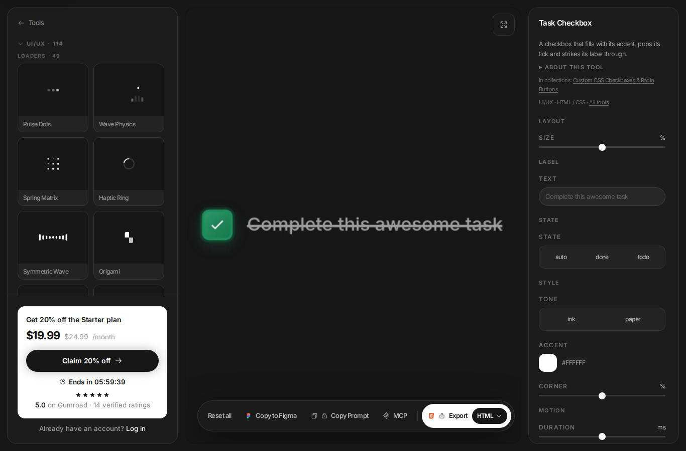 |
| 08 | AlignUI (+ HorizonX) | [Segmented Control](https://alignui.com/docs/v1.2/ui/segmented-control) · [Glass Radio](https://horizonx.so/tools/glass-radio) | Grupo de opciones en píldora con fondo deslizante | MIT (AlignUI) · propietaria (HorizonX) | React + Radix Tabs · HTML/CSS | Portal: citas (Mañana/Tarde) · BO: calendario (Día/Semana/Mes), ajustes | CSS: `epi-segmentado` sobre radios + `:has(:checked)` | S | Ninguna | 3 | 3 | DESPUÉS | No hay un sitio claro para la demo: el calendario del back office es del núcleo y Raúl lo deja así. 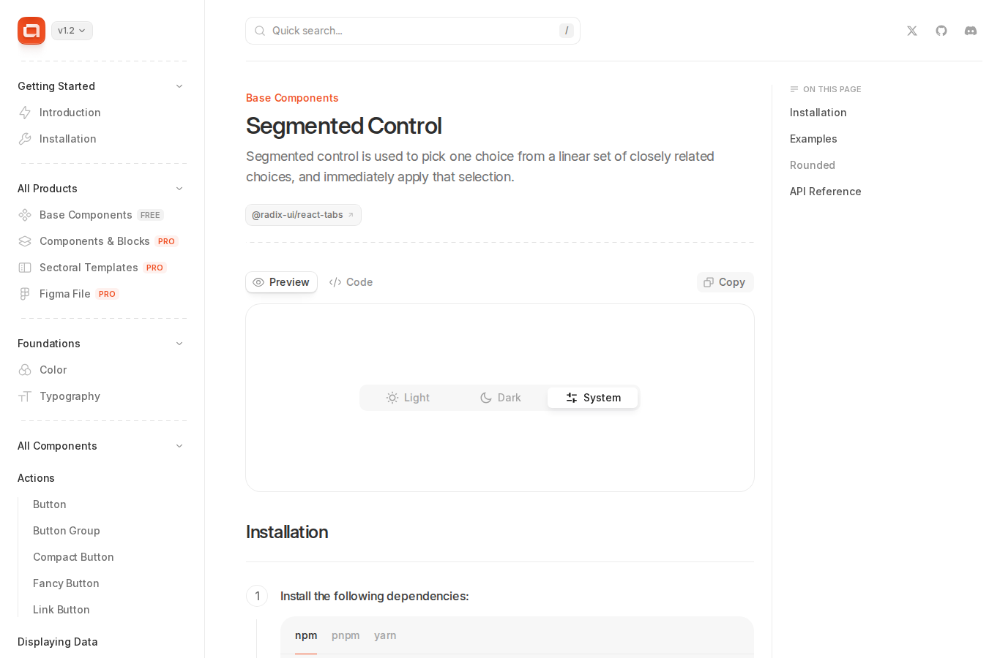 |
| 09 | AlignUI (+ HorizonX/Uiverse) | [Tooltip](https://alignui.com/docs/v1.2/ui/tooltip) · [Rise Tooltip](https://horizonx.so/tools/rise-tooltip) | Etiqueta breve al pasar el ratón o enfocar | MIT (AlignUI; el original de Uiverse también es MIT) | React + Radix Tooltip | Transversal · BO: botones de icono de tablas y ficha | CSS: `[data-epi10-tip]` con `::after`, visible en `:hover` y `:focus-visible` | S | Ninguna | 3 | 3 | DESPUÉS | Útil en el back office denso; no cambia la demo. Ojo con el móvil: no hay hover. 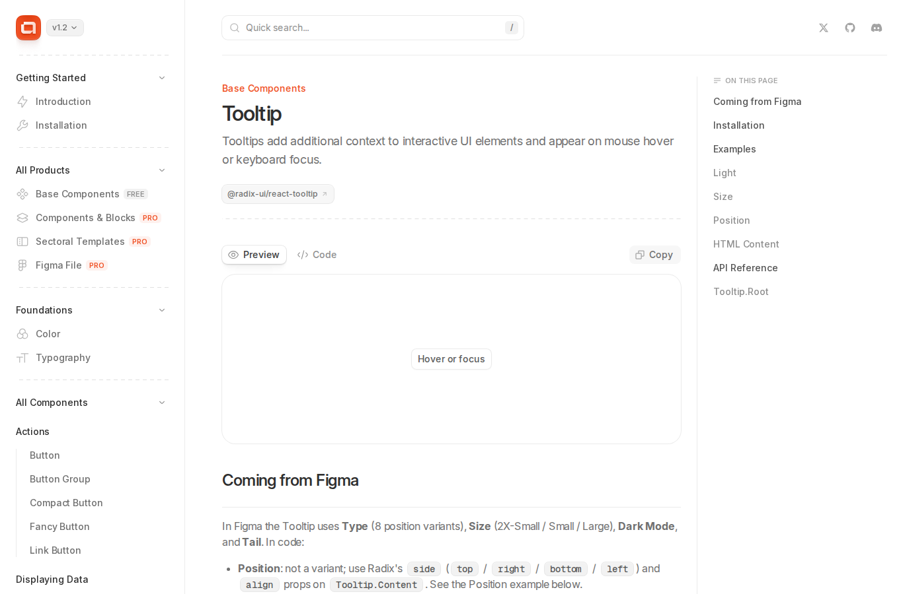 |
| 10 | AlignUI Pro | [Auth Card](https://pro.alignui.com/blocks/auth-card) | Login centrado con icono de marca dentro de un halo de anillos concéntricos y botón social arriba | Propietaria → INSPIRACIÓN | React + Tailwind | Portal: login · BO: login | CSS: halo con `radial-gradient` repetido detrás del logo en `epi-auth` | S | Ninguna | 5 | 2 | DESPUÉS | Los dos logins ya están renovados y quedan bien (pantalla partida). Solo si Raúl quiere otra estética. 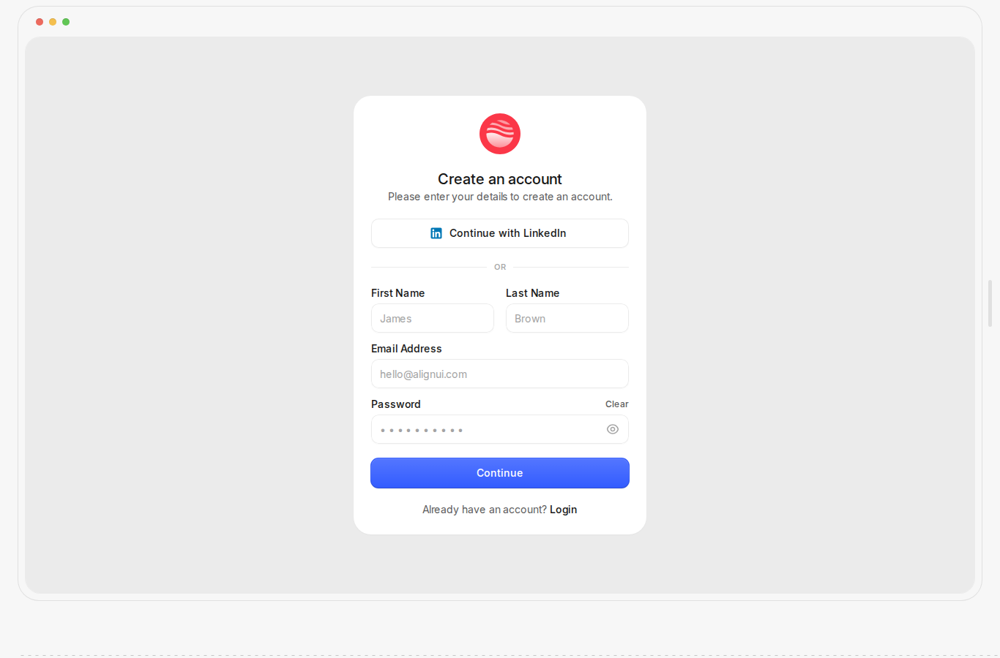 |
| 11 | AlignUI Pro | [Stats & Metrics](https://pro.alignui.com/blocks/stats-metrics) | Tarjetas de cifra grande con etiqueta de contexto y texto de apoyo (9 variantes; la 01, capturada, es de marketing) | Propietaria → INSPIRACIÓN | React + Tailwind | BO: panel «Hoy», selector de funcionalidades | CSS: `epi-stat` (`__cifra` `__delta` `__spark` con SVG inline) | M | Ninguna | 4 | 3 | DESPUÉS | El panel «Hoy» ya tiene cifras. El delta y la tendencia necesitan datos históricos que hoy no tenemos. 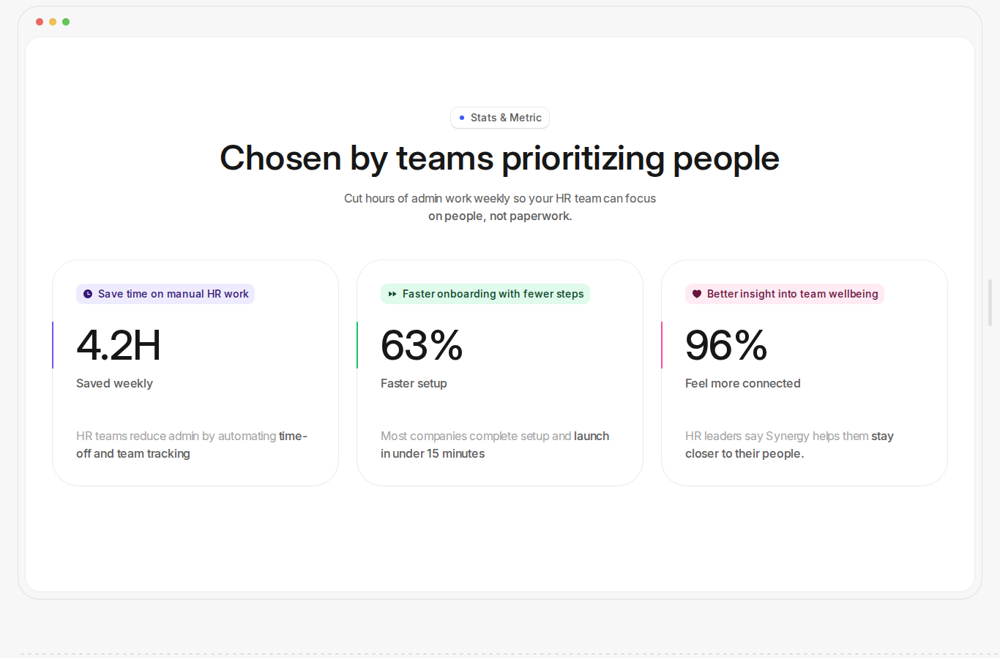 |
| 12 | AlignUI Pro | [Notification](https://pro.alignui.com/blocks/notification) | Panel de notificaciones con pestañas (Todas / No leídas), avatar, hora y punto de no leído | Propietaria → INSPIRACIÓN | React + Tailwind + Radix Popover | BO: transversal (campana en la cabecera), mensajes del equipo | Isla: popover con `epi-list` + `epi-count`; datos del panel «Hoy» | M | Ninguna | 4 | 3 | DESPUÉS | Requiere un endpoint de «novedades» del equipo. La captura muestra el panel ya abierto. 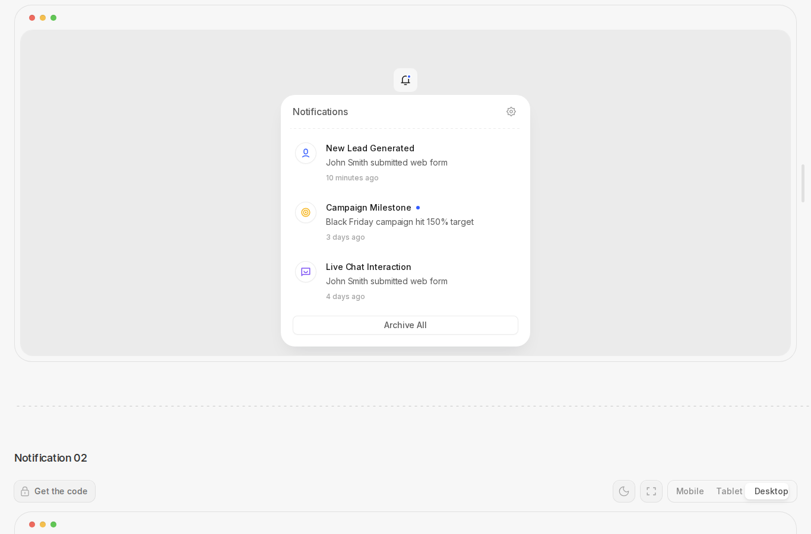 |
| 13 | AlignUI (+ Pro, + Kobra) | [File Upload](https://alignui.com/docs/v1.2/ui/file-upload) · [File Upload Pro](https://pro.alignui.com/blocks/file-upload) · [Magnetic Dropzone](https://kobra.systems/components/magnetic-dropzone) | Zona de arrastre con borde discontinuo y «Examinar», y lista de ficheros subiendo con barra y estado | MIT (base) · propietaria (Pro, Kobra) | React + Radix Slot · Motion | Portal: mis documentos (adjuntar) · BO: ficha de clienta (Documentos) | CSS sobre `<input type=file>` nativo (`epi-dropzone`) + JS mínimo para `dragover` y la lista | M | Ninguna | 4 | 3 | DESPUÉS | Raúl quiere «adjuntar» en segundo plano. Lo «magnético» de Kobra es un adorno con Motion: descartado. 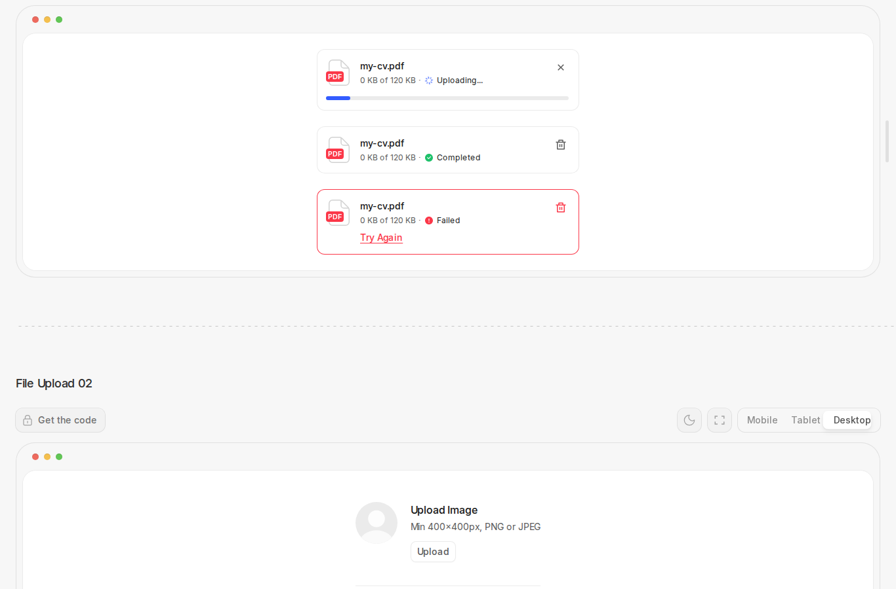 |
| 14 | Kobra | [Grouped Table](https://kobra.systems/components/grouped-table) | Tabla agrupada por estado, con cabecera de grupo plegable y su recuento | Propietaria → INSPIRACIÓN | React + Tailwind + Base UI Collapsible + Motion | BO: buscador y lista de clientas (agrupada por fase) | CSS + HTML: `<details>` por fase con `epi-table` dentro y `epi-count` en el `summary` | M | Ninguna | 4 | 4 | DESPUÉS | Muy útil con 30+ clientas; en la demo hay una sola y ya hay chips por fase. 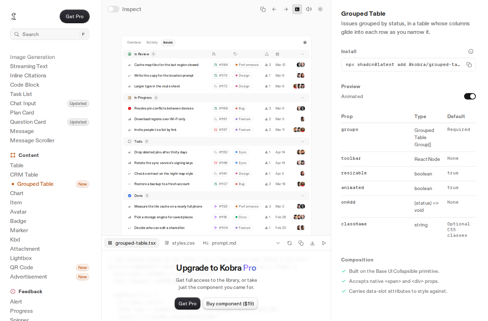 |
| 15 | Kobra | [Sheet](https://kobra.systems/components/sheet) | Diálogo que entra desde un lateral | Propietaria → INSPIRACIÓN | React + Base UI Dialog + Motion | BO: lista de clientas (vista rápida de la clienta sin salir) | CSS: `<dialog class="epi-dialog epi-dialog--lateral">` con la animación de entrada; reutiliza `data-epi10-abrir-modal` | S | Ninguna | 3 | 3 | DESPUÉS | Es una variante del modal que ya existe. Vale cuando la lista crezca. 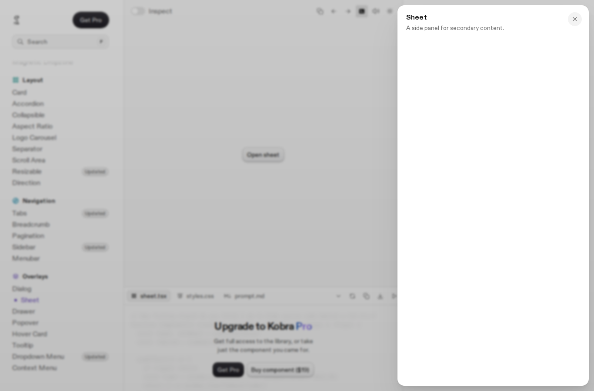 |
| 16 | Kobra (+ AlignUI) | [Command Menu](https://kobra.systems/components/command-menu) · [AlignUI command-menu](https://alignui.com/docs/v1.2/ui/command-menu) | Paleta ⌘K con búsqueda difusa, grupos y navegación por teclado | Propietaria (Kobra, sobre kmenu) · MIT (AlignUI, sobre cmdk) | React + cmdk/kmenu | BO: transversal (buscar clienta o ir a una funcionalidad desde cualquier pantalla) | Isla nueva `paleta.mjs` sobre `<dialog>` + endpoint de búsqueda | L | Ninguna en la versión Preact (cmdk es React: no se vendoriza) | 4 | 4 | DESPUÉS | Gran mejora para Aitor, pero es L y el back office vive dentro de `main.php` (atajos en iframes). 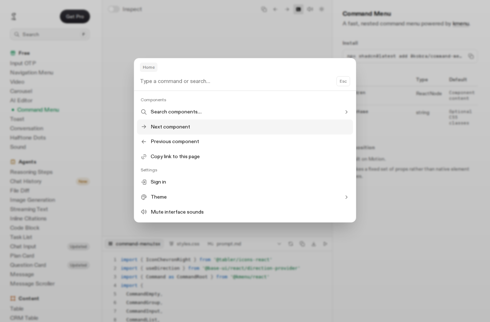 |
| 17 | AlignUI | [Avatar Group](https://alignui.com/docs/v1.2/ui/avatar-group) | Avatares solapados con «+N» | MIT | React + tailwind-variants | BO: ficha de clienta (equipo asignado), mensajes del equipo | CSS: `epi-avatares` (margen negativo + anillo blanco) sobre `epi-avatar` | S | Ninguna | 4 | 2 | DESPUÉS | No hay todavía un dato de «equipo asignado» que enseñar. 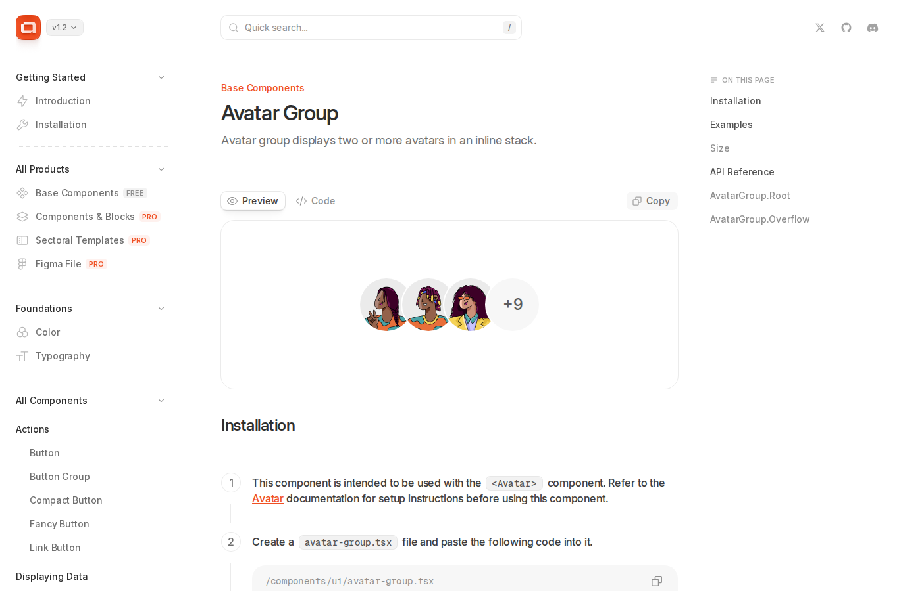 |
| 18 | Kobra | [Marker](https://kobra.systems/components/marker) | Punto de estado con texto y marca temporal («Build passed in 42s · Today») | Propietaria → INSPIRACIÓN | React + Tailwind | BO: ficha de clienta (actividad: «Consentimiento firmado · 11 oct») | CSS: `epi-actividad` (lista vertical con raíl y `epi-marca`) | M | Ninguna | 3 | 4 | DESPUÉS | La pieza es mínima; lo valioso es el patrón de cronología de la ficha. Necesita reunir eventos de varias tablas. 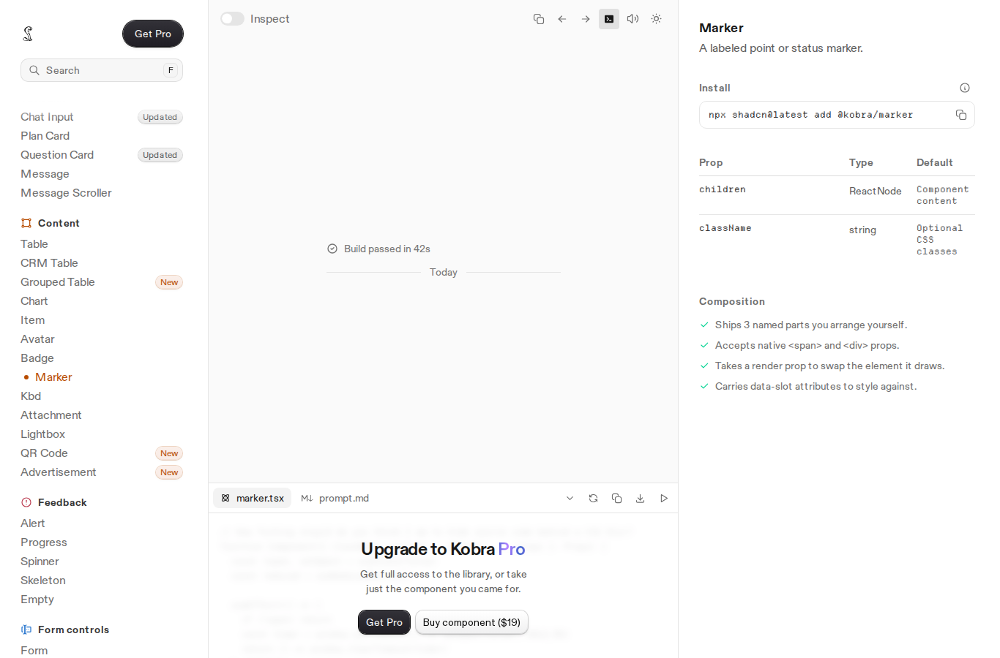 |
| 19 | Hanging Team (Framer) | [Hanging Team](https://www.framer.com/marketplace/components/hanging-team/) | Tarjetas del equipo colgadas de un hilo, con balanceo físico, inclinación 3D, reflejo holográfico y giro para ver la biografía | De pago, uso único → INSPIRACIÓN | Framer (React + motion) | Portal: inicio (bloque «Tu equipo EPI10»), ayuda | CSS: tarjetas `epi-card` con foto, nombre y rol, ligeramente giradas (`rotate: -2deg`), hilo con `::before` y un vaivén suave solo en `:hover`, con `prefers-reduced-motion`. Sin física, sin 3D, sin giro | M | Ninguna | 4 | 2 | DESPUÉS | Bonito y humano («las personas que cuidan de tu caso»), pero hay que decidir la estética, hacen falta fotos reales del equipo con su consentimiento y el original es de agencia creativa. 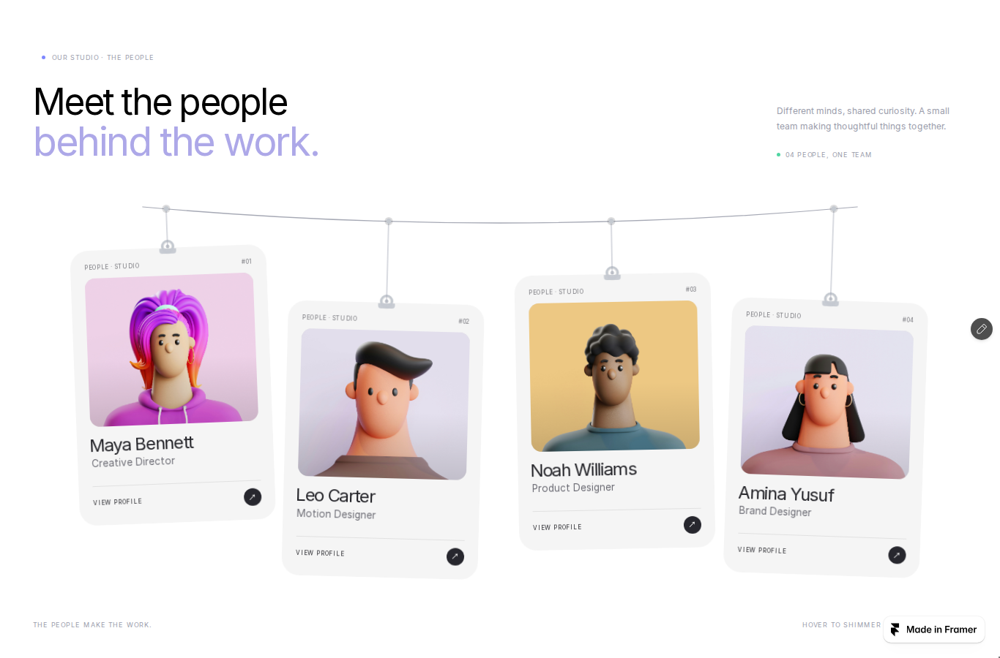 |
| 20 | HorizonX | [AI Prompt Composer](https://horizonx.so/tools/ai-prompt-composer) | Redactor en píldora que se abre en un compositor con textarea que crece, bandeja de adjuntos y botón que pasa a «Enviar» | Propietaria → INSPIRACIÓN | HTML/CSS/JS | Portal: mensajes · BO: mensajes del equipo | Isla: estado «abierto» en `epi-chat-redactor` (`chat.mjs`) + `field-sizing: content` con alternativa JS | M | Ninguna | 5 | 3 | DESPUÉS | El redactor actual funciona. Tocarlo la víspera de la demo es un riesgo mayor que la mejora. 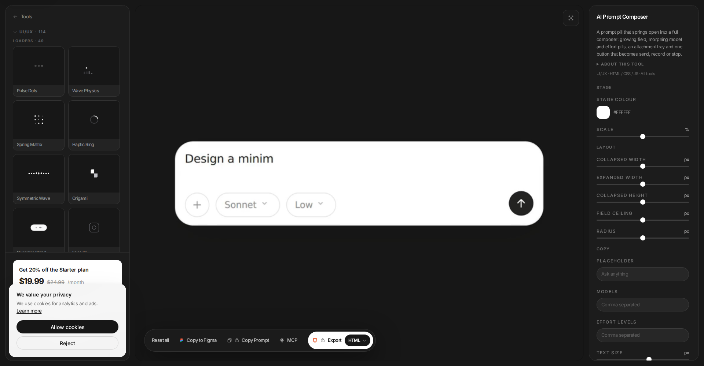 |
| 21 | HorizonX | [Word Carousel Loader](https://horizonx.so/tools/word-carousel-loader) | Etiqueta fija + palabra que rota hacia arriba («Preparando… tu informe / tus documentos») | Propietaria → INSPIRACIÓN | HTML/CSS | Portal: mi informe (carga del visor PDF), login (entrando…) | CSS: `epi-cargando-palabras` con `@keyframes` y `prefers-reduced-motion` | S | Ninguna | 4 | 2 | DESPUÉS | Amable, pero el visor PDF carga en menos de 1 s en la demo. Sin captura: la vista previa no se pinta en Chromium sin interfaz (sale el lienzo vacío); se ve en el enlace. |
| 22 | HorizonX | [Effort Slider Sleek](https://horizonx.so/tools/effort-slider-sleek) | Slider de 6 paradas que gana color en cada parada | Propietaria → INSPIRACIÓN | HTML/CSS/JS | Portal: cuestionario por pasos (escalas tipo «¿Cuánto ejercicio haces? 1–6») | Isla/CSS: `input[type=range]` con `list` y `accent-color` + relleno por `--valor` | M | Ninguna | 4 | 3 | DESPUÉS | Solo si el cuestionario de hábitos incorpora escalas: hoy son opciones. Sin chispas ni sonido. 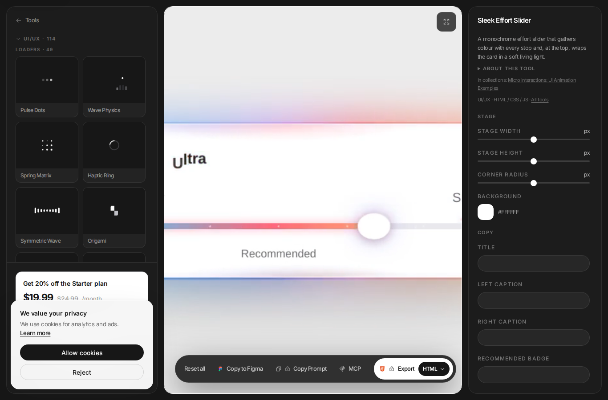 |
| 23 | Kobra | [Task List](https://kobra.systems/components/task-list) | Lista de tareas compacta y plegable con contador «1/5», hechas tachadas y la actual con spinner | Propietaria → INSPIRACIÓN | React + Tailwind | Portal: inicio (resumen «Tus tareas 1 de 2» dentro de la tarjeta de fase) · BO: panel «Hoy» | CSS: `epi-checklist` sobre `<details>` con `epi-count` | S | Ninguna | 4 | 3 | DESPUÉS | Repite información de «Mis documentos». Interesante si el inicio deja de tener tarjetas por sección. 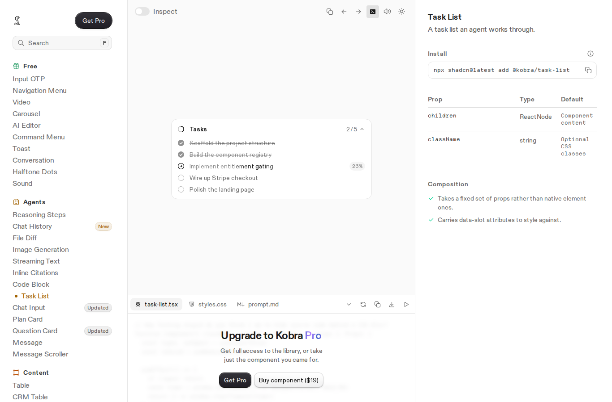 |

## Top 5 del lote

1. **Icono de formato de fichero** (AlignUI, MIT · mi informe, mis documentos, mensajes, ficha de clienta · S): con una etiqueta «PDF» en rojo, el informe y los adjuntos parecen documentos de verdad y no un icono genérico. Es la mejora más visible por menos esfuerzo.
2. **Skeleton de carga** (HorizonX y Kobra, inspiración · transversal, panel «Hoy» · S): en vez de un spinner o un hueco, el contenido «se dibuja» antes de llegar. Es lo que más separa una app moderna de un formulario de 2005.
3. **Stepper vertical en la tarea firmable** (AlignUI, MIT · tarea firmable, cuestionario · S): «Leer → Aceptar → Firmar → Enviar» siempre a la vista. Responde a la crítica de que no se sabe qué se firma ni qué viene después.
4. **Anillo de progreso** (AlignUI, MIT · inicio, ficha de clienta · S): «4 de 5» en un anillo junto a la fase del caso. La clienta y Aitor ven dónde están de un vistazo.
5. **Opciones con letra y atajos** (Kobra, inspiración · cuestionario por pasos · S): A, B, C con atajo de teclado e Intro para seguir. El cuestionario de hábitos pasa de formulario a conversación guiada.

(El sexto, la **transición direccional entre pasos** de HorizonX, M, encaja con el 5 si sobra tiempo.)

## Descartados y por qué

- **AlignUI, componentes base que duplican lo nuestro** (botón y sus variantes fancy, compact, social y link; button-group; input; textarea; select; checkbox; radio; switch; label; hint; alert; badge; status-badge; modal; drawer; dropdown; popover; tab-menu; table; breadcrumb; progress-bar; datepicker; avatar y avatar-empty-icons; notification-provider (toasts); horizontal-stepper; dot-stepper; divider): ya existen como `epi-btn`, `epi-form`, `epi-check`/`epi-switch`, `epi-alert`, `epi-badge` (con punto), `epi-dialog`, `epi-tabs`, `epi-table`, `epi-steps`, `epi-progress`, cally o `EPI10.toast`.
- **AlignUI, sin uso en EPI10**: color-picker, slider, kbd, tag (los chips de filtro ya existen), pagination (con pocas clientas no hace falta), svg-rating-icons (no hay encuesta), digit-input (OTP: el login del portal ya entra por enlace por correo) y banner (ya existe la isla `aviso-novedades`).
- **AlignUI Pro, bloques de marketing** (hero, features, pricing, testimonials, blog, careers, newsletter, footer, integrations, brand-social, how-it-works, cta, faq, teams, contact, announcement): son de landing, de pago y no aplican. **profile-card**: la cabecera de la ficha ya lo resuelve. **filter y table Pro**: cubiertos por los chips y por la fila 14. **Plantillas HR, Finance, Marketing y AI**: de pago y de otro dominio.
- **HorizonX** (≈220 de 236 tools): 3D/WebGL, orbs, partículas, trails de cursor, hover de galería, motion tipográfico, grids, scroll y efectos de entrada (≈130). Son efectos de landing con GSAP, Three.js o WebGL en runtime, impropios de un portal de salud. También quedan fuera los botones y switches llamativos (halo, neon, spectrum, jelly, relief, 3D, neumórficos, prism), que no son sobrios y duplican `epi-btn`/`epi-switch`. Los 45 loaders restantes duplican `epi-spinner`; solo se salvan el skeleton y la palabra rotatoria. El theme-switch no aplica porque no hay modo oscuro en el alcance. Tampoco hay vista para comparison-slider, sheet-stack, option-wheel ni los carruseles. testimonial-switcher y text-loop son de marketing. payment-method-checkbox es en realidad una tarjeta de saldo. beacon-tabs y save-slide-button duplican `epi-steps` y `epi-btn`. Los puntos de «escribiendo…» no tienen una señal real detrás, porque el chat consulta cada 10 s. `/explore`, `/textures`, `/shaders` y `/collections` son plantillas Figma de pago o efectos de imagen. **Medlio, Calendar App y Calma** (`/explore`) solo valen como referencia estética, sin código.
- **Kobra** (el resto de los 81): los primitivos que ya tenemos (accordion, alert, avatar, badge, breadcrumb, button, card, checkbox, collapsible, dialog, dropdown-menu, empty, form, input, item, pagination, popover, progress, radio-group, select, separator, spinner, switch, table, tabs, textarea, toast, calendar, conversation, message, message-scroller, attachment) y los que no tienen vista (aspect-ratio, carousel, logo-carousel, chart, color-palette, color-picker, combobox, multi-select, context-menu, drawer, hover-card, lightbox, menubar, navigation-menu, resizable, scroll-area, slider, toggle-group, filter-chips, kbd, direction (RTL), sidebar (el back office navega por `main.php`), input-otp (el login usa enlace) y qr-code). Quedan fuera también las superficies de agente IA (ai-editor, chat-history, chat-input, reasoning-steps, plan-card, file-diff, image-generation, streaming-text, inline-citations, code-block) y las piezas de efecto (advertisement, halftone-dots, input-dissolve, video). **sound** (un sonido en cada pulsación) se descarta por sobriedad y accesibilidad.
- **Hanging Team**: solo se rescata la idea de mostrar al equipo (fila 19). La física, el holograma, el giro 3D y el QR quedan fuera.

## Riesgos de licencia o de dependencias

- **Solo AlignUI base es MIT.** Si se trasladan fragmentos literales (las siluetas SVG del file-format-icon o la geometría del progress-circle), hay que añadir `vendor/LICENSE-alignui.txt` con el aviso «© 2024 Doğukan Çavuş» y citarlo en la cabecera de la sección de `epi10-ui.css`, igual que Basecoat.
- **AlignUI Pro, HorizonX, Kobra y Hanging Team son de pago o propietarios.** No se copia ni JSX, ni clases, ni CSS exportado, ni valores de animación concretos: se reescribe desde la descripción del patrón. Kobra prohíbe además usar su código para entrenar modelos o pasárselo a un servicio que lo haga: **no se pega su código en ningún agente**. Las 10 piezas «Free» de Kobra son solo para uso personal, así que tampoco valen.
- **Procedencia dudosa en HorizonX.** Las piezas de Uiverse.io (MIT) se pueden tomar del original citando autor y licencia, nunca de la exportación de HorizonX. El stepper procede de React Bits, que hoy es MIT + Commons Clause: se reescribe sobre nuestra isla `ejemplo-pasos.mjs`.
- **Dependencias.** Ninguna recomendación arrastra dependencias. El stack original de las cuatro fuentes es React + Tailwind (+ Radix, Base UI, Motion, GSAP o Three.js según el caso), así que no hay nada que vendorizar. cmdk, react-otp-input y react-day-picker son React y no entran en una isla Preact sin build.
- **Movimiento.** Toda animación nueva (skeleton, transición de pasos, tick) debe llevar `prefers-reduced-motion: reduce` y durar 200 ms o menos. En salud, el rebote y las partículas se quitan.
- **Unknown.** No he visto el código de la mayoría de los bloques Pro de AlignUI ni el interior de sus plantillas (piden pago), ni el Figma de AlignUI o de Kobra. Para inspiración no hace falta.

## Resumen para el integrador

```json
{
  "lote": "C",
  "fuentes_recorridas": ["AlignUI (base MIT + Pro)", "HorizonX", "Kobra", "Hanging Team (Framer)"],
  "componentes_vistos": 685,
  "recomendados_hoy": 6,
  "recomendados_despues": 17,
  "top5": [{"componente": "File Format Icon", "fuente": "AlignUI", "vista": "mi informe, mis documentos, mensajes, ficha de clienta", "esfuerzo": "S"}, {"componente": "Skeleton de carga", "fuente": "HorizonX + Kobra", "vista": "transversal (cargas), panel «Hoy»", "esfuerzo": "S"}, {"componente": "Vertical Stepper", "fuente": "AlignUI", "vista": "tarea firmable, cuestionario por pasos", "esfuerzo": "S"}, {"componente": "Progress Circle", "fuente": "AlignUI", "vista": "inicio, ficha de clienta", "esfuerzo": "S"}, {"componente": "Question Card (opciones con letra y atajos)", "fuente": "Kobra", "vista": "cuestionario por pasos", "esfuerzo": "S"}]
}
```
