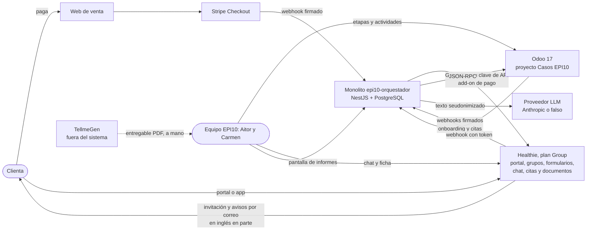
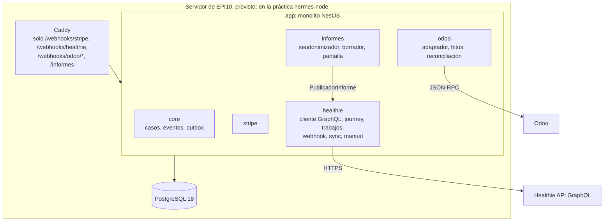
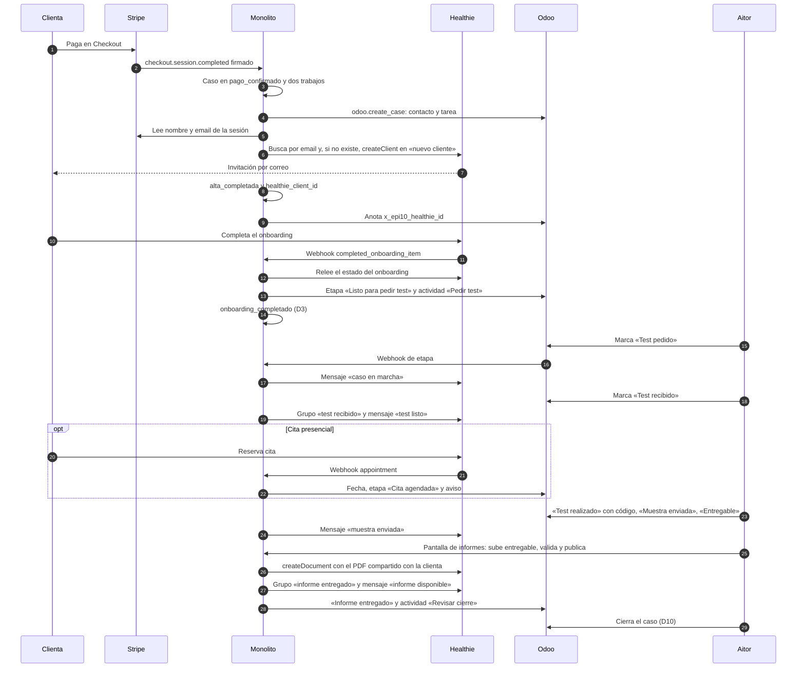
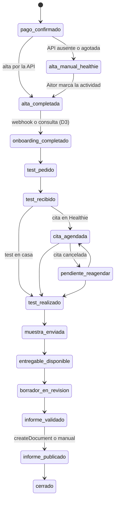
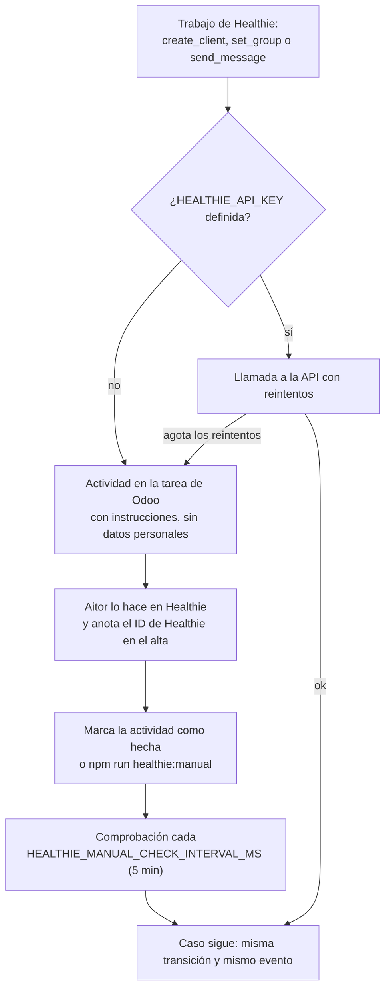

# Arquitectura del sistema EPI10 Salud v0: la versión con Healthie

Fecha: 2026-10-12 · Linear: SKI2-247 · Hito: «5 · Demo OpenEMR a Carmen» · Estado: **v0, histórico; describe el sistema anterior a la crisis del 7 oct para compararlo con la v1**

Base de código descrita:

| Repo | Commit | Qué es |
|---|---|---|
| `Skilland-ai/epi10-orquestador` | `master` **bab87af** (4 oct, 22:28) | Último commit antes de la crisis de Healthie (SKI2-204, 7 oct). El siguiente, 65bb925 (11 oct), ya añade OpenEMR |
| `Skilland-ai/EPI-10` (este repo) | `master` 7aa6990 | Documentación |

Documento de referencia, con menos profundidad que la [arquitectura v1](2026-10-12_arquitectura_sistema_v1.md) (SKI2-238), que es la descripción vigente del sistema. Sirve para comparar las dos versiones (§6) y explicar el cambio a Carmen y en el dossier.

### Cómo se citan las rutas

Igual que en la v1:

- `orq/…` = raíz de `epi10-orquestador` **en el commit bab87af** (`git show bab87af:<ruta>`). Casi todo sigue igual en `master` como legado; cuando no, se dice.
- `doc/…` = raíz de este repo `EPI-10`.

### Lo que nunca se probó contra Healthie real

**Ninguna llamada del monolito llegó a la API real de Healthie.** El add-on de API nunca se activó (SKI2-101 sigue en Backlog), así que no hubo clave ni sandbox. *Developer features* (webhooks y claves) salía bloqueado incluso para el owner (`doc/04_outputs/modulos/healthie/2026-10-03_contrato_api_healthie_v1.md`, nota del 4 oct). Todo lo que este documento llama «funciona» funciona **contra el simulador** `orq/test/fakes/healthie/`, construido a partir de la documentación pública. Lo único real en Healthie fue la configuración manual de la cuenta en la interfaz (SKI2-175 y SKI2-176).

---

## Índice

1. [Contexto y decisiones de la época](#1-contexto-y-decisiones-de-la-época)
2. [Componentes](#2-componentes)
3. [Flujos de punta a punta con Healthie](#3-flujos-de-punta-a-punta-con-healthie)
4. [Modelo de datos](#4-modelo-de-datos)
5. [Alternativa manual y límites de la API](#5-alternativa-manual-y-límites-de-la-api)
6. [Comparación v0 ↔ v1](#6-comparación-v0--v1)

---

## 1. Contexto y decisiones de la época

### 1.1 Situación del 3 al 6 de octubre

- **Plan Group de Healthie contratado**, con credenciales. El white label solo existe en Enterprise y la API es un add-on de pago sin precio conocido (`doc/03_specs/decisions.md`, 3 oct).
- **Journey v2 congelado el 3 oct** (`doc/04_outputs/modulos/journey/2026-10-03_customer_journey_mvp_v2.md`): Healthie es el portal de la clienta y guarda sus datos; Odoo es el back office del equipo; una «capa» propia los une.
- **D2 decidida el 3 oct** (SKI2-159, [ADR](2026-10-03_adr_orquestador_v1.md)): esa capa es un monolito NestJS + PostgreSQL con cinco módulos (core, Stripe, Healthie, Odoo e informes), desplegado en el servidor donde EPI10 tiene Odoo. AWS descartado.
- El 3 y 4 oct se construyen y fusionan todos los módulos, incluido el de Healthie (SKI2-170, 171, 172 y 179), y se ensayan de punta a punta contra simuladores (SKI2-178, `orq/docs/ensayo-e2e.md`).

### 1.2 Decisiones que daban forma a la v0

| Decisión | Contenido | Fuente | Dónde se ve en el código |
|---|---|---|---|
| D1 | Web → Stripe → monolito → Healthie + Odoo | journey v2 | `orq/src/modules/stripe/stripe.jobs.ts` (`healthie.create_client`, `odoo.create_case`) |
| D2 | Monolito propio en el servidor de Odoo; Odoo solo por API | ADR | `orq/compose.yaml` |
| D3 | «Listo para pedir test» = **onboarding de Healthie completado** (consentimiento y datos básicos) | journey v2 | `orq/src/modules/healthie/webhook/healthie-sync.ts` |
| D4 | La cita del test se agenda **en Healthie** (tipo «Realización test EPI10») | journey v2 (propuesta) | `HEALTHIE_APPOINTMENT_TYPE_ID`, `healthie-sync.ts` |
| D5 | Mensajería por el **chat de Healthie**; lo que escale, tarea en Odoo | journey v2 (propuesta) | `orq/src/modules/healthie/mensajes.ts` |
| D6 | Fase 1 con la marca básica del plan Group: la clienta ve «Healthie» en algunos correos | journey v2 | Configuración manual (SKI2-175) |
| D7 | Borrador del informe autónomo; publicar exige validación humana | ADR | `orq/src/modules/informes/` (igual que en la v1) |
| D8 | Código del kit obligatorio al marcar «test realizado» | journey v2 | `orq/src/modules/odoo/milestones/stage-rules.ts` |
| Test mixto | En casa por defecto; cita presencial **opcional** (Raúl, 4 oct, SKI2-186) | contrato de Healthie, nota del 4 oct | `orq/src/modules/core/case-state.ts` |

### 1.3 Qué hacía cada sistema

| Sistema | Papel en la v0 |
|---|---|
| **Stripe** | Cobro único por Checkout. Fuente de nombre y email (el monolito no los guarda) |
| **Monolito** | Dueño del caso: estado, IDs externos, eventos y outbox. Orquesta Stripe, Healthie y Odoo. Aloja la pantalla de informes |
| **Healthie** (plan Group) | **Portal de la clienta**: invitación, onboarding (formularios de consentimiento y datos básicos), chat, citas y documentos. Guarda los datos de la clienta y el informe final. Avisa por **webhooks** |
| **Odoo** | Back office de operaciones: kanban «Casos EPI10», etapas que marca Aitor, actividades, campos `x_epi10_*` |
| **Pantalla de informes** | Dentro del monolito: seudonimizar el entregable de TellmeGen, borrador con LLM, validar y publicar |

---

## 2. Componentes

### 2.1 Contexto del sistema

Diferencia clave con la v1: el monolito **no enviaba ningún correo**. La invitación, los avisos de formulario y de documento compartido los enviaba Healthie con sus plantillas, que estaban bloqueadas y no se podían poner en español del todo (`doc/04_outputs/modulos/healthie/2026-10-07_noticias_healthie_v1.md` §2).

### 2.2 Contenedores y módulos

| Pieza | Ruta | Qué hace |
|---|---|---|
| Transporte GraphQL | `orq/src/modules/healthie/graphql-transport.ts` | Cabeceras de autenticación (`Basic` por defecto) y versión `2026-07-01`; reintentos solo de fallos transitorios |
| Cliente tipado | `orq/src/modules/healthie/healthie.client.ts` | 13 operaciones del contrato: buscar por email, `createClient`, `updateClient` (grupo), conversaciones, `createNote`, `createConversation`, documentos, `createDocument`, onboarding y citas. Respuestas validadas con Zod |
| Journey | `orq/src/modules/healthie/healthie-journey.ts` | Buscar antes de crear (R6), vincular o bloquear duplicados, grupos, mensajes y publicación del PDF `Informe EPI10.pdf` |
| Trabajos | `orq/src/modules/healthie/healthie.jobs.ts` | `healthie.create_client`, `healthie.set_group`, `healthie.send_message` y el publicador del informe |
| Webhook | `orq/src/modules/healthie/webhook/` | `POST /webhooks/healthie`: IP de origen opcional, firma HMAC, deduplicación y trabajo en el outbox |
| Sincronización | `orq/src/modules/healthie/webhook/healthie-sync.ts` | `healthie.webhook_event`, `healthie.sync_case`, `healthie.reconcile` (consulta de respaldo) y `healthie.webhook_silence` |
| Alternativa manual | `orq/src/modules/healthie/manual/` | Actividades en Odoo para Aitor y comando `npm run healthie:manual` (§5) |
| Configuración | `orq/src/config/healthie-env.ts`, `orq/src/modules/healthie/healthie.config.ts` | 20 variables `HEALTHIE_*`, todas opcionales; sin `HEALTHIE_API_KEY` el módulo no registra nada |
| Simulador | `orq/test/fakes/healthie/` | Healthie falso con webhooks firmados y fallos programables, para CI, ensayo y demo |

En la v0 **no había** selector de portal: `orq/src/modules/portal/portal-cliente.ts` y `PORTAL_CLIENTE` llegan en 65bb925 con OpenEMR. El publicador del informe se elegía así: Healthie si la API estaba configurada; si no, publicación manual (`orq/src/modules/informes/pantalla/pantalla.module.ts`).

### 2.3 Lo que se configuró en Healthie a mano

Hecho por Raúl en la interfaz de producción (SKI2-175 y 176; `doc/04_outputs/modulos/healthie/2026-10-03_contrato_api_healthie_v1.md`, notas del 4 oct). Los IDs van en variables de entorno, nunca en el código:

- Tres grupos sin flujo propio: «EPI10 · nuevo cliente» (`HEALTHIE_GROUP_NUEVO`), «EPI10 · test recibido» (`HEALTHIE_GROUP_TEST_RECIBIDO`) y «EPI10 · informe entregado» (`HEALTHIE_GROUP_INFORME`).
- Flujo de onboarding «Onboarding EPI10», asociado a «nuevo cliente», con dos formularios provisionales obligatorios: «EPI10 · Consentimiento» y «EPI10 · Datos básicos».
- Tipo de cita «Realización test EPI10 (presencial)». Su ID quedó **Unknown**: la interfaz no lo muestra.
- Marca básica: nombre, logo y color de la barra. Sin ajuste de idioma; textos fijos en inglés en formularios y correos.

---

## 3. Flujos de punta a punta con Healthie

### 3.1 Flujo principal

Detalles que el código fija:

- **Pago → alta.** El pago encola `odoo.create_case` y `healthie.create_client` con solo IDs de Stripe (`orq/src/modules/stripe/stripe.jobs.ts`). El alta busca antes de crear porque Healthie crea cuentas vinculadas sin error con un email repetido (R6). Dos clientes activos con el mismo email, uno archivado o uno en mitad de otro caso escalan a una persona (`HealthieJourneyError` en `healthie-journey.ts`). La invitación la manda Healthie al crear el cliente.
- **Onboarding (D3).** Healthie no tiene evento de «onboarding completado», solo uno por paso (R5). Cada aviso se trata como «algo cambió»: el trabajo relee `onboardingStatus` y decide (`healthie-sync.ts`). Nunca se aplica lo que trae el aviso.
- **Hitos de Aitor.** Las reglas `AITOR_STAGES` de `orq/src/modules/odoo/milestones/stage-rules.ts` traducen cada etapa de Odoo en efectos sobre Healthie: `send_message` y `set_group`. Los textos de los cuatro mensajes viven en `orq/src/modules/healthie/mensajes.ts`, en español y sin datos personales.
- **Informe.** Tras validar en la pantalla, `HealthieJobs` sube el PDF con `createDocument`, compartido con la clienta y con el `case_id` en `metadata`, para reconocerlo si el trabajo se repite (SKI2-179). Después, cambio de grupo y mensaje.
- **Ensayo.** El recorrido completo pasó 38/38 pasos en 84 s contra simuladores, con fallos inyectados (Healthie caído, webhook de Odoo perdido, doble clic) y sin datos personales en la base ni en los logs (`orq/docs/ensayo-e2e.md`). Nunca se ejecutó contra Healthie real.

### 3.2 Webhooks y consulta periódica

- **Receptor** (`healthie-webhook.service.ts`): responde 404 con `HEALTHIE_WEBHOOK_ENABLED=false`, 503 sin `HEALTHIE_WEBHOOK_SECRET` (Healthie reintenta durante 3 días) y 403 si la IP no está admitida. Sin firma válida no se lee el cuerpo. Healthie no documenta un ID de evento, así que la clave de deduplicación es `event_type + resource_id + Content-Digest`.
- **Eventos atendidos:** `completed_onboarding_item.created/updated/deleted` y `appointment.created/updated/deleted` (`healthie-sync.ts`).
- **Respaldo:** `healthie.reconcile` revisa los casos abiertos contra Healthie cada `HEALTHIE_RECONCILE_INTERVAL_MINUTES` (1440 por defecto). Si la cuenta no tiene webhooks, es la única vía.
- **Silencio:** `healthie.webhook_silence` avisa en Odoo si pasan `HEALTHIE_WEBHOOK_SILENCE_DAYS` sin avisos, porque Healthie desactiva un webhook tras 3 días de errores (R12).

### 3.3 Estados del caso

Los 17 estados de `orq/src/modules/core/case-state.ts` son los mismos en la v0 y en la v1. Tres solo tienen sentido con Healthie y en la v1 ya no los alcanza nadie (v1 §3.1):

Se omiten `falta_codigo_barras` (D8) y `cancelado`, iguales en las dos versiones.

| Estado | Quién lo pone en la v0 | Ruta |
|---|---|---|
| `alta_manual_healthie` | La alternativa manual, cuando no hay API o `healthie.create_client` agota sus reintentos | `orq/src/modules/healthie/manual/healthie-manual.ts` |
| `cita_agendada` | `healthie-sync.ts` al leer una cita del tipo configurado, solo si la tarea sigue en «Test recibido» | `healthie-sync.ts`, `OdooCaseClient.moveStageFrom` |
| `pendiente_reagendar` | `healthie-sync.ts` cuando la cita pasa a cancelada | `healthie-sync.ts` |

---

## 4. Modelo de datos

### 4.1 Monolito

Las tablas de `orq/src/db/migrations/0001_core.ts` a `0003_odoo_sync.ts`. La v1 añade `0004_openemr.ts`.

```mermaid
erDiagram
  cases ||--o{ case_events : registra
  cases ||--o{ jobs : encola
  cases {
    uuid case_id PK
    text state "17 estados"
    text stripe_checkout_session_id UK
    text stripe_payment_intent_id UK
    text stripe_customer_id
    text healthie_client_id "no único: varias compras"
    text odoo_partner_id
    text odoo_case_id UK
  }
  case_events {
    uuid event_id PK
    text source "core stripe healthie odoo informes"
    text type
    text external_event_id "clave de idempotencia"
    jsonb metadata "solo IDs y códigos"
  }
  jobs {
    uuid job_id PK
    text type "healthie.create_client, healthie.set_group..."
    jsonb payload
    text status
    text idempotency_key UK
  }
```

- `cases.healthie_client_id` era el **único** vínculo con Healthie. No es único porque una clienta puede comprar más de una vez (`orq/src/modules/core/external-ids.ts`).
- Los eventos de Healthie quedaban en `case_events` con `source = 'healthie'`: avisos de webhook, `healthie.message_sent` (uno por caso y plantilla) y `healthie.report_published` (uno por caso).
- Ninguna tabla guardaba datos personales ni de salud (comentario de `0001_core.ts`, `orq/src/modules/core/safe-record.ts`). Igual que en la v1.

### 4.2 Qué vivía en Healthie y en Odoo

| Dato | Dónde | Notas |
|---|---|---|
| Nombre, email y cuenta de la clienta | Healthie (perfil) y Odoo (contacto) | El monolito los lee de Stripe y los descarta |
| Consentimiento y datos básicos | Healthie (formularios del onboarding) | El monolito solo leía si quedaban pasos pendientes, nunca las respuestas |
| Conversación y mensajes | Healthie (chat) | El monolito escribía y no leía |
| Citas | Healthie | El monolito leía fecha y estado y los copiaba a Odoo |
| Informe final (PDF) | Healthie (documentos) | Se reconoce por `metadata` con el `case_id` |
| Etapa, actividades y marcas del caso | Odoo | `x_epi10_healthie_id`, `x_epi10_onboarding_ok`, `x_epi10_cita_fecha`, `x_epi10_cita_estado`… (`orq/src/modules/odoo/odoo.model.ts`) |
| Entregable de TellmeGen y borrador | Monolito, solo en memoria y temporal | Se borran al generar el borrador y al publicar (ADR, «Datos») |

### 4.3 Qué dependía de la API de pago

Todo lo automático entre el monolito y Healthie. Sin el add-on solo quedaba la vía manual:

| Paso del journey | Operación de Healthie | Sin API |
|---|---|---|
| 1.2–1.3 Alta e invitación | `users(keywords)`, `createClient` | Actividad «Alta manual en Healthie» |
| 2.2 Onboarding (D3) | Webhooks + `onboardingStatus` | **Sin vía automática**: los webhooks también eran del add-on, y la consulta periódica usa la API |
| 3.1, 3.3, 4.2 Mensajes | `createNote`, `createConversation` | Actividad «Enviar mensaje … en Healthie» |
| 3.3 Cambio de grupo | `updateClient(user_group_id)` | Actividad «Cambiar grupo en Healthie a …» |
| 3.4 Citas | Webhooks + `appointment` | Sin vía automática ni actividad: Aitor lo veía en Healthie |
| 5.1 Publicar el informe | `createDocument` | Actividad «Publicar informe en Healthie» |

---

## 5. Alternativa manual y límites de la API

### 5.1 La alternativa manual (SKI2-172)

`orq/src/modules/healthie/manual/healthie-manual.ts` y la guía para Aitor `orq/docs/guia-tareas-manuales-healthie.md`:

- Con o sin API, el resultado en el core es el mismo: la misma transición y el mismo evento (`message:<caso>:<plantilla>`). Si se activaba la API después, no repetía nada, y si llegaba antes que Aitor cerraba la actividad pendiente.
- El informe tiene su propia actividad, «Publicar informe en Healthie»: Aitor sube el PDF y lo marca como publicado en la pantalla de informes (`orq/src/modules/informes/integracion/publicacion-manual.ts`).
- El ensayo comprobó el camino «Healthie caído» de punta a punta, contra el simulador (`orq/docs/ensayo-e2e.md`, caso B).
- Coste para Aitor: hasta 4 actividades de alta, mensajes y grupos por caso, más la publicación, y además seguir a mano el onboarding y las citas en Healthie, porque sin webhooks nada los traía a Odoo. Es la opción A de SKI2-204. No se llegó a medir en minutos por caso.

### 5.2 Lo que la API de Healthie hacía imposible o caro

| Problema | Detalle | Fuente |
|---|---|---|
| **Precio** | Add-on de API: 475 $/mes el primer año, 950 $/mes el segundo y después 1.900 $/mes (unos 5.700 $ el primer año, frente a un proyecto de 4.700 €). Claves y webhooks solo con la API | `doc/04_outputs/modulos/healthie/2026-10-07_noticias_healthie_v1.md` §1 |
| Cuenta de sistema | Puesto extra para la clave: 50 $/mes. Mensajes y documentos aparecen como del dueño de la clave (R9) | noticias §1, contrato R9 |
| **Idioma** | Sin ajuste de idioma; botones, pies de correo y frases de los formularios en inglés | contrato R3, noticias §2 |
| Correos | Plantillas bloqueadas en una cuenta nueva hasta revisión manual | noticias §2 |
| Marca | Sin white label fuera de Enterprise (D6) | contrato R4 |
| Sin evento de onboarding completo | Hay que recalcular en cada paso | contrato R5 |
| Duplicados | `createClient` con email repetido crea una cuenta vinculada sin error | contrato R6 |
| Webhooks frágiles | Sin ID de evento; se desactivan en silencio tras 3 días de errores | contrato §3, R12 |
| Datos | Región de alojamiento sin documentar (RGPD) | contrato R16 |
| Esquema | La versión fijada, `2026-07-01`, no estaba en la copia local de la documentación (`2026-01-01`) | comentario de `healthie.client.ts`, contrato R10 |

---

## 6. Comparación v0 ↔ v1

Referencias a la [arquitectura v1](2026-10-12_arquitectura_sistema_v1.md) por sección.

| Dimensión | v0 · Healthie (4 oct) | v1 · OpenEMR (11–12 oct) | v1 |
|---|---|---|---|
| **Coste recurrente** | Plan Group más el add-on de API: 475 → 950 → 1.900 $/mes, y 50 $/mes por la cuenta de sistema | Software libre autoalojado: 0 € de licencia; 2–4 h/mes de mantenimiento estimadas (`doc/04_outputs/modulos/crisis-healthie/2026-10-07_openemr_headless_v1.md`) | §1.1, §8.5 |
| **Portal de la clienta** | Healthie, SaaS: marca básica, inglés en parte, app móvil incluida | OpenEMR con «EPI10 UI»: todo en español, marca EPI10 | §6.2 |
| **Back office** | Odoo (operaciones) + interfaz de Healthie (chat, formularios, citas) | Odoo (operaciones) + back office de OpenEMR con la ficha EPI10 | §1.3, §6.3 |
| **Datos de salud** | En Healthie (SaaS sobre Aptible y AWS, región sin documentar, contrato R16) | En OpenEMR, autoalojado; el monolito igual de limpio | §5.6, §7.3 |
| **Integración** | API GraphQL pública de Healthie, 13 operaciones, nunca probada en real | Contrato propio de 7 operaciones (`oe-module-epi10`), probado contra la instancia | §4 |
| **Cambios de vuelta** | **Webhooks** firmados + consulta diaria de respaldo | **Consulta periódica** (`openemr.poll`, 120 s por defecto); sin webhooks | §3.3, §3.8 |
| **Regla D3** | Onboarding de Healthie completado | Consentimiento firmado **y** encuesta enviada | §1.4 |
| **Correo a la clienta** | Lo envía Healthie con sus plantillas (bloqueadas) | Un único correo del monolito con enlace mágico, en español | §1.3 |
| **Citas** | En Healthie, sincronizadas con Odoo (`cita_agendada`) | En el portal de OpenEMR; no llegan al monolito | §3.6 |
| **Control de la interfaz** | Casi ninguno: color de la barra y logo | Total, sin tocar el núcleo: plantillas, CSS, menús y ACL | §6.1 |
| **Dependencia de terceros** | Alta: precio, idioma, correo y webhooks dependen de Healthie | Baja en licencias; alta en mantener OpenEMR (versiones, módulos) | §9 |
| **Alternativa si falla** | Vía manual con actividades en Odoo (SKI2-172) | Sin vía manual: reintentos y actividad «Reintentar…» | §3.7 |
| **Horas estimadas** | Construido el 3–4 oct; horas no medidas (Unknown). Faltaban la activación de la API y las comprobaciones del sandbox (contrato §4.1) | 52–76 h de MVP (SKI2-207), más 8–12 h legales | `decisions.md`, 7 oct |
| **Estado del código** | Módulo `healthie` completo y probado contra simulador | Módulo `healthie` sigue como legado, inactivo con `PORTAL_CLIENTE=openemr` | §9.2 (D3) |

### 6.1 Qué se conservó y qué se perdió

- **Se conservó sin cambios:** core (casos, eventos, outbox), Stripe, Odoo con sus 11 etapas e hitos, pantalla de informes, seudonimizador y la regla de no guardar datos personales en el monolito. La crisis solo afectó a la pieza del portal (`doc/03_specs/decisions.md`, 7 oct).
- **Se perdió:** los webhooks (la v1 consulta periódicamente), la sincronización de citas con Odoo y la alternativa manual. Tres estados del caso quedaron sin uso.
- **Se ganó:** idioma y marca propios, datos de salud bajo control de EPI10, coste de licencia nulo y un contrato estrecho que el equipo controla.

---

**Fuentes principales:** `orq/` en bab87af, `doc/03_specs/decisions.md`, [ADR](2026-10-03_adr_orquestador_v1.md), [journey v2](../journey/2026-10-03_customer_journey_mvp_v2.md), [contrato de la API de Healthie](../healthie/2026-10-03_contrato_api_healthie_v1.md), [noticias de Healthie](../healthie/2026-10-07_noticias_healthie_v1.md) y Linear SKI2-101, 170, 171, 172, 175, 176, 179, 204, 205, 206 y 207.
