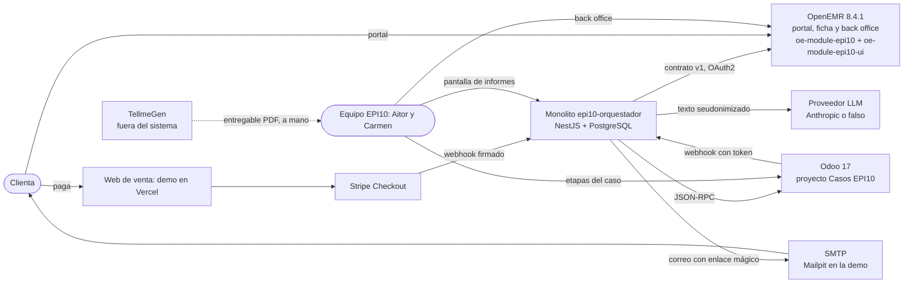
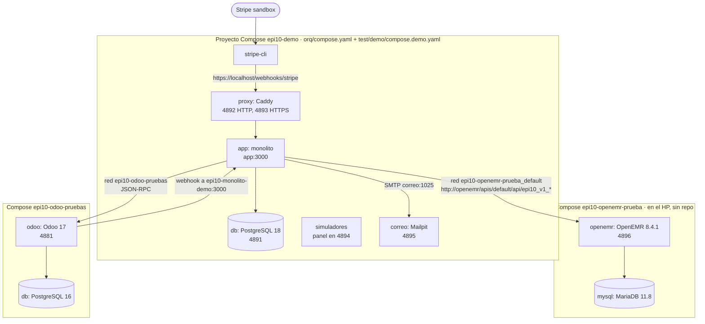
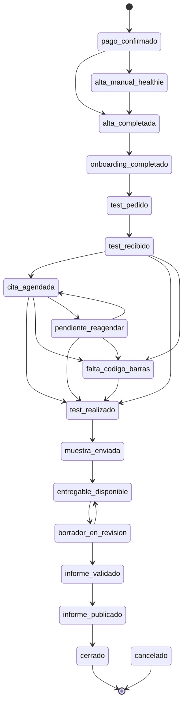
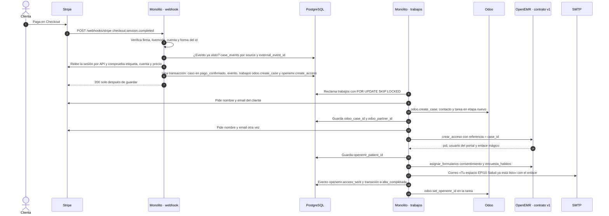
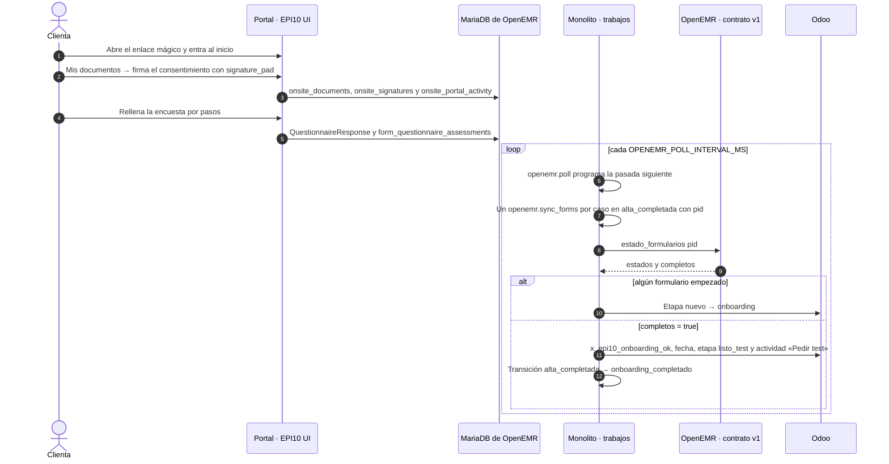
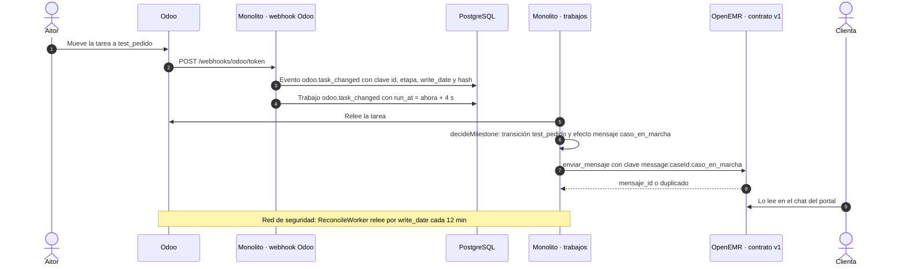
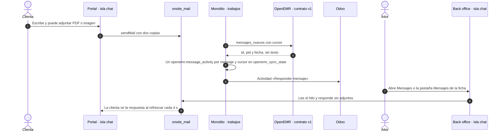
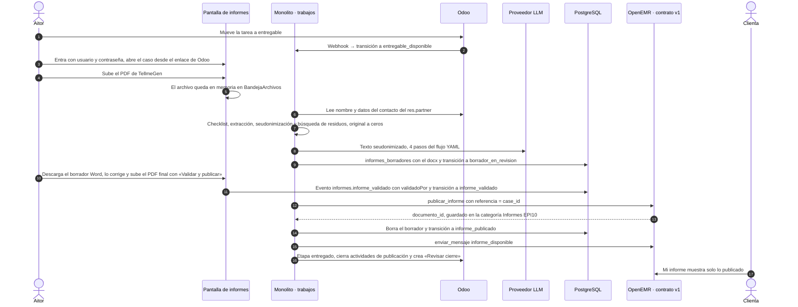
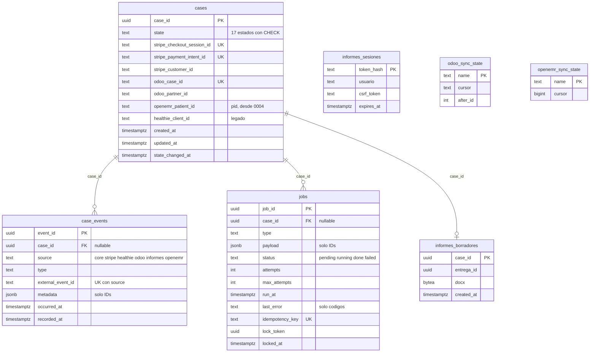
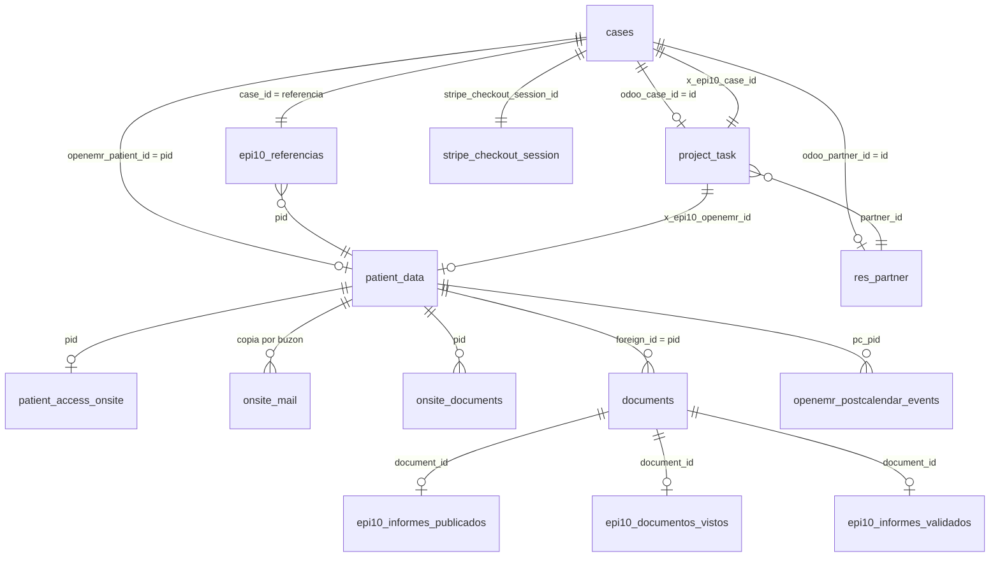

# Arquitectura del sistema EPI10 Salud v1: tal como está construido

Fecha: 2026-10-12 · Linear: SKI2-238 · Hito: «5 · Demo OpenEMR a Carmen» · Estado: **v1, describe el sistema construido; no es un plan**

Base de código descrita:

| Repo | Rama y commit | Qué es |
|---|---|---|
| `Skilland-ai/epi10-orquestador` | `master` 65bb925 | Monolito NestJS + PostgreSQL |
| `Skilland-ai/epi10-oe-module` | `main` b013569 | Módulos de OpenEMR: `oe-module-epi10` (contrato v1) y `oe-module-epi10-ui` (interfaz «EPI10 UI»), más `config-instancia/` |
| `Skilland-ai/EPI-10` (este repo) | `master` 0f837d0 | Documentación y scripts de pruebas de la instancia |

Instancia contrastada: hermes-node, consultada **en solo lectura** el 12 oct por la mañana (contenedores, esquema de MariaDB y PostgreSQL, globals de OpenEMR, clientes OAuth sin secretos y nombres de variables de entorno, nunca sus valores).

Documentos que este sustituye como descripción del sistema (siguen valiendo como historia de las decisiones): [ADR del orquestador](2026-10-03_adr_orquestador_v1.md) (D2, escrito cuando el portal era Healthie), [OpenEMR headless](../crisis-healthie/2026-10-07_openemr_headless_v1.md) (SKI2-207) y los documentos del plan renove en [`crisis-healthie/renove/`](../crisis-healthie/renove/).

Versión anterior, para comparar: [arquitectura v0 con Healthie](2026-10-12_arquitectura_sistema_v0_healthie.md) (SKI2-247), el sistema tal como estaba antes de la crisis del 7 oct.

### Cómo se citan las rutas

- `orq/…` = raíz de `epi10-orquestador`.
- `oem/…` = raíz de `epi10-oe-module`. Dentro: `oem/oe-module-epi10/…` (contrato) y `oem/oe-module-epi10-ui/…` (interfaz).
- `doc/…` = raíz de este repo `EPI-10`.
- «Instancia» = lo comprobado en hermes-node el 12 oct.

Cuando se cita una función, va como `Clase::metodo` o `funcion()`. Los números de línea se omiten salvo cuando ayudan: el código cambia y la función es más estable.

---

## Índice

1. [Visión general y principios](#1-visión-general-y-principios)
2. [Componentes y despliegue](#2-componentes-y-despliegue)
3. [Flujos de punta a punta](#3-flujos-de-punta-a-punta)
4. [Contrato v1 monolito ↔ OpenEMR](#4-contrato-v1-monolito--openemr)
5. [Modelo de datos y esquema](#5-modelo-de-datos-y-esquema)
6. [Vistas e interfaz](#6-vistas-e-interfaz)
7. [Seguridad y datos personales](#7-seguridad-y-datos-personales)
8. [Operación](#8-operación)
9. [Deuda y decisiones abiertas](#9-deuda-y-decisiones-abiertas)

---

## 1. Visión general y principios

### 1.1 Contexto

EPI10 Salud vende un servicio de nutrigenética. En la demo el producto se llama **NutriWell** (nombre provisional) y cuesta 100 EUR ficticios en el sandbox de Stripe. El recorrido de la clienta tiene cinco tramos ([journey v2](../journey/2026-10-03_customer_journey_mvp_v2.md)):

1. compra y alta;
2. activación y documentos (consentimiento firmado y encuesta de hábitos);
3. test genético (en casa por defecto; cita presencial opcional desde el 4 oct, SKI2-186);
4. laboratorio (TellmeGen, fuera del sistema) e informe;
5. entrega del informe y cierre.

El equipo son Aitor (operaciones y revisión del informe) y Carmen (dirección).

Tras la crisis de Healthie (SKI2-204: la API cuesta de 475 a 1.900 $/mes y EPI10 no la paga), Raúl eligió el 7 oct **OpenEMR autoalojado con lavado de cara** como portal de la clienta y ficha de salud (vía 1 de SKI2-207). Odoo se queda como back office de operaciones. El monolito orquesta.

### 1.2 Contexto del sistema

### 1.3 Reparto de responsabilidades

| Sistema | Para qué sirve | Quién lo usa |
|---|---|---|
| **Stripe** | Cobro único (Checkout por Payment Link) | Clienta |
| **Monolito** (`orq/`) | Dueño del **caso**: estado, IDs externos, eventos y trabajos pendientes. Orquesta Stripe, OpenEMR y Odoo. Aloja la **pantalla de informes** (seudonimizador, borrador con LLM, validación y publicación) | Nadie directamente, salvo Aitor en la pantalla de informes |
| **OpenEMR** + módulos (`oem/`) | **Portal de la clienta** (acceso, documentos firmables, chat, citas, «Mi informe») y **ficha de salud** con su back office (clientes, ficha EPI10, mensajes, calendario). Guarda todos los datos de salud | Clienta y equipo |
| **Odoo** | **Back office de operaciones**: kanban «Casos EPI10» con 11 etapas, actividades para Aitor, código del kit (D8) | Equipo |
| **Correo** | El monolito envía un único correo: el de acceso con el enlace mágico | Clienta |

### 1.4 Decisiones vigentes

| Decisión | Contenido | Fuente | Dónde se ve en el código |
|---|---|---|---|
| D1 | Entrada: web → Stripe → monolito → portal + Odoo | journey v2 | `orq/src/modules/stripe/` |
| D2 | Monolito propio NestJS + PostgreSQL en el servidor de EPI10. Odoo solo por API, sin módulos. AWS descartado | [ADR](2026-10-03_adr_orquestador_v1.md), SKI2-159 | `orq/compose.yaml` |
| Portal | **OpenEMR en lugar de Healthie**, vía 1: lavado de cara sin tocar el núcleo, con módulo propio | `doc/03_specs/decisions.md` (7 oct), SKI2-207 | `PORTAL_CLIENTE=openemr` (`orq/src/modules/portal/portal-cliente.ts`) |
| Contrato | El monolito **solo** habla con 7 operaciones de `oe-module-epi10`; nunca con tablas, servicios ni la API estándar o FHIR de OpenEMR | `oem/CONTRATO.md` «Por qué existe» | `orq/src/modules/openemr/contrato.ts`, `oem/oe-module-epi10/src/Contrato/ContratoV1.php` |
| D3 redefinida | «Listo para pedir test» = consentimiento firmado **y** encuesta enviada (`completos: true`) | `oem/CONTRATO.md` › `estado_formularios` | `EstadoFormularios::calcular()`, job `openemr.sync_forms` |
| Odoo | Back office de operaciones; el caso es un `project.task` en «Casos EPI10» con 11 etapas | decisions.md (3 oct) | `orq/src/modules/odoo/odoo.model.ts` (`CASE_STAGES`) |
| R4 | **Regla de publicación**: el portal solo enseña y entrega los informes publicados por `publicar_informe`. Nada más de la ficha llega a la clienta | `oem/CONTRATO.md`, `oem/README.md` «Regla de publicación del portal» | `oem/oe-module-epi10/src/Portal/GuardaPortal.php`, `Informes::idsPublicados()` |
| D7 | Borrador del informe autónomo; publicar exige validación humana | ADR | `orq/src/modules/informes/borrador/guardas.ts`, `InformesPantallaService` |
| Datos del informe | El entregable de TellmeGen entra, se usa y se borra. El borrador se borra al publicar | ADR «Datos» | `BandejaArchivos` (memoria), `finalizarPublicacion()` |
| D8 | Código del kit obligatorio al marcar «test realizado» | journey v2 | `orq/src/modules/odoo/milestones/stage-rules.ts` (`falta_codigo_barras`) |
| D10 | Cierre del caso manual, desde la actividad «Revisar cierre» de Odoo | journey v2 | `cerrarEntrega()` en `informes-pantalla.service.ts` |
| EPI10 UI | Base de interfaz: shadcn/ui vía Basecoat como CSS plano con prefijo `epi-`, sin build, con islas Preact. Módulo hermano, separado del contrato | decisions.md (11 oct), SKI2-209 | `oem/oe-module-epi10-ui/` |
| Idioma | Nunca mezclar idiomas: todo en español | feedback de Raúl (SKI2-208) | `oem/oe-module-epi10-ui/i18n/openemr_es.tsv`, `oem/scripts/detectar-ingles.mjs` |

### 1.5 Principios que el código cumple

1. **No se toca el núcleo de OpenEMR.** Todo entra por eventos del module manager, plantillas Twig sobrescritas, configuración nativa (globals, listas, `custom_menus`, ACL) y SQL de datos (`oem/README.md`, `oem/oe-module-epi10-ui/openemr.bootstrap.php`).
2. **Un contrato estrecho y versionado** entre monolito y OpenEMR (§4). Lo que hay detrás (plantillas, buzón, documentos) puede cambiar sin tocar el monolito.
3. **Los datos de salud viven solo en OpenEMR.** El monolito guarda IDs, estados y eventos (`orq/src/modules/core/safe-record.ts`); los datos de contacto los pide a Stripe cuando un trabajo los necesita (`orq/src/modules/core/contact-source.ts`). Odoo no recibe datos genéticos.
4. **Sin colas externas:** patrón outbox en PostgreSQL con reintentos, espera creciente y escalado a Odoo (§3.8).
5. **Idempotencia en cada borde:** id de evento de Stripe, claves de trabajo, `referencia` y `clave` del contrato, clave del webhook de Odoo.
6. **Logs sin datos personales:** solo IDs, tipos de evento y códigos de error (`orq/src/logging/`).
7. **Por omisión, no por adición:** lo que EPI10 no usa en OpenEMR se esconde con CSS, menús y ACL; no se borra.

### 1.6 Fuera del sistema v1

- Logística del kit y seguimiento del envío; API de TellmeGen (no existe).
- Cobro dentro del portal, tienda o carrito: la tarjeta «Tienda EPI10» solo enlaza a la web (`oem/oe-module-epi10/config.php` › `tienda_url`).
- Lectura de las respuestas de la encuesta por el monolito, citas en el contrato, republicar un informe y acceso recurrente (`oem/CONTRATO.md` «Fuera de v1»).
- Feedback tras la entrega (D9) e interpretación genética automática.
- Despliegue en el servidor de EPI10 (SKI2-173): hoy todo corre en hermes-node (§8.5).

---

## 2. Componentes y despliegue

### 2.1 Inventario de componentes

| Componente | Tecnología | Versión | Repo o imagen | Estado |
|---|---|---|---|---|
| Monolito `app` | Node + NestJS + TypeScript, Kysely | — | `orq/Dockerfile` → `epi10-orquestador:local` | En uso |
| Base de datos del monolito | PostgreSQL | 18 (`postgres:18-alpine`) | `orq/compose.yaml` › `db` | En uso |
| Proxy HTTPS | Caddy | 2 (`caddy:2-alpine`) | `orq/compose.yaml` › `proxy`, `orq/docker/caddy/Caddyfile` | En uso |
| OpenEMR | Apache + PHP, imagen oficial | 8.4.1 (imagen `openemr/openemr:latest` en la instancia) | Compose en `~/Projects/epi10-openemr-prueba` del HP, **fuera de los repos** | En uso |
| Base de datos de OpenEMR | MariaDB | 11.8 | Mismo compose del HP | En uso |
| `oe-module-epi10` | Módulo PHP de OpenEMR | 1.0.0, contrato 1.0.0 (`version.php`, `ContratoV1::VERSION`) | `oem/oe-module-epi10/` | Activo en la instancia (`modules.mod_active = 1`) |
| `oe-module-epi10-ui` | Módulo PHP + Twig + CSS plano + islas Preact | 0.1.0 (`oem/oe-module-epi10-ui/version.php`) | `oem/oe-module-epi10-ui/` | Activo en la instancia |
| Odoo de pruebas | Odoo Community | 17 (`odoo:17`) + PostgreSQL 16 | Repo `Skilland-ai/epi10-odoo-pruebas` (SKI2-182) | En uso para la demo |
| Correo de la demo | Mailpit | 1.31.2 | `orq/test/demo/compose.demo.yaml` › `correo` | Solo demo |
| Stripe CLI | Reenvío de eventos del sandbox | 1.53.0 | `compose.demo.yaml` › `stripe-cli` | Solo demo |
| Simuladores | Odoo y Healthie simulados, panel del core | — | `compose.demo.yaml` › `simuladores` | Ensayos y panel de la demo |
| Módulo `healthie` del monolito | GraphQL de Healthie | — | `orq/src/modules/healthie/` | **Legado**: se importa siempre, inactivo con `PORTAL_CLIENTE=openemr` |

### 2.2 Módulos del monolito

`orq/src/app.module.ts` importa **siempre** todos los módulos. Cada uno decide al arrancar si se registra, según su configuración (sus factorías devuelven `null` si falta).

| Módulo | Qué hace | Se activa con |
|---|---|---|
| `core` | Caso, máquina de estados, eventos, outbox, escalado, oyentes de transición (`orq/src/modules/core/core.module.ts`) | Siempre |
| `stripe` | Webhook, validación de la compra contra la API, registro de pagos (`StripeLedger`), fuente de contacto | `STRIPE_SECRET_KEY` o `STRIPE_WEBHOOK_SECRET` |
| `portal` | Elige el portal y sus tipos de trabajo; textos de los 4 mensajes de hito (`portal-cliente.ts`, `mensajes.ts`) | Siempre |
| `openemr` | Cliente del contrato v1, alta, mensajes, consulta periódica, publicador del informe, correo de acceso | `PORTAL_CLIENTE=openemr` (`openemr.config.ts`) |
| `odoo` | Adaptador JSON-RPC o JSON-2, tareas y actividades, webhook, reglas de hito, reconciliación, `odoo:setup` | `ODOO_URL` |
| `informes` | Pantalla con login propio, seudonimización, borrador con LLM, validación y publicación | Siempre (valida `INFORMES_*` al arrancar) |
| `healthie` | Legado de antes de la crisis | `PORTAL_CLIENTE=healthie` |

### 2.3 Contenedores en hermes-node

Comprobado con `docker ps` en la instancia el 12 oct. Todo escucha solo en `127.0.0.1` del HP y se abre desde el ASUS con `hn open <puerto>`.

Fuente del diagrama: `orq/docs/demo-visual.md` (cabecera y tabla de accesos) y `orq/test/demo/compose.demo.yaml`.

| Puerto en el HP | Servicio | Quién lo usa |
|---|---|---|
| 4891 | PostgreSQL del monolito | Diagnóstico |
| 4892 / 4893 | Caddy HTTP / HTTPS (CA interna) | Pantalla de informes `https://localhost:4893/informes`, webhooks |
| 4894 | Panel de solo lectura del core (simuladores) | Demo |
| 4895 | Mailpit | Correo de la clienta en la demo |
| 4896 | OpenEMR (portal `/portal`, back office `/`, API `/apis`, OAuth `/oauth2`) | Clienta, equipo y monolito |
| 4881 | Odoo de pruebas | Equipo, monolito |

### 2.4 `orq/compose.yaml` (el de producción)

| Servicio | Imagen | Puertos | Notas |
|---|---|---|---|
| `app` | build local | Ninguno publicado | `read_only`, `cap_drop: ALL`, `no-new-privileges`, `depends_on: db (healthy)`. Healthcheck en `orq/Dockerfile` (`wget /health`); el `CMD` aplica migraciones y arranca |
| `db` | `postgres:18-alpine` | `127.0.0.1:${POSTGRES_PORT:-5432}` | Volumen `pgdata`, healthcheck `pg_isready` |
| `proxy` | `caddy:2-alpine` | `${PROXY_BIND:-127.0.0.1}:80` y `:443` | Volúmenes `caddy_data`, `caddy_config`; `Caddyfile` en solo lectura |

Red única `backend`. El superpuesto de la demo (`orq/test/demo/compose.demo.yaml`) añade `simuladores`, `correo` y `stripe-cli`, une la app a las redes externas `epi10-odoo-pruebas` y `epi10-openemr-prueba_default` y fija `PORTAL_CLIENTE=openemr`, `OPENEMR_POLL_INTERVAL_MS=5000`, proveedor LLM `falso` y un outbox de 5 intentos con esperas de 1 a 5 s. El ensayo antiguo (`orq/test/ensayo/compose.ensayo.yaml`) sigue con `PORTAL_CLIENTE=healthie` y simuladores.

**Caddy** (`orq/docker/caddy/Caddyfile`): solo enruta `/webhooks/stripe`, `/webhooks/healthie`, `/webhooks/odoo/*`, `/informes` y `/informes/*`; todo lo demás responde 404. `admin off`, sin directiva `log` (no registra accesos), HSTS, `nosniff`, `Referrer-Policy: no-referrer`. `SITE_ADDRESS=localhost` usa la CA interna; un dominio, Let's Encrypt. `/health` no se publica.

OpenEMR **no está detrás del Caddy del monolito**: en la instancia se sirve directamente en el puerto 4896.

### 2.5 Variables de entorno (solo nombres)

Validación en `orq/src/config/env.ts` (`validateConfig`): si falta una obligatoria o tiene mal formato, la app no arranca. Las vacías cuentan como ausentes. Lista contrastada con los nombres del contenedor `epi10-demo-app-1`.

| Grupo | Variables | Obligatoriedad |
|---|---|---|
| Aplicación | `NODE_ENV`, `HOST`, `PORT`, `DATABASE_URL`, `DATABASE_POOL_MAX`, `LOG_LEVEL` | `DATABASE_URL` siempre |
| Outbox | `OUTBOX_WORKER_ENABLED`, `OUTBOX_POLL_INTERVAL_MS`, `OUTBOX_BATCH_SIZE`, `OUTBOX_MAX_ATTEMPTS`, `OUTBOX_BASE_DELAY_MS`, `OUTBOX_MAX_DELAY_MS`, `OUTBOX_LEASE_MS`, `OUTBOX_HANDLER_TIMEOUT_MS`, `OUTBOX_SHUTDOWN_GRACE_MS` | Opcionales (valores por defecto en §3.8) |
| Stripe | `STRIPE_SECRET_KEY`, `STRIPE_WEBHOOK_SECRET`, `STRIPE_LIVEMODE`, `STRIPE_ACCOUNT_ID`, `STRIPE_PRICE_ID`, `STRIPE_AMOUNT`, `STRIPE_CURRENCY`, `STRIPE_CHECKOUT_TAG`, `STRIPE_API_URL` | Si hay clave o secreto, el bloque entero |
| Portal | `PORTAL_CLIENTE` (`healthie` u `openemr`; por defecto `healthie`) | Opcional |
| OpenEMR (`orq/src/config/openemr-env.ts`) | `OPENEMR_URL`, `OPENEMR_SITE`, `OPENEMR_CLIENT_ID`, `OPENEMR_CLIENT_SECRET`, `OPENEMR_USER`, `OPENEMR_PASSWORD`, `OPENEMR_TIMEOUT_MS`, `OPENEMR_POLL_INTERVAL_MS` (por defecto 120 000), `OPENEMR_ENLACE_CADUCIDAD_HORAS` (48) | Las de URL, cliente y usuario, con `PORTAL_CLIENTE=openemr` |
| Correo | `CORREO_SMTP_URL`, `CORREO_REMITENTE` | Con `PORTAL_CLIENTE=openemr` |
| Odoo (`orq/src/config/odoo-env.ts`) | `ODOO_URL`, `ODOO_DB`, `ODOO_LOGIN`, `ODOO_API_KEY`, `ODOO_API_KEY_EXPIRES_AT`, `ODOO_PROTOCOL`, `ODOO_TIMEOUT_MS`, `ODOO_PROJECT_NAME`, `ODOO_ACTIVITY_USER_LOGIN`, `ODOO_ACTIVITY_DEADLINE_DAYS`, `ODOO_WEBHOOK_TOKEN`, `ODOO_RECONCILE_INTERVAL_MS` | Con `ODOO_URL`: login, clave y base |
| Informes (`orq/src/modules/informes/config.ts`) | `INFORMES_URL_PUBLICA`, `INFORMES_USUARIOS`, `INFORMES_SESION_HORAS`, `INFORMES_LOGIN_MAX_INTENTOS`, `INFORMES_LOGIN_BLOQUEO_MINUTOS`, `INFORMES_MAX_BYTES`, `INFORMES_MIN_CARACTERES`, `INFORMES_BANDEJA_TTL_MS`, `INFORMES_PROCESAR_TIMEOUT_MS`, `INFORMES_LLM_PROVIDER`, `INFORMES_LLM_MODEL`, `INFORMES_LLM_EFFORT`, `INFORMES_LLM_FALLBACK`, `INFORMES_LLM_TIMEOUT_MS`, `INFORMES_LLM_MAX_INTENTOS`, `INFORMES_LLM_ESPERA_MS`, `INFORMES_PERMITIR_FALSOS`, `INFORMES_DIR_TEMPORAL`, `INFORMES_RECURSOS_DIR`, `ANTHROPIC_API_KEY` | `ANTHROPIC_API_KEY` en producción con proveedor `anthropic`; `falso` prohibido en producción |
| Healthie (legado) | `HEALTHIE_*` (17 variables, `orq/src/config/healthie-env.ts`) | Solo con `PORTAL_CLIENTE=healthie` |
| Compose | `POSTGRES_USER`, `POSTGRES_PASSWORD`, `POSTGRES_DB`, `POSTGRES_PORT`, `SITE_ADDRESS`, `PROXY_BIND`, `HTTP_PORT`, `HTTPS_PORT` | `POSTGRES_PASSWORD` |
| Scripts | `ODOO_SETUP_LOGIN`, `ODOO_SETUP_API_KEY`, `ODOO_WEBHOOK_URL` (`odoo:setup`); `DEMO_DIR`, `DEMO_ODOO_ENV`, `DEMO_OPENEMR_ENV`, `DEMO_CAPTURAS` (demo); `TEST_DATABASE_URL`, `OPENEMR_REAL_ENV_FILE` (pruebas) | — |

Los módulos de OpenEMR no leen variables de entorno: su configuración son ficheros PHP sin secretos (`config.php`, `config-backoffice.php`, `config.citas.php`, `config_tareas.php`) y globals de OpenEMR (§5.3).

### 2.6 Configuración de OpenEMR que el sistema necesita

Globals comprobados en la instancia (tabla `globals`):

| Global | Valor en la instancia | Para qué | Valor en producción |
|---|---|---|---|
| `portal_onsite_two_enable` | 1 | Portal activo | 1 |
| `portal_onsite_two_address` | URL local del portal | Lo usan los enlaces mágicos | URL pública |
| `portal_onsite_two_register` | 0 | Sin registro público | 0 |
| `rest_api`, `rest_fhir_api`, `rest_portal_api` | 1, 1, 1 | El contrato usa solo `rest_api` | `rest_api` = 1; FHIR y API del portal, a revisar (no los usa nadie) |
| `oauth_password_grant` | 3 (activado) | Lo usan el monolito y las pruebas | **Desactivado** (`oem/README.md` «Condiciones de producción») |
| `api_log_option` | **2** | Registra peticiones y respuestas completas en `api_log` | **1** |
| `drive_encryption` | 1 | Documentos cifrados en disco | 1 |
| `enable_auditlog` | 1 | Registro de auditoría | 1 |
| `enforce_signin_email` | 0 | Login del portal sin correo (`oem/oe-module-epi10-ui/sql/acceso_portal_simple.sql`) | 0 (decisión del área 1) |
| `password_max_failed_logins` | 20 | Bloqueo por intentos | A revisar |
| `gbl_time_zone` | Atlantic/Canary | `oem/oe-module-epi10-ui/sql/zona_horaria.sql`, pendiente de que Raúl la ratifique | Pendiente (el README del módulo dice Europe/Madrid) |
| `allow_custom_report`, `ccda_alt_service_enable` | 0, 0 | Cierran rutas del portal que enseñaban la historia (área 4) | 0 |
| `language_default`, `openemr_name` | Spanish (Spain), EPI10 Salud | Idioma y marca | Igual |

Además: lista `default_open_tabs` con «Inicio» EPI10 (`oem/oe-module-epi10-ui/sql/inicio_backoffice.sql`), grupo ACL y menús del área 7 (§6.6), plantillas «Consentimiento EPI10 Salud» y «Hábitos de vida EPI10» en el repositorio de plantillas y el cuestionario FHIR (`oem/README.md`, paso 4), y la agenda de disponibilidad de la demo (`citas_disponibilidad_demo.sql`).

Clientes OAuth registrados en la instancia (tabla `oauth_clients`, sin secretos): cuatro, todos con `grant_types = authorization_code` en su ficha. Dos son del contrato v1 («EPI10 monolito · demo (SKI2-210)» y «… contrato v1 (pruebas SKI2-210)», este con `user/document.write`) y dos del prototipo de SKI2-207, con scopes amplios (`user/patient.write`, FHIR…) y todavía **habilitados**.

---

## 3. Flujos de punta a punta

### 3.1 Estados del caso

La máquina de estados vive en `orq/src/modules/core/case-state.ts` (`CASE_STATES`, `NEXT`). Desde cualquier estado no terminal se puede ir a `cancelado`. `CaseService::transition` bloquea la fila (`SELECT … FOR UPDATE`), rechaza transiciones no permitidas (`InvalidTransitionError`), registra `case.state_changed` y avisa a los oyentes en la misma transacción.

Con `PORTAL_CLIENTE=openemr`, **tres estados no los alcanza nadie**: `alta_manual_healthie` (alternativa manual de Healthie), `cita_agendada` y `pendiente_reagendar`. Los dos últimos solo los pone `orq/src/modules/healthie/webhook/healthie-sync.ts`; las citas del portal de OpenEMR no llegan al monolito (§3.6).

Correspondencia con las etapas de Odoo (`orq/src/modules/odoo/odoo.model.ts` › `CASE_STAGES`; reglas en `milestones/stage-rules.ts` › `AITOR_STAGES`) y con la fase que enseña el portal (`oem/oe-module-epi10-ui/src/Inicio/FaseCaso.php`):

| Etapa de Odoo (`x_epi10_code`) | Quién la pone | Estado del caso | Efecto en el monolito | Tramo en el portal |
|---|---|---|---|---|
| `nuevo` | Sistema (`odoo.create_case`) | `pago_confirmado`, `alta_completada` | — | 1 · Bienvenida |
| `onboarding` | Sistema (`openemr.sync_forms`, al empezar un formulario) | `alta_completada` | — | 2 · Tus documentos |
| `listo_test` | Sistema (`openemr.sync_forms`, D3) | `onboarding_completado` | Actividad «Pedir test» | 3 · Tu test |
| `test_pedido` | Aitor | `test_pedido` | Mensaje `caso_en_marcha` | 3 |
| `test_recibido` | Aitor | `test_recibido` | Mensaje `test_listo` | 3 |
| `cita` | Nadie con OpenEMR | (`cita_agendada`) | — | 3 |
| `test_realizado` | Aitor | `test_realizado` o `falta_codigo_barras` | Sin código de kit: actividad «Completar código de barras» (D8) | 3 |
| `muestra_enviada` | Aitor | `muestra_enviada` | Mensaje `muestra_enviada` | 4 · Laboratorio |
| `entregable` | Aitor | `entregable_disponible` (y siguientes) | El caso aparece en la pantalla de informes | 4 |
| `entregado` | Sistema (`cerrarEntrega()`) | `informe_publicado` | Actividad «Revisar cierre» | 5 · Tu informe |
| `cerrado` | Aitor o Carmen (D10) | `cerrado` | — | 5 |

Un salto de etapa que el core no permite crea la actividad «Revisar etapa» (`decideMilestone()`). El portal **no conoce** la etapa de Odoo: deduce la fase de lo que sabe OpenEMR (formularios, cita futura, informe publicado), así que entre `listo_test` y `entregable` enseña siempre lo mismo. Ver §9.

### 3.2 Pago → caso → alta en el portal

Detalles verificables:

- **Webhook** (`orq/src/modules/stripe/stripe-webhook.service.ts`): cuerpo en bruto de 256 KB como máximo; sin firma 400, sin configuración 503; `Stripe.webhooks.constructEvent()`. Tipos atendidos: `checkout.session.completed`, `checkout.session.async_payment_succeeded`, `…async_payment_failed`, `…expired` y `charge.refunded` (`stripe-webhook.ts`). Errores permanentes: 200 `needs_review` y trabajo `stripe.review`, que falla adrede para escalar. Errores transitorios: 503 para que Stripe reintente.
- **Registro del pago** (`StripeLedger::record`, `orq/src/modules/stripe/stripe-ledger.ts`): candado `pg_advisory_xact_lock` por pedido, doble comprobación de duplicado y decisión (`decide()`): pago nuevo, pago repetido, devolución antes del pago, devolución con el caso cerrado (revisión). Una devolución cancela el caso.
- **Trabajos del pago**: `odoo.create_case` y el de alta del portal elegido (`trabajosPortal(portal).alta` = `openemr.create_access`), con clave `<tipo>:<caseId>`. El contenido del trabajo (`payload`) solo lleva los IDs de la sesión y del pago (`orq/src/modules/stripe/stripe.jobs.ts`).
- **Alta** (`openemr.create_access` en `orq/src/modules/openemr/openemr.jobs.ts`): se salta si el caso está cancelado; si ya existe el evento `acceso:<caseId>`, solo completa la transición, así que un reintento **no reenvía el correo**. El enlace mágico solo vive en memoria del trabajo y en el correo (`oem/CONTRATO.md` «Datos»).
- **Correo** (`orq/src/modules/openemr/correo-acceso.ts`): nodemailer sin logger. Un 5xx del SMTP es error permanente (`openemr.correo_rechazado`); el resto, reintentable.
- Del lado de OpenEMR, `Acceso::crearSinCandado` (`oem/oe-module-epi10/src/Portal/Acceso.php`) resuelve la paciente por `referencia` (tabla `epi10_referencias`) o por email; crea credenciales con contraseña aleatoria que nunca sale de OpenEMR y un enlace `OneTimeAuth` de un solo uso que caduca en 48 h por defecto.

### 3.3 Onboarding: documentos firmables y regla D3 por consulta periódica

OpenEMR no tiene webhooks salientes. El monolito consulta.

- La isla de tareas escribe **en las mismas tablas que el portal nativo** (`oem/oe-module-epi10-ui/src/Tareas/Tareas.php`), así que el contrato (`EstadoFormularios::calcular()`) no cambia: `completado` = `denial_reason` en «In Review» o «Locked» y, en el consentimiento, `patient_signed_status = 1`.
- `openemr.poll` (`orq/src/modules/openemr/openemr.sync.ts`): clave `openemr.poll:<intervalo>:<ranura>` con la ranura `floor(now/intervalo)+1`, un solo intento; hay un `setInterval` de respaldo cada `max(intervalo, 30 s)` (`openemr.module.ts`). `openemr.sync_forms`: 3 intentos. Los dos están excluidos de «Revisar incidencia».
- Cada pasada deja **una fila nueva** en `jobs`. En la instancia, con 5 s de intervalo: 11.230 filas `openemr.poll` en `done` en unas 15,6 h y ningún caso. No hay purga (§9).
- La regla D3 no tiene en cuenta la cita ni el código del kit.

### 3.4 Hitos que marca Aitor en Odoo → mensajes en el portal

- Webhook (`orq/src/modules/odoo/webhook/odoo-webhook.service.ts`): el token va en la ruta, se compara en tiempo constante sobre su SHA-256 y se redacta en los logs. El retraso de 4 s (`TASK_READ_DELAY_MS`) existe porque Odoo 17–18 avisa antes de confirmar la escritura.
- Reconciliación (`milestones/odoo-reconciler.ts`): páginas de 200 por `write_date`, cursor en `odoo_sync_state` (fila `reconcile`), cada `ODOO_RECONCILE_INTERVAL_MS` (720 000 ms por defecto).
- Textos de los 4 mensajes en `orq/src/modules/portal/mensajes.ts` («Texto pendiente de Raúl»).
- `enviar_mensaje` deja dos copias en `onsite_mail` (buzón de la clienta y del equipo), igual que el portal nativo (`oem/oe-module-epi10/src/Portal/Mensajes.php`).

### 3.5 Chat: la clienta escribe, el equipo responde

- `mensajes_nuevos` solo devuelve mensajes con 3 s de antigüedad para que un `id` menor confirmado tarde no se quede detrás del cursor (`Mensajes::nuevos`, `MARGEN_SEGUNDOS`).
- Las respuestas del equipo **no pasan por el monolito**: se escriben desde el back office de OpenEMR con `oem/oe-module-epi10-ui/public/backoffice/api/mensajes.php`. El monolito no sabe si un mensaje se ha respondido; la actividad de Odoo se cierra a mano.
- Adjuntos: la clienta sí puede (10 MiB, 20 al día, PDF o imagen); el equipo **no** (`config.php` › `chat.adjuntos_equipo = false`), porque al portal solo llega lo publicado (R4).
- No hay aviso por correo de mensaje nuevo (área 3, «Unknown»).

### 3.6 Citas del test presencial (opcional)

- La clienta reserva y cancela en `oem/oe-module-epi10-ui/public/portal/citas.php` (isla `calendario`). La disponibilidad son los bloques «En consulta» del calendario del equipo; la cita se guarda con `AppointmentService::insert` en `openemr_postcalendar_events` y deja una nota al equipo en `pnotes` (`src/Citas/Agenda.php`). Las páginas de citas del núcleo redirigen con 303 a la vista propia (`src/Citas/GuardaCitas.php`).
- **Las citas están fuera del contrato v1**: el monolito no las lee y Odoo no las ve (`x_epi10_cita_fecha` y la etapa `cita` se quedan sin uso con OpenEMR). El equipo las ve en el calendario de OpenEMR y en la pestaña Citas de la ficha.

### 3.7 Informe: del entregable al portal

- Pantalla (`orq/src/modules/informes/pantalla/`): estados listados `entregable_disponible`, `borrador_en_revision` e `informe_validado`. Rutas en §7.1.
- Procesar (`integracion/procesador-entregable.ts`, `seudonimizacion/`): el nombre se sustituye por el `case_id`; el resto por marcadores (`[EMAIL]`, `[TELEFONO]`, `[DNI_NIE]`, `[FECHA_NACIMIENTO]`, `[DIRECCION]`, `[CODIGO_MUESTRA]`). Sin Odoo y con proveedor distinto de `falso`, falla de forma permanente.
- Borrador (`borrador/`): flujo `recursos/flujo.yaml` (resumen, resultados, puntos de revisión, limitaciones), skills en Markdown, plantilla `.docx` con docxtemplater, marca «BORRADOR — pendiente de revisión humana» y sin interpretación genética ni clínica (`guardas.ts`). En la demo el proveedor es `falso` (variable comprobada en la instancia).
- El **PDF final también espera en memoria** hasta que lo recoge `informes.publicar_informe`; si la app se reinicia antes, el trabajo falla con `informes.pdf_final_perdido` y se escala (`informes-pantalla.service.ts`).
- Publicador: OpenEMR si está activo, si no Healthie, si no manual (`pantalla.module.ts`). Con OpenEMR no hay alternativa manual: si se agotan los reintentos, actividad «Reintentar publicación del informe».
- En OpenEMR, `Informes::publicar` guarda el PDF (≤ 20 MB, empieza por `%PDF-`) con `Document::createDocument` y lo apunta en `epi10_informes_publicados`, que es la **lista blanca de R4** (§7.4).

### 3.8 Mecanismos transversales

**Outbox** (`orq/src/modules/core/outbox/`):

| Pieza | Comportamiento |
|---|---|
| Encolado | Tipo con forma `dominio.accion`; payload validado y pasado por `assertSafeRecord`; `ON CONFLICT (idempotency_key) DO NOTHING` |
| Reclamo | `UPDATE … WHERE job_id IN (SELECT … FOR UPDATE SKIP LOCKED)` sobre `pending` vencidos o `running` cuya reserva (`OUTBOX_LEASE_MS`) ha caducado porque el proceso murió. Suma un intento y pone `lock_token` |
| Procesador | `OutboxWorker`: hasta `OUTBOX_BATCH_SIZE` (10) en paralelo, espera `OUTBOX_POLL_INTERVAL_MS` (1 000; 500 en la demo) si no hay trabajo, apagado con gracia |
| Tiempo límite | `OUTBOX_HANDLER_TIMEOUT_MS` (60 s) con `AbortSignal`, menor que `OUTBOX_LEASE_MS` (40 min) |
| Espera creciente | `backoff.ts`: `min(OUTBOX_MAX_DELAY_MS, OUTBOX_BASE_DELAY_MS · 2^(intento−1))`, mitad fija y mitad aleatoria. Con los valores por defecto (5 s de base, 8 intentos): de 2,5–5 s a 160–320 s, unos 10 min en total |
| Intentos | `OUTBOX_MAX_ATTEMPTS` (8); excepciones: `stripe.review` y `openemr.poll` 1, `openemr.sync_forms` 3, trabajos de informes 5 |
| Error permanente | `PermanentJobError` o `UnsafeDataError`: se escala sin reintentar |
| Escalado | `fail()` pone el trabajo en `failed`, registra `job.escalated` y avisa a los oyentes: `OdooJobs.onEscalated` crea «Revisar incidencia · <tipo>» en Odoo; la pantalla de informes encola `informes.publicar_a_mano` |
| Reencolar | `npm run jobs:retry-failed -- --type <tipo>` o por `job_id` (`retry-failed.ts`) |

**Idempotencia, borde a borde:**

| Borde | Clave | Dónde |
|---|---|---|
| Stripe → monolito | `(source, external_event_id)` único en `case_events` + candado por pedido | `0001_core.ts`, `stripe-ledger.ts` |
| Trabajos | `jobs.idempotency_key` único (`<tipo>:<caseId>`, `message:<caseId>:<plantilla>`…) | `outbox.service.ts` |
| Odoo → monolito | `odoo:<id>:<etapa>:<write_date>:<hash12>` | `odoo-webhook.service.ts` |
| Monolito → OpenEMR, alta | `referencia` = `case_id` en `epi10_referencias` | `Acceso.php` |
| Monolito → OpenEMR, mensaje | `clave` en `epi10_mensajes_enviados` | `Mensajes.php` |
| Monolito → OpenEMR, informe | `referencia` en `epi10_informes_publicados` | `Informes.php` |
| Monolito → OpenEMR, formularios | Ya asignado → `nuevo: false` | `Formularios.php` |
| Concurrencia en OpenEMR | `GET_LOCK` de MariaDB por recurso; 10 s de espera, si no `en_curso` (409) | `Candado.php` |
| Concurrencia en el monolito | Candado consultivo por caso (`withAdvisoryLock`, importado de `healthie/locks`) | `openemr.sync.ts` |

Límite conocido: si el módulo cae entre enviar un mensaje y registrar su clave, el reintento lo duplica; se acepta por ser «menos grave que uno perdido» (`Mensajes.php`).

### 3.9 Seguimiento y cierre

- Tras publicar, la tarea pasa a «Informe entregado» con la actividad «Revisar cierre». El cierre es manual (D10). Las actividades que crea el monolito no se cierran solas, salvo las de publicación (SKI2-181, pendiente).
- La clienta conserva el acceso al portal y al informe. Las dudas van por el chat (§3.5).
- **Republicar un informe corregido no es posible** en v1: `publicar_informe` con la misma `referencia` devuelve el primero (§4.6).

---

## 4. Contrato v1 monolito ↔ OpenEMR

Fuente: `oem/CONTRATO.md` (versión 1.0.0). Implementación: `oem/oe-module-epi10/src/Contrato/` y `src/Portal/`. Cliente: `orq/src/modules/openemr/openemr.client.ts` y `contrato.ts`. Prueba contra instancia real: `oem/tests/contrato/contrato_v1.py`.

### 4.1 Reglas generales

| Tema | Regla | Implementación |
|---|---|---|
| Base | `{OE}/apis/default/api` | Rutas registradas con `RestApiCreateEvent` (`Bootstrap::addRoutes` → `ContratoV1::registrar`) |
| Autenticación | OAuth2 de OpenEMR con un usuario del equipo. Hoy *password grant*; en producción *authorization code* con *refresh token* (pendiente) | El cliente pide token a `/oauth2/<site>/token`, lo guarda en memoria, lo renueva 30 s antes de caducar y reintenta una vez ante un 401 |
| Permisos | Un scope por recurso: `user/epi10_v1_<recurso>.c` para POST, `.s` para GET, más ACL del usuario | Scopes anunciados con `RestApiScopeEvent`; ACL con `RestConfig::request_authorization_check` |
| Formato | JSON UTF-8, fechas ISO 8601 con zona | — |
| Versión | Cabecera `X-Epi10-Contrato: 1.0.0` en toda respuesta. Compatible sube el menor; incompatible = rutas `epi10_v2_*` en paralelo | El monolito exige versión mayor 1 (`openemr.contrato_incompatible`) y comprueba el contrato al arrancar sin bloquear el arranque |
| Datos | Solo IDs, estados y fechas. Excepción: el enlace mágico, que el monolito no guarda ni registra | — |
| Errores | `{"error": {"codigo", "mensaje"}}`; el monolito decide por `codigo` | `ErrorContrato`; `error_interno` registra solo clase, fichero y línea |

### 4.2 Operaciones

| Operación | Método y ruta | Scope | ACL de OpenEMR | Idempotencia | Respuesta |
|---|---|---|---|---|---|
| `contrato` | `GET /api/epi10_v1_contrato` | `.s` | — | — | 200 `{version, operaciones, formularios}` |
| `crear_acceso` | `POST /api/epi10_v1_acceso` | `user/epi10_v1_acceso.c` | `patients/demo` write o addonly | `referencia` | 201 `{pid, uuid, paciente_creada, acceso_creado, usuario_portal, enlace_magico, caduca_en}` (también al repetir) |
| `asignar_formularios` | `POST /api/epi10_v1_formularios` | `.c` | `patients/docs` | Por plantilla ya asignada | 201 `{pid, formularios: [{formulario, nuevo}]}` |
| `estado_formularios` | `GET /api/epi10_v1_formularios?pid=` | `.s` | `patients/docs` | — | 200 `{pid, formularios: [{formulario, estado, completado_en}], completos}` |
| `enviar_mensaje` | `POST /api/epi10_v1_mensajes` | `.c` | `patients/notes` | `clave` | 201, o 200 con `duplicado: true` |
| `mensajes_nuevos` | `GET /api/epi10_v1_mensajes?cursor=&limite=` | `.s` | `patients/notes` | Cursor | 200 `{mensajes: [{id, pid, fecha}], cursor, hay_mas}` |
| `publicar_informe` | `POST /api/epi10_v1_informe` | `.c` | `patients/docs` | `referencia` | 201 `{pid, documento_id, duplicado}`, o 200 si repetido |

Formularios lógicos (`oem/oe-module-epi10/config.php` › `formularios`): `consentimiento` → plantilla «Consentimiento EPI10 Salud», con firma; `encuesta_habitos` → «Hábitos de vida EPI10», que incrusta el cuestionario FHIR del mismo nombre.

### 4.3 Errores y cómo los trata el monolito

| `codigo` | HTTP | Cuándo | Monolito (`orq/src/modules/openemr/openemr.errors.ts`) |
|---|---|---|---|
| `entrada_invalida` | 400 | Campo ausente o mal formado | Permanente |
| `paciente_no_encontrado` | 404 | `pid` inexistente | Permanente |
| `paciente_duplicado` | 409 | Varias pacientes con ese email | Permanente: lo decide una persona |
| `sin_acceso_portal` | 409 | Mensaje a paciente sin acceso | Reintentable |
| `formulario_no_configurado` | 409 | Falta la plantilla en el repositorio | Permanente |
| `clave_en_uso`, `referencia_en_uso` | 409 | Clave o referencia usada con otra paciente | Permanente |
| `en_curso` | 409 | Otra petición con la misma clave lleva más de 10 s | Reintentable |
| `error_openemr` | 502 | OpenEMR no hizo lo pedido | Reintentable |
| `error_interno` | 500 | Fallo inesperado | Reintentable |
| (sin código) | 401, 403, 404 de ruta | Token, scope o módulo inactivo | 401: renueva token una vez; 403 y 404 (`contrato_no_disponible`): permanentes. 429 y 5xx: reintentables |

### 4.4 Formato de los cuerpos

- `crear_acceso`: `referencia` `[A-Za-z0-9._:-]{1,64}`; `paciente.nombre` (1–100), `apellidos` (1–150), `email` (se pasa a minúsculas), `fecha_nacimiento` y `sexo` opcionales (el pago no los trae); `caducidad_horas` 1–168 (`Validacion::crearAcceso`).
- `enviar_mensaje`: `clave` `[A-Za-z0-9._:-]{1,128}` (no documentado en `CONTRATO.md`), `asunto` 1–120, `cuerpo` 1–4000 en texto plano (el módulo lo escapa, un `
` por línea).
- `publicar_informe`: `nombre_archivo` terminado en `.pdf`, sin barras ni caracteres de control; `pdf_base64` estricto, ≤ 20 MB decodificado y empezando por `%PDF-`.

### 4.5 Desajustes menores entre documento y código

Encontrados al contrastar; ninguno rompe el contrato:

- `ContratoV1::scopes()` anuncia 10 scopes (`.c` y `.s` de los 5 recursos), 3 de ellos sin ruta (`epi10_v1_contrato.c`, `epi10_v1_acceso.s`, `epi10_v1_informe.s`). El cliente que registra `oem/scripts/registrar-cliente.py` solo pide los 7 que se usan.
- `crear_acceso` con una `referencia` ya conocida devuelve su paciente sin comprobar que el email coincida (`Acceso.php`). `referencia_en_uso` solo existe en `publicar_informe`.
- `caduca_en` lo calcula el módulo con la hora de PHP, no lo devuelve `OneTimeAuth`.

### 4.6 Previsto para v1.1 (cambios compatibles)

| Cambio | Para qué | Origen |
|---|---|---|
| Campo opcional `revision` en `publicar_informe` | Republicar un informe corregido (journey 5.2) | `oem/CONTRATO.md` «Fuera de v1» |
| Tabla `epi10_fase_caso (pid, codigo, actualizado)` y operación `fijar_fase` (`POST /api/epi10_v1_fase`, scope `user/epi10_v1_fase.c`) | Que el portal y el back office de OpenEMR sepan la etapa real de Odoo | Área 1, aprobada por el orquestador el 11 oct ([doc del área 1](../crisis-healthie/renove/2026-10-11_area_1_acceso_inicio_v1.md)) |
| `publicado_en` o un evento en `mensajes_nuevos` | Que el monolito se entere de una publicación hecha desde la ficha | [Área 4](../crisis-healthie/renove/2026-10-11_area_4_biblioteca_documentos_v1.md) |
| Reflejar en OpenEMR la validación hecha en el monolito | Estado «Validado» de la pestaña Documentos | Área 4 |
| Acceso recurrente: enlace nuevo a petición | Hoy el monolito puede repetir `crear_acceso` | `oem/CONTRATO.md` |
| *Authorization code* con *refresh token* y usuario técnico propio | Producción | `oem/CONTRATO.md`, `oem/README.md` |

La lectura de las respuestas de la encuesta y las citas siguen fuera, sin fecha.

---

## 5. Modelo de datos y esquema

### 5.1 Monolito (PostgreSQL)

Migraciones Kysely en `orq/src/db/migrations/` (migrador en `orq/src/db/migrator.ts`; tipos en `orq/src/db/database.ts`). En la instancia están aplicadas las cuatro (`kysely_migration`, 11 oct a las 19:59 UTC).

| Tabla | Migración | Qué guarda |
|---|---|---|
| `cases` | 0001 (+ columna en 0004) | El caso: estado e IDs externos. Ningún dato personal |
| `case_events` | 0001 (CHECK de `source` ampliado en 0004) | Registro de eventos, también la idempotencia de los externos |
| `jobs` | 0001 | Outbox |
| `informes_sesiones` | 0002 | Sesiones de la pantalla de informes (solo el SHA-256 del token) |
| `informes_borradores` | 0002 | Borrador `.docx` seudonimizado, mientras dura la revisión |
| `odoo_sync_state` | 0003 | Cursor de la reconciliación de Odoo |
| `openemr_sync_state` | 0004 | Cursor de `mensajes_nuevos` (fila `mensajes`) |

Las FK hacia `cases` son `ON DELETE RESTRICT`. Índices relevantes: parciales `jobs_pending_run_at_idx` (`WHERE status = 'pending'`) y `jobs_running_locked_at_idx`, y `case_events (case_id, recorded_at)`. Estado de la instancia el 12 oct: `cases`, `case_events` e `informes_*` vacías (tras `demo:visual -- limpiar`); `jobs` con 11.231 filas, todas `openemr.poll`; cursor de mensajes en 97.

### 5.2 Tablas propias en la base de OpenEMR (MariaDB)

| Tabla | Quién la crea | Columnas | Para qué |
|---|---|---|---|
| `epi10_referencias` | `oem/oe-module-epi10/table.sql` y `Portal\Esquema::asegurar()` | `referencia` PK, `pid`, `creado` | `case_id` ↔ `pid`; idempotencia de `crear_acceso` |
| `epi10_mensajes_enviados` | Ídem | `clave` PK, `pid`, `mensaje_id`, `creado` | Idempotencia de `enviar_mensaje` |
| `epi10_informes_publicados` | Ídem | `referencia` PK, `pid`, `document_id` UK, `creado` | Idempotencia de `publicar_informe` y **lista blanca de R4** |
| `epi10_documentos_vistos` | `oem/oe-module-epi10-ui/src/Biblioteca/Esquema.php` en tiempo de ejecución, **no** en `table.sql` | `(pid, document_id)` PK, `primera_vez`, `ultima_vez`, `veces`, `descargas` | Estados «nuevo» y «visto» de «Mi informe» |
| `epi10_informes_validados` | Ídem | `document_id` PK, `pid`, `usuario`, `validado_en` | Marca «Validado» del borrador en la ficha (atajo de demo) |
| `epi10ui_respaldo` | `oem/oe-module-epi10-ui/sql/acceso_portal_simple.sql`, `inicio_backoffice.sql` | `clave` PK, `valor`, `creado` | Valores de globals y listas antes de cambiarlos, para deshacer |
| `epi10_config_previa` | `oem/config-instancia/area-7/acl_epi10_operaciones.php` | `(tipo, clave)` PK, `valor`, `creado` | Grupos, menús y globals previos del área 7, para `--revertir` |
| `epi10_limpieza_bak_*` (21 tablas) | `doc/…/openemr-pruebas/scripts/limpieza_demo/limpiar_pacientes_prueba.sh` | Copia de las filas borradas | Vuelta atrás de la limpieza del 11 oct; se quitan con `soltar` |
| `epi10_fase_caso` | **No existe** (propuesta v1.1) | `pid` PK, `codigo`, `actualizado` | Etapa real de Odoo en OpenEMR |

`oem/oe-module-epi10-ui/table.sql` no crea tablas: aplica las traducciones de `i18n/openemr_es.tsv` (lo genera `oem/scripts/i18n-a-sql.sh`). Todas las tablas propias guardan solo IDs, claves y fechas.

### 5.3 Tablas nativas de OpenEMR que se usan

L = lee, E = escribe. «Servicio» = la escritura la hace una clase o función del núcleo, no SQL del módulo.

| Tabla nativa | Contrato (`oe-module-epi10`) | Interfaz (`oe-module-epi10-ui`) | Qué guarda para EPI10 |
|---|---|---|---|
| `patient_data` | L; E por servicio (`PatientService::databaseInsert`) en `crear_acceso` | L en todas las áreas; E solo en la pestaña Datos de la ficha (`updatePatientData`, campos de `Backoffice\Config` › `campos_ficha`) | Ficha de la clienta: nombre, email, teléfono, dirección, `usertext1` como «Código del kit» (propuesta) |
| `patient_access_onsite` | L; E por servicio (`PatientAccessOnsiteService::saveCredentials`) | L | Usuario y login del portal |
| `onetime_auth` | E por servicio (`OneTimeAuth::createPortalOneTime`) | — | Enlace mágico |
| `document_templates` | L; E por servicio (`DocumentTemplateService::insertTemplate`); E de la plantilla «Help» por SQL | L | Plantillas del repositorio y asignadas |
| `onsite_documents`, `onsite_signatures`, `onsite_portal_activity` | L (estado de formularios) | E (isla de tareas, igual que el portal nativo) | Consentimiento firmado y encuesta enviada |
| `questionnaire_response`, `form_questionnaire_assessments`, `forms` | — | E por servicio (`QuestionnaireResponseService`, `FormService`); L para «Ver respuestas» | Respuestas de la encuesta (FHIR) |
| `onsite_mail` | L; E por función del núcleo (`sendMail`, dos copias) | L/E (chat; estado de lectura por UPDATE) | Mensajes del chat |
| `documents`, `categories`, `categories_to_documents`, `categories_seq` | E (`Document::createDocument`, categoría «Informes EPI10»); L | L/E (adjuntos del chat, borradores, «Documentos del equipo EPI10») | PDF del informe, adjuntos, consentimiento archivado |
| `openemr_postcalendar_events`, `openemr_postcalendar_categories`, `facility` | — | L/E (`AppointmentService::insert`, cancelación) | Citas y disponibilidad («Cita EPI10») |
| `pnotes` | — | E (`addPnote`, aviso de reserva o cancelación) | Notas al equipo |
| `users` | L (nombre que firma los mensajes) | L | Equipo |
| `layout_options`, `layout_group_properties` | — | L (ficha) | Formato de los campos |
| `lang_constants`, `lang_definitions`, `lang_custom`, `lang_languages` | E (`sql/traducciones_es.sql`); L | E (`table.sql`) | Traducciones |
| `globals`, `list_options`, `modules` | E (SQL de instalación) | E (SQL de instalación) | Configuración |
| `gacl_*` (phpGACL), `users.main_menu_role`, `users.patient_menu_role` | — | E (`config-instancia/area-7`) | Grupo «EPI10 Operaciones» y menús |

### 5.4 Odoo

Lo configura `npm run odoo:setup` (`orq/src/modules/odoo/setup/`), de forma idempotente:

- Proyecto «Casos EPI10» con las 11 etapas de §3.1. El caso es un `project.task`; la clienta, un `res.partner`.
- Campos `x_epi10_*` en la tarea: `case_id`, `openemr_id`, `healthie_id` (legado), `onboarding_ok`, `onboarding_fecha`, `cita_fecha`, `cita_estado`, `codigo_barras`, `url_informes` (`odoo.model.ts`).
- 10 tipos de actividad y dos tareas fijas de incidencias.
- Regla de automatización con webhook hacia `/webhooks/odoo/<token>`.

### 5.5 Cómo se relacionan los IDs entre sistemas

### 5.6 Dónde vive cada dato y quién es la fuente de verdad

| Dato | Dónde vive | Fuente de verdad | Quién lo escribe | Copias |
|---|---|---|---|---|
| Pago, importe, sesión | Stripe | Stripe | Stripe | IDs en `cases` |
| Nombre y email de la clienta | Stripe (`customer_details`), Odoo (`res.partner`), OpenEMR (`patient_data`) | **Stripe en el alta**; después cada sistema mantiene el suyo | Monolito al dar de alta | El monolito no guarda copia (`contact-source.ts`). Si la clienta cambia su email en OpenEMR, Odoo no se entera |
| Estado del caso | `cases.state` | **Monolito** | Core, a partir de Stripe, Odoo, OpenEMR y la pantalla | Etapa en Odoo, fase deducida en OpenEMR |
| Etapa del journey | `project.task.stage_id` | **Odoo** para los hitos de Aitor (test, muestra, entregable, cierre); el sistema para alta, onboarding y entrega | Aitor y monolito | `cases.state` |
| Consentimiento firmado, encuesta | `onsite_documents`, `onsite_signatures`, `questionnaire_response` | **OpenEMR** | Clienta en el portal | Odoo: solo `x_epi10_onboarding_ok` y fecha |
| Mensajes | `onsite_mail` | **OpenEMR** | Clienta, equipo, monolito (hitos) | Monolito: solo id, pid y fecha en eventos; Odoo: actividad «Responder mensaje» |
| Citas | `openemr_postcalendar_events` | **OpenEMR** | Clienta en el portal, equipo en el calendario | Ninguna: no llegan a Odoo ni al monolito |
| Código del kit (D8) | `x_epi10_codigo_barras` en Odoo | **Odoo** | Aitor | Propuesta de duplicarlo en `patient_data.usertext1` (pendiente, SKI2-185) |
| Entregable de TellmeGen | Memoria del monolito durante el proceso | Nadie lo conserva | Aitor lo sube | Ninguna: se sobrescribe con ceros |
| Borrador del informe | `informes_borradores` (docx seudonimizado) | Monolito, temporal | Monolito | Se borra al publicar |
| Validación del informe | Evento `informes.informe_validado` con `validadoPor` | **Monolito** | Aitor en la pantalla | `epi10_informes_validados` solo si se marca en la ficha (atajo de demo, no sincronizado) |
| Informe final publicado | `documents` (categoría «Informes EPI10») + `epi10_informes_publicados` | **OpenEMR** | Monolito por el contrato | Evento `openemr.report_published` en el monolito |
| Lectura del informe | `epi10_documentos_vistos` | OpenEMR | Portal | Ninguna |
| Credenciales del portal | `patient_access_onsite` | OpenEMR | `crear_acceso` | Nunca salen de OpenEMR |
| Usuarios del equipo | OpenEMR `users` + ACL, Odoo `res.users`, `INFORMES_USUARIOS` | Cada sistema el suyo | Administración | Tres altas por persona |

---

## 6. Vistas e interfaz

### 6.1 Cómo se inyecta la interfaz sin tocar el núcleo

`oem/oe-module-epi10-ui/src/Bootstrap.php` se suscribe con prioridad −100 (después de `oe-module-epi10`, para poder quitar su tema):

| Mecanismo | Evento o pieza | Qué hace |
|---|---|---|
| CSS por vista | `StyleFilterEvent` | En las `vistas_renovadas` de `config.php` (`/portal/index.php`, `/portal/home.php`, `/interface/login/login.php`) añade `ui/epi10-ui.css` y `ui/epi10-nucleo.css` y quita el tema heredado de `oe-module-epi10`. `estilos_por_vista` añade hojas sueltas (p. ej. `backoffice-main.css` en `main.php`) |
| JS por vista | `ScriptFilterEvent` | `ui/epi10-ui.js` en las vistas renovadas; `epi10-login-portal.js` en el login del portal; `scripts_por_vista` para ajustes puntuales (`epi10-bandeja-es.js` en el buzón clásico, `calendario-backoffice.js` en el calendario) |
| Plantillas Twig | `TwigEnvironmentEvent` | `prependPath(templates/sobrescritas)`: gana al núcleo y a `oe-module-epi10`. Espacio `@epi10` para las vistas propias. Funciones `epi10_caso()` y `epi10_destino()` (`Inicio\FuncionesTwig`) y global `epi10` |
| Login del back office | `TemplatePageEvent` | Sustituye la plantilla por `@epi10/login/backoffice.html.twig` |
| Aterrizaje en la ficha | `PatientDemographics\ViewEvent` | Para el grupo «EPI10 Operaciones» (salvo `admin`), `demographics.php` salta a la ficha EPI10 (`Backoffice\Aterrizaje`); `?epi10_completa=1` lo evita |
| Citas del núcleo | `Citas\GuardaCitas::aplicar()` en cada petición | `portal/add_edit_event_user.php` y `find_appt_popup_user.php` → 303 a `citas.php` |
| Tarjetas del inicio | `config.php` › `destinos_tarjetas` + `epi10_destino()` | Cada tarjeta conserva su id del núcleo (`#documents-go`…) y navega a la vista propia si el fichero está instalado |
| Primera pestaña del back office | Lista nativa `default_open_tabs` | «Inicio» EPI10 para **todos** los usuarios, también admin; `cal` y `msg` desactivados |
| Vistas propias | Páginas PHP en `public/` + `Vista::portal()` o `Vista::backoffice()` | Layout común (cabecera, «volver», menú de usuario), token CSRF y contexto `epi10` |

Islas Preact (`public/ui/islas/*.mjs`): la macro `ui.isla()` pinta `
` y `epi10-ui.js` hace `import()` del módulo ES. Sin mapas de importación, sin npm, sin empaquetador y sin CDN: Preact + htm, signature_pad 5.1.4, Cally 0.9.2 y PDF.js 6.3.289 están vendorizados en `public/ui/vendor/` (`VENDORS.md`, incompleto: ver §9).

i18n: `i18n/openemr_es.tsv` (57 constantes) se convierte en SQL que escribe en `lang_definitions` y `lang_custom`, así que sobrevive a la sincronización de idiomas. Los textos propios están en español en las plantillas. Lo que el JS del núcleo pinta sin `xl()` se traduce en la vista (`epi10-bandeja-es.js`, `calendario-backoffice.js`, `MenuCompleto::TRADUCCIONES`).

### 6.2 Inventario del portal de la clienta

URL relativas a la raíz de OpenEMR. «UI» = `/interface/modules/custom_modules/oe-module-epi10-ui/public/`.

| Vista | URL | Origen | Isla | Datos |
|---|---|---|---|---|
| Login | `/portal/index.php` | **Nativa** envuelta: el JS mueve el formulario del núcleo dentro del armazón EPI10; bloque «Entra con tu enlace»; sin campo de correo | — | `patient_access_onsite` |
| Enlace mágico | `/portal/index.php?service_auth=…` | Nativa con plantilla sobrescrita `portal/login/autologin.html.twig` | — | `onetime_auth` |
| Primer acceso | `/portal/index.php?password_update=1` | Nativa traducida | — | — |
| Inicio «Tu espacio EPI10» | `/portal/home.php` | **Nativa** con `header.html.twig` y tarjetas sobrescritas; tarjeta «Estás en · Siguiente» con 5 tramos | — | Fase deducida (`Inicio\DatosCaso`, `FaseCaso`) |
| Mis documentos | `UI/portal/mis-documentos.php` | **Módulo UI** | `tareas` | `document_templates`, `onsite_documents` vía `Portal\Formularios` del contrato |
| Tarea (firmar o cuestionario) | `UI/portal/tarea.php?f=` | Módulo UI | `tareas` | Escribe como el portal nativo (§5.3) |
| Mensajes (chat) | `UI/portal/mensajes.php` | Módulo UI | `chat` | `onsite_mail`, adjuntos en `documents` |
| Citas | `UI/portal/citas.php` | Módulo UI | `calendario` | `openemr_postcalendar_events` |
| Mi informe (biblioteca) | `UI/portal/biblioteca.php` | Módulo UI | — | `Informes::publicados()` (R4) + `epi10_documentos_vistos` |
| Lector de documento | `UI/portal/biblioteca-documento.php?id=` | Módulo UI | `visor-pdf` | Marca visto |
| PDF | `UI/portal/biblioteca-pdf.php?id=[&descargar=1]` | Módulo UI | — | Solo ids publicados para esa clienta |
| «Tu informe EPI10» | `/interface/modules/custom_modules/oe-module-epi10/public/portal/informes.php` y `descargar.php` | **Módulo del contrato**: destino de la redirección de `get_patient_documents.php` (`GuardaPortal`) | — | Lista blanca R4 |
| Ajustes, Ayuda | `/portal/home.php?landOn=Settings` y `?landOn=Help` | Nativas (plantilla «Help» reescrita en español) | — | — |
| Buzón clásico | `/portal/messaging/messages.php` | Nativa, solo traducida; sigue accesible por URL | — | `onsite_mail` |
| Documentos del portal | `/portal/patient/onsitedocuments` | Nativa sin tocar; vista de respaldo | — | `onsite_documents` |
| APIs JSON | `UI/portal/api/{tareas,mensajes,citas,biblioteca-novedades}.php` | Módulo UI | — | Sesión del portal + `X-CSRF-Token` en POST |
| Muestrario | `UI/portal/kit.php` | Módulo UI | `ejemplo-pasos` | — |

El portal tiene **dos páginas de «Mi informe»** con la misma regla: la del módulo UI (destino de la tarjeta `reports-go`) y la del contrato (destino de la redirección de la lista del núcleo).

### 6.3 Inventario del back office

| Vista | URL | Origen | ACL | Notas |
|---|---|---|---|---|
| Login | `/interface/login/login.php` | PHP nativo con plantilla del módulo | — | Sin selector de idioma |
| Armazón con pestañas | `/interface/main/tabs/main.php` | Nativo + CSS | — | — |
| Inicio: selector y panel «Hoy» | `UI/backoffice/inicio.php` | **Módulo UI** | Panel solo con `patients/demo` | Casos nuevos, consentimientos y cuestionarios, mensajes sin responder, informes por publicar (aproximado sin `epi10_fase_caso`) |
| Clientes | `UI/backoffice/clientes.php` | Módulo UI (sustituye al Finder) | `patients/demo` | Buscador, filtro por fase, 25 por página |
| Ficha EPI10 | `UI/backoffice/ficha.php?set_pid=` | Módulo UI | `patients/demo`; cada pestaña con la suya (docs, notes, appt) | Pestañas Resumen, Documentos, Mensajes, Citas y Datos; nada clínico; enlace al caso en la pantalla de informes (`config-backoffice.php` › `enlace_caso`) |
| Documentos de la ficha | `UI/backoffice/ficha-documentos.php`, `ficha-documentos-accion.php`, `ficha-ver-documento.php`, `ficha-pdf.php` | Módulo UI | `patients/docs` (+ write para acciones) | Consentimiento, Cuestionario, Informe; acciones `subir_informe`, `subir_otro`, `validar` y `publicar` (atajos de demo) |
| Mensajes del equipo | `UI/backoffice/mensajes.php` (+ `api/mensajes.php`) | Módulo UI (sustituye a «My Messages») | `patients/notes` | Isla `chat` cara equipo; también incrustada en la ficha |
| Funciones avanzadas | `UI/backoffice/avanzadas.php` | Módulo UI | Filtra con las restricciones del menú del núcleo | Menú estándar de OpenEMR agrupado |
| Adjunto del chat | `UI/adjunto.php?id=` | Módulo UI (ambas caras) | Portal: su pid; equipo: `patients/docs` | §7.4 |
| Calendario | `/interface/main/main_info.php`, `/interface/main/calendar/index.php` | **Nativo** + `calendario-backoffice.js` | `patients/appt` | Aquí se marcan los bloques «En consulta» |
| Documentos (menú de ficha) | `/controller.php?document&list&patient_id=` | Nativo | `patients/docs` | El equipo ve la ficha completa |
| Informes «Listado de clientes» y «Citas» | `/interface/reports/patient_list.php`, `appointments_report.php` | Nativos | `patients/demo` | — |
| Mis preferencias, cambiar contraseña | `edit_globals.php?mode=user`, `user_info.php` | Nativos | — | — |
| Panel clínico | `demographics.php` | Nativo; redirigido para «EPI10 Operaciones» | — | Admin lo sigue viendo |
| Muestrario | `UI/backoffice/kit.php` | Módulo UI | Solo sesión | — |

### 6.4 Plantillas y layouts

`templates/epi10/layouts/{base,portal,backoffice}.html.twig`, componentes en `templates/epi10/componentes/` (macros `ui.html.twig`, cabecera, menú de usuario, documentos de la ficha), una plantilla por vista en `templates/epi10/paginas/`. Componentes CSS con prefijo `epi-` (`public/ui/epi10-ui.css`); selectores de prueba `data-epi10-*` (guía: `doc/04_outputs/modulos/crisis-healthie/renove/00_base_interfaz.md` §10).

El tema del prototipo (`oem/oe-module-epi10/public/css/`, plantillas `templates/portal/*`, tarjeta de tienda) sigue cargándose en las vistas **no** renovadas; en las renovadas lo quita el módulo UI.

### 6.5 Configuración por vista

| Fichero | Claves |
|---|---|
| `oem/oe-module-epi10-ui/config.php` | `vistas_renovadas`, `scripts_por_vista`, `estilos_por_vista`, `css_heredado`, `marca`, `chat` (asunto fijo, buzón del equipo, adjuntos, refresco 4 s), `ayuda_url`, `destinos_tarjetas`, `fases_muestra` (vacío), `selector_backoffice`, `ficha_cliente`, `dias_casos_nuevos` |
| `config-backoffice.php` (+ `src/Backoffice/Config.php`) | `enlace_caso` (URL de la pantalla de informes por `case_id`), `campos_ficha`, `chat_hilo_url`, `grupos_ficha_epi10` |
| `config.citas.php` | Equipo, categoría `epi10_cita`, 30 min, antelaciones de 24 h, 60 días reservables, una cita futura como máximo |
| `config_tareas.php` | Textos de cada formulario lógico (deben coincidir con `formularios` del contrato) |

### 6.6 Menús y permisos por rol

Aplicado con `oem/config-instancia/area-7/aplicar.sh --menu-principal` (idempotente; `--revertir` lo deshace).

| | `admin` | Grupo «EPI10 Operaciones» (`epi10_operaciones`) |
|---|---|---|
| Grupo ACL | Administrators | Solo este grupo, hijo de «users» |
| Permisos | Todos | `write` sobre `patients/demo`, `patients/docs`, `patients/notes`, `patients/appt` y `patientportal/portal`. Nada clínico (`med`, `rx`, `lab`, `encounters`), ni facturación ni administración |
| Menú principal | Estándar de OpenEMR (parte en inglés) | `custom_menus/EPI10 Operaciones.json`: Inicio, Calendario, Buscador, Mensajes, Clientes (ficha y citas del cliente), Informes (listado, citas), Ajustes (preferencias, contraseña, funciones avanzadas) |
| Menú de ficha | Estándar | `patient_menus/EPI10 Operaciones.json`: Ficha EPI10 y Documentos |
| Primera pestaña | Inicio EPI10 | Inicio EPI10 |
| Al abrir un cliente | Panel clínico del núcleo | Ficha EPI10 |

`main_menu_role` y `patient_menu_role` son **por usuario**: cada alta nueva de operaciones necesita pasar otra vez por `aplicar.sh` con `USUARIOS=…`. En la instancia el único usuario de operaciones es `operaciones.prueba`. Usuarios protegidos que el script no toca: `admin`, `oe-system`, `portal-user`, `phimail-service`.

---

## 7. Seguridad y datos personales

### 7.1 Autenticación de cada superficie

| Superficie | Expuesta en la demo | Autenticación | Fuente |
|---|---|---|---|
| `POST /webhooks/stripe` | Por Caddy | Firma `stripe-signature` sobre el cuerpo en bruto; además `livemode`, cuenta y etiqueta del checkout; relectura por API | `stripe-webhook.service.ts`, `stripe-webhook.ts` |
| `POST /webhooks/odoo/:token` | Por Caddy | Token de 32 o más caracteres en la ruta, comparado en tiempo constante; 404 sin token configurado | `odoo-webhook.service.ts` |
| `POST /webhooks/healthie` | Por Caddy | HMAC; con OpenEMR responde 503 | Legado |
| Pantalla de informes `/informes/*` | Por Caddy | Usuario y contraseña (argon2id, `INFORMES_USUARIOS`); cookies `__Host-` `HttpOnly`, `Secure`, `SameSite=Strict`; CSRF de doble envío en el login y sincronizado en la sesión; `Sec-Fetch-Site` y `Origin`; límite de intentos con bloqueo (en memoria); CSP `default-src 'none'`, `X-Frame-Options: DENY`, `no-store` | `orq/src/modules/informes/pantalla/` |
| `GET /health` | No | Ninguna | `orq/src/health/` |
| API del contrato `/apis/default/api/epi10_v1_*` | Puerto de OpenEMR | OAuth2 + scope + ACL del usuario. Hoy *password grant* con usuario y contraseña en el `.env` del monolito | §4.1 |
| Portal | Puerto de OpenEMR | Usuario y contraseña aleatoria, o enlace mágico de un solo uso (48 h); sin correo (`enforce_signin_email = 0`); bloqueo a los 20 fallos | `Acceso.php`, globals |
| Back office | Puerto de OpenEMR | Usuarios de OpenEMR + ACL phpGACL. OpenEMR admite segundo factor, pero en la instancia **ningún usuario lo tiene registrado** (`login_mfa_registrations` vacía) | §6.6 |
| Odoo | Puerto de Odoo | El monolito: usuario técnico con clave de API (`ODOO_API_KEY`, aviso 14 días antes de caducar) | `odoo-env.ts` |

### 7.2 Secretos

- En el código no hay ningún valor secreto. El monolito los recibe por variables de entorno (§2.5); en la demo viven en `~/.config/epi10-demo/` y `~/.config/epi10-openemr/` del HP (directorios 700, ficheros 600), según `orq/docs/demo-visual.md` «Secretos».
- Las contraseñas de la instancia de OpenEMR están en `~/Projects/epi10-openemr-prueba/.env` del HP. Los clientes OAuth se crean con `oem/scripts/registrar-cliente.py`, que imprime `OE_CLIENT_ID` y `OE_CLIENT_SECRET` para guardarlos fuera del repo.
- En producción, según el ADR: un fichero de entorno en el servidor, fuera del repositorio.

### 7.3 Datos de salud y personales

| Dato | Dónde está | Protección |
|---|---|---|
| Consentimiento, firma, encuesta, mensajes, informe | Solo OpenEMR | `drive_encryption = 1` (documentos cifrados en disco), auditoría (`enable_auditlog = 1`), ACL |
| Entregable de TellmeGen | Memoria del monolito durante el proceso | Nunca se sube a OpenEMR ni se guarda en disco o base de datos; se sobrescribe con ceros |
| Texto enviado al LLM | Proveedor del modelo | Seudonimizado: el nombre pasa a `case_id` y los identificadores, a marcadores. En la demo, proveedor `falso` |
| Borrador | `informes_borradores` | Seudonimizado; se borra al publicar |
| Nombre y email | Stripe, Odoo y OpenEMR | El monolito no los guarda |
| Hitos y código del kit | Odoo | Nada genético ni clínico |

### 7.4 Regla de publicación R4

Una clienta solo puede ver y descargar documentos que estén en `epi10_informes_publicados` y en `documents` con `foreign_id = pid` y sin borrar (`Informes::publicados()`). Se aplica en cuatro sitios:

1. `GuardaPortal` (`oem/oe-module-epi10/src/Portal/GuardaPortal.php`), en cada carga del módulo con sesión de portal: redirige `get_patient_documents.php` a «Tu informe EPI10» y filtra cualquier parámetro `documents[]` (cubre la descarga en ZIP).
2. Biblioteca y PDF del módulo UI: 404 si el id no está publicado para esa clienta.
3. Chat: un adjunto solo se sirve si lo escribió la clienta, está en la categoría del chat y pertenece a su pid; el equipo no puede adjuntar.
4. Globals `allow_custom_report = 0` y `ccda_alt_service_enable = 0`.

**Depende de que el módulo esté activo.** Si `oe-module-epi10` falta o falla al arrancar, OpenEMR vuelve a enseñar todos los documentos de la ficha. Procedimiento firme en `oem/README.md`: nada interno en la ficha, `contrato_v1.py` en verde tras instalar, actualizar o reiniciar, y revisar en cada versión las páginas del portal que leen documentos.

### 7.5 Qué no se registra en los logs

- **Monolito** (`orq/src/logging/`): peticiones con id, método, ruta sin query y estado; sin cabeceras, IP ni cuerpo. El token del webhook de Odoo se redacta. Los eventos solo admiten campos de una lista (evento, resultado, `caseId`, ids, intento, duración, código de error) y cualquier valor que no tenga forma de identificador se sustituye por `[redactado]`. `SafeExceptionsFilter` responde 500 genérico y registra solo el código. `safe-record.ts` impide que `metadata` y `payload` lleven correos, espacios u objetos anidados. `jobs.last_error` solo guarda códigos. ESLint prohíbe `console.*`.
- **Caddy**: sin log de accesos.
- **Módulo del contrato**: `error_interno` registra clase, fichero y línea, nunca el mensaje.
- **OpenEMR, a corregir antes de producción**: `api_log_option = 2` guarda en `api_log` las respuestas completas de la API, y la de `crear_acceso` lleva el enlace mágico, el nombre y el email. El log de accesos de Apache guarda el token del enlace mágico en el *referer*. Las dos cosas están en `oem/README.md` «Condiciones de producción».

### 7.6 Otras medidas del módulo UI

- CSRF en todas las escrituras (cabecera `X-CSRF-Token` o campo del formulario, con asuntos propios para citas y documentos). Los GET de lectura no lo llevan.
- En el portal, el `pid` sale siempre de la sesión (`verify_session.php`), nunca de la petición. En el back office el `pid` llega por la petición y la protección es la ACL (más `Document::can_access()` en documentos): no hay restricción por clienta más allá del grupo.
- Límites: adjuntos ≤ 10 MiB y 20 al día con lista blanca de tipos por `finfo`; texto del chat ≤ 5000; PDF del equipo ≤ 20 MiB con cabecera `%PDF-`; firma como PNG ≤ 700.000 caracteres.
- Escapes con los filtros de OpenEMR (`|text`, `|attr`); los `|raw` son JSON con `JSON_HEX_*`.

---

## 8. Operación

### 8.1 Instalación de OpenEMR con los módulos

Orden de `doc/04_outputs/modulos/crisis-healthie/openemr-pruebas/scripts/instalar_demo.sh` (se ejecuta en el ASUS, sin reiniciar OpenEMR, idempotente):

1. `git archive` del commit pedido (por defecto `origin/main`) al HP: nunca el árbol de trabajo.
2. `oem/scripts/instalar-en-contenedor.sh <openemr> <mariadb> [--registrar]`: copia `oe-module-epi10` con cambio de carpeta por `mv`, ejecuta `table.sql` y, con `--registrar`, `sql/registrar_modulo.sql`. **No** aplica `traducciones_es.sql` ni `plantilla_ayuda_es.sql` (paso manual del README). `SIN_CONTRATO=1` lo salta.
3. `oem/scripts/instalar-ui.sh`: rechaza marcas de conflicto de git y PHP que no compile, copia, vacía APCu y aplica las traducciones.
4. `oem/config-instancia/area-7/aplicar.sh --menu-principal`: grupo ACL, menús y globals.
5. Prueba de humo con `curl`: portal y login 200; vista propia 302 sin sesión.

Configuración aplicada una sola vez y que el instalador no repite: `acceso_portal_simple.sql`, `inicio_backoffice.sql`, `zona_horaria.sql`, `citas_disponibilidad_demo.sql` (todas con su `_quitar.sql` salvo la zona horaria). Detalle en [instalacion_demo.md](../crisis-healthie/renove/instalacion_demo.md).

Vía normal fuera de la instancia de pruebas (`oem/README.md`): imagen derivada `FROM openemr/openemr:8.4.1` con `COPY` de las dos carpetas, registrar e instalar en el module manager, traducciones, plantillas y cuestionario FHIR, dos clientes OAuth y `GET /apis/default/api/epi10_v1_contrato` como comprobación.

### 8.2 Monolito

- Producción: `orq/compose.yaml` + `.env`. La imagen aplica migraciones al arrancar (`npm run migrate:prod`).
- Odoo: `npm run odoo:setup` con `ODOO_SETUP_LOGIN`, `ODOO_SETUP_API_KEY` y `ODOO_WEBHOOK_URL`.
- Usuarios de la pantalla: `npm run informes:hash` (argon2id, 12 caracteres como mínimo).
- Demo en hermes-node: `npm run demo:visual -- up | estado | probar | limpiar | accesos | down` (`orq/scripts/demo-visual.ts`, proyecto `epi10-demo`).

### 8.3 Pruebas

| Prueba | Qué cubre | Cómo | Último resultado registrado |
|---|---|---|---|
| Unitarias del monolito | 60 ficheros (vitest, proyecto `unit`) | `npm run test:unit` | Sin CI en GitHub desde el 8 oct; se ejecuta en hermes-node o en local |
| Integración del monolito | 29 ficheros con PostgreSQL real (Testcontainers o `TEST_DATABASE_URL`) | `npm run test:int` | Ídem. `openemr-real.int-spec.ts` solo con `OPENEMR_REAL_ENV_FILE` |
| PHPUnit de los módulos | Validación, estados, R4, coherencia de scopes y `table.sql`, tareas | `docker run … composer:2 … vendor/bin/phpunit` (`oem/README.md`) | — |
| Contrato contra instancia | Las 7 operaciones, idempotencia, R4 en el portal, ZIP filtrado | `OE_ENV_FILE=… python3 oem/tests/contrato/contrato_v1.py` | 35/35 (área 7, 11 oct) |
| E2E del chat | Envío, adjuntos ajenos 404, inyección de marcador, CSRF | `node oem/tests/e2e/chat.mjs` | 12/12 (área 3) |
| E2E de citas | Reserva, doble reserva 409, CSRF, cancelación, móvil | `node oem/scripts/prueba-citas.mjs` | Área 5 |
| Recorrido del back office | Menús, lista, ficha, aterrizaje, admin intacto | `node oem/scripts/area-7-recorrido.mjs` | 19/19 (área 7) |
| **Recorrido de la demo** | Portal de Lucía y back office de operaciones y admin, escritorio y móvil | `node doc/…/openemr-pruebas/scripts/recorrido_demo.mjs <carpeta>` | **63/63** sobre `main` b013569, también tras la limpieza |
| Detector de inglés | Textos visibles en inglés | `node oem/scripts/detectar-ingles.mjs todo` | Portal limpio; en el back office, falsos positivos |
| **Ensayo `probar`** | Pago real en el sandbox → caso → Odoo real → correo → portal real (firma y encuesta) → hitos → chat → pantalla de informes → informe en el portal | `npm run demo:visual -- probar` | Guion de 10 pasos en 76 s (estado del 11 oct) |
| Ensayo E2E de 5 tramos | Contra simuladores, con fallos inyectados y búsqueda de datos personales | `npm run ensayo:e2e` | Legado: usa `PORTAL_CLIENTE=healthie` |

### 8.4 Limpieza de datos de prueba

No hay una limpieza única para los tres sistemas:

| Sistema | Herramienta | Qué hace |
|---|---|---|
| Monolito y Odoo | `npm run demo:visual -- limpiar` | Borra las tareas de caso del Odoo de pruebas y sus contactos, y reinicia la pila con los volúmenes vacíos (core y Mailpit). **Las pacientes quedan en OpenEMR** |
| OpenEMR | `limpieza_demo/limpiar_pacientes_prueba.sh contar | limpiar | restaurar | soltar` | Respalda en `epi10_limpieza_bak_*` y borra una **lista fija de pids (2–35)** en 18 tablas, conservando a Lucía (pid 1). No toca el log de auditoría ni los ficheros en disco |
| OpenEMR, citas de prueba | `oem/scripts/prueba-citas-limpiar.sql` | Citas canceladas y notas de la paciente 1 |

### 8.5 Despliegue

- **Hoy solo existe hermes-node.** No hay ningún entorno en el servidor de EPI10 (SKI2-173, en Backlog, bloqueada por SKI2-104: acceso al servidor y mantenedor de Odoo).
- Receta prevista (ADR §Despliegue, `openemr_headless_v1.md` §4.2–4.4, área 7 §6):
  - un Compose con el monolito (app, PostgreSQL, Caddy) y OpenEMR (imagen derivada fijada en 8.4.x con los dos módulos, MariaDB 11.8), junto al Odoo de EPI10;
  - entrada desde Internet solo por HTTPS: webhooks y `/informes` del monolito; `/portal`, `/oauth2` y `/apis` de OpenEMR con límite de peticiones; el back office de OpenEMR restringido por IP o VPN, o al menos con segundo factor;
  - configuración de la instancia en este orden: módulos, `enlace_caso`, `inicio_backoffice.sql`, centro y categoría de citas, `aplicar.sh` con los usuarios reales, recorrido de comprobación;
  - copias diarias de PostgreSQL, de MariaDB y del volumen `sites` de OpenEMR (que contiene las claves de cifrado de documentos), cifradas y en la UE;
  - parches de OpenEMR en días (la 8.4.0 corrigió 16 avisos, tres críticos), con un entorno de preproducción, `contrato_v1.py` y capturas antes de cada actualización.
- Recursos del servidor, subdominios, destino de las copias y forma de publicar versiones: **Unknown**.

---

## 9. Deuda y decisiones abiertas

### 9.1 Decisiones de arquitectura abiertas

| # | Tema | Situación | Propuesta | Referencia |
|---|---|---|---|---|
| A1 | **La fase del caso tiene tres versiones**: `cases.state` (monolito), etapa de Odoo y fase deducida en OpenEMR (dos clases, `Inicio\FaseCaso` y `Backoffice\FaseCaso`, con reglas distintas). El portal no ve test, muestra ni laboratorio | Para la demo, `fases_muestra` | Contrato v1.1 con `epi10_fase_caso` + `fijar_fase`, llamado por el monolito en cada transición; una sola clase de fase | Área 1 (R4, R6), §3.1 |
| A2 | **Escrituras en OpenEMR que el monolito no ve**: publicar o validar desde la ficha y las citas del portal. Ni el monolito ni Odoo se enteran; no hay aviso a la clienta ni etapa | Publicar desde la ficha es «atajo de demo»; las citas están fuera del contrato | Decidir que todo hito pasa por el monolito: quitar los atajos en producción o exponerlos en `mensajes_nuevos` / `publicado_en` (v1.1); decidir si la cita llega a Odoo (`x_epi10_cita_fecha`, etapa `cita`) | Área 4, área 5, SKI2-186 |
| A3 | **Autenticación de producción**: *password grant* con usuario y contraseña en el monolito | Pendiente en contrato, cliente y README | *Authorization code* + *refresh token* y usuario técnico «Equipo EPI10» con solo `patients/demo`, `docs` y `notes` | `oem/CONTRATO.md`, `openemr.client.ts` |
| A4 | Republicar un informe corregido | Imposible en v1 | Campo `revision` (v1.1) | `oem/CONTRATO.md` |
| A5 | Cierre de las actividades de Odoo que crea el monolito | Nadie las cierra salvo las de publicación | Recomendado: que las cierre el monolito | SKI2-181 |
| A6 | Código del kit con test en casa | Solo en Odoo; propuesta de duplicarlo en OpenEMR | Pendiente de Raúl | SKI2-185, área 7 §3 |
| A7 | Aviso por correo de mensaje nuevo del equipo | No existe | Decidir si lo envía el monolito tras `mensajes_nuevos` o una lectura del lado del equipo | Área 3 |
| A8 | Zona horaria | Instancia en `Atlantic/Canary`; el README del módulo pide `Europe/Madrid` | Ratificación de Raúl y alinear el README | `zona_horaria.sql`, `oem/README.md` |
| A9 | Tres altas por persona del equipo (OpenEMR, Odoo y `INFORMES_USUARIOS`) | Sin inicio de sesión único | Aceptar para el MVP y documentarlo en la guía de despliegue | §5.6 |
| A10 | Despliegue y operación de OpenEMR en el servidor de EPI10 | Sin acceso; recursos y mantenimiento desconocidos | — | SKI2-173, SKI2-104 |

### 9.2 Deuda técnica comprobada

| # | Deuda | Evidencia | Impacto |
|---|---|---|---|
| D1 | **La tabla `jobs` crece sin límite**: cada `openemr.poll` deja una fila y no hay purga de trabajos `done` | Instancia: 11.231 filas en ~15,6 h con 5 s de intervalo; sin `DELETE` sobre `jobs` en `orq/src` | Con el intervalo por defecto (120 s), unas 720 filas al día; con 5 s, unas 17.000. Hace falta una purga periódica |
| D2 | **Estado en memoria**: archivos subidos y PDF final en `BandejaArchivos`, límite de intentos del login y `ReconcileWorker` | `bandeja.ts`, `limite-intentos.ts`, `reconcile.worker.ts` | El monolito solo admite una instancia. Un reinicio entre «Validar y publicar» y la publicación pierde el PDF (`informes.pdf_final_perdido`, escalado) |
| D3 | **Healthie legado dentro del monolito**: unas 4.200 líneas importadas siempre; `PORTAL_CLIENTE` por defecto `healthie` en el código y en `compose.yaml`; `/webhooks/healthie` publicado en Caddy; estados y campos de Odoo de Healthie; OpenEMR depende de `healthie/locks` y `healthie/concurrency`; el ensayo E2E sigue en Healthie | `portal-cliente.ts`, `compose.yaml`, `Caddyfile`, `openemr.sync.ts` | Un despliegue sin `PORTAL_CLIENTE=openemr` arrancaría con el portal equivocado. Mover los candados a `core` y retirar el módulo |
| D4 | **Instancia de OpenEMR sin compose en ningún repo** e imagen `openemr/openemr:latest` | `docker ps` de la instancia; compose en `~/Projects/epi10-openemr-prueba` del HP | La instancia no es reproducible y la versión puede cambiar al recrearla |
| D5 | Instancia de pruebas con ajustes no aptos para producción: `api_log_option = 2`, `oauth_password_grant = 3`, dos clientes OAuth del prototipo con scopes amplios habilitados | Globals y `oauth_clients` de la instancia | Riesgo si la instancia se toma como base del despliegue |
| D6 | **R4 depende de que el módulo esté activo** y de una lista cerrada de páginas del portal | `GuardaPortal.php`, `oem/README.md` | Una página nueva del núcleo en una actualización puede saltarse la regla |
| D7 | Dos páginas de «Mi informe» (contrato y UI) con la misma regla | §6.2 | Mantenimiento doble |
| D8 | Duplicaciones de reglas: `PanelHoy::sqlEsperandoInforme` repite en SQL la regla de `EstadoFormularios`; dos `FaseCaso` | `PanelHoy.php`, área 1 R6 | Divergencia si cambia el motor de formularios |
| D9 | Dependencia desigual del módulo UI con el del contrato: Inicio y Back office comprueban `class_exists`; Biblioteca y Tareas no | `Biblioteca/Esquema.php`, `Tareas.php` | Si falta `oe-module-epi10`, esas vistas dan 500 |
| D10 | Tablas propias del UI creadas en tiempo de ejecución, fuera de `table.sql` | `Biblioteca/Esquema.php` | El module manager no las conoce |
| D11 | Limpieza de datos de prueba no coordinada entre sistemas y con pids fijos | §8.4 | Pacientes huérfanas en OpenEMR tras `limpiar` |
| D12 | Rendimiento: el estado por clienta se calcula al listar (tope 300); el chat consulta cada 4 s y `onsite_mail.sender_id` no tiene índice | Área 7 R1, área 3 | Bien para cientos de clientas, no para miles |
| D13 | Candado de citas solo para reservas del portal | `Agenda.php` («riesgo aceptado para el MVP») | Una cita del equipo a la vez puede solaparse |
| D14 | Textos y contenidos provisionales: mensajes de hito y correo («Texto pendiente de Raúl»), plantillas de consentimiento y encuesta, flujo del borrador «neutro de ejemplo», checklist del entregable | `mensajes.ts`, `correo-acceso.ts`, `flujo.yaml`, `checklist.ts` | SKI2-184, SKI2-177 |
| D15 | Documentación desfasada: `VENDORS.md` sin signature_pad ni Cally y Preact «Unknown»; comentario de `stripe.module.ts` que habla de `healthie.create_client`; isla `aviso-novedades` sin montar; comentario de `citas_disponibilidad_demo.sql` con un nombre de fichero que no existe; `oem/README.md` no lista la mitad de los scripts | §6, fichas de los repos | Confusión al mantener |
| D16 | Las integraciones con Odoo y OpenEMR solo se han probado contra las instancias de pruebas; la réplica del Odoo de EPI10 no existe | SKI2-104, SKI2-183 | El adaptador puede fallar contra la versión real |

### 9.3 Issues de Linear relacionadas

| Issue | Estado (12 oct) | Relación |
|---|---|---|
| SKI2-173 Desplegar el monolito en el servidor de EPI10 | Backlog | §8.5, A10 |
| SKI2-104 Sesión técnica con el mantenedor de Odoo | Todo | A10, D16 |
| SKI2-181 Cierre de las actividades de Odoo | Todo | A5 |
| SKI2-185 Código del kit con test en casa | Backlog | A6 |
| SKI2-184 Formularios de Carmen y Aitor | In Progress | D14 |
| SKI2-177 Entregable de TellmeGen y plantilla Word | In Progress | D14 |
| SKI2-211 Generación de informes en la demo | Todo | §3.7 |
| SKI2-212 Entorno, guion y ensayo de la demo del 13 oct | Backlog | §8.3 |
| SKI2-174 Prueba de los cinco tramos de punta a punta | Backlog | §8.3 |
| SKI2-183 Pruebas de contrato contra simulador y servicio real | Backlog | D16 |

No hay todavía issues para el contrato v1.1 (A1, A2, A4), la purga de `jobs` (D1), la retirada de Healthie (D3) ni el compose versionado de OpenEMR (D4). Las crea el orquestador si lo ve oportuno.

---

*Escrito a partir del código de los tres repos y de la instancia de hermes-node en solo lectura. Sin datos reales ni secretos: las variables van por nombre y las personas de la instancia son ficticias.*
