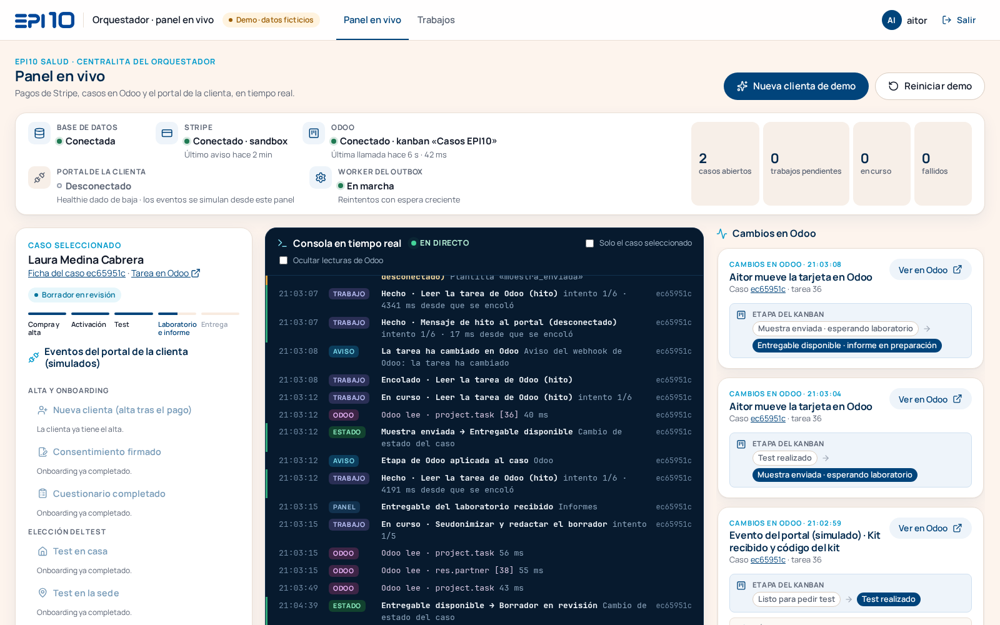
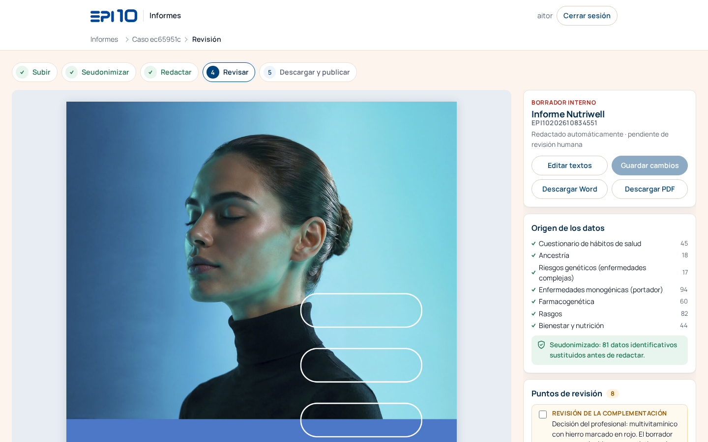

# Guía para probar la demo a mano

Para Raúl · demo EPI10 del 28 o el 29 de octubre · pila `epi10-demo` en hermes-node, desde `master` (6ac2695), con el **modelo real** en los borradores. **Solo datos ficticios.**



## 1. Abrir

Los túneles 4894, 4893 y 4881 ya están abiertos en el ASUS. Si no lo están: `hn open 4894; hn open 4893; hn open 4881`.

| Pantalla                     | URL                               | Usuario | Contraseña (pídela en el ASUS; nunca la escribas en un chat)                    |
| ---------------------------- | --------------------------------- | ------- | -------------------------------------------------------------------------------- |
| Panel en vivo                | <http://localhost:4894/panel>     | `aitor` | `hn sh 'grep PANEL_CONTRASENA ~/.config/epi10-demo/credenciales-panel.txt'`      |
| Odoo · kanban «Casos EPI10»  | <http://localhost:4881>           | `aitor` | `hn sh 'grep ODOO_AITOR_PASSWORD ~/Projects/epi10-odoo-pruebas/.env'`            |
| Pantalla de informes         | <https://localhost:4893/informes> | `aitor` | `hn sh 'grep INFORMES_CONTRASENA ~/.config/epi10-demo/credenciales-panel.txt'`   |

La pantalla de informes usa un certificado de la CA interna de Caddy: la primera vez, «Avanzado ▸ Continuar».

Ten tres pestañas a la vista: **Panel**, **Odoo** (proyecto «Casos EPI10», vista kanban) e **Informes**.

## 2. Qué clicar, en orden

**Panel → Odoo → Informes → Word.** Unos 5 minutos.

1. **Panel · Nueva clienta de demo.** Paga una clienta ficticia en el sandbox de Stripe. En la consola entran el aviso de Stripe, el caso, «Crear el caso en Odoo» y el alta en el portal. A la derecha, la tarjeta **Cambios en Odoo**: tarea nueva en «Nuevo».
2. **Panel · Consentimiento firmado → Cuestionario completado → Test en casa.** Cada botón mueve la tarea en Odoo. Con el test, «Listo para pedir test», marca de onboarding, dirección de envío y actividad «Pedir test» (antes → después en la tarjeta). «Ver en Odoo» abre la ficha.
3. **Odoo · arrastra la tarjeta a «Test pedido».** El panel recibe el webhook de Odoo y el caso pasa a «Test pedido». El mensaje de hito queda registrado y no se envía: el portal está desconectado.
4. **Panel · Test recibido · código del kit** y **Mensaje de la clienta.** Código del kit y «Test recibido» en la tarea, y actividad «Responder mensaje».
5. **Odoo · arrastra a «Test realizado», «Muestra enviada» y «Entregable disponible».**
6. **Informes · abre el caso** (el último de la lista; sin nombres, solo el código) y **arrastra los 7 PDF del caso A** a la zona: los seis de TellmeGen y el cuestionario. Están en el ASUS, junto a esta guía, en la carpeta `caso-a-lucia/` (`EPI-10/05_scratch/carriles-2026-10-25/caso-a-lucia/`; son una copia de `test/fixtures/informes/casos-demo/caso-a-lucia/` de `master`). La persona es Lucía Ferrer Montalbán, ficticia. Selecciónalos todos y arrástralos a la vez. «Subir y generar borrador».
7. **Informes · progreso.** El cuadro verde dice qué datos se han quitado y cuántas veces; después, la redacción sección a sección con el modelo real (unos 1,5 minutos: 95 s en el ensayo). Se abre la revisión sola.
8. **Informes · revisión.** El borrador maquetado como el informe Nutriwell. En el semáforo, el multivitamínico con hierro sale en rojo por la variante en HFE, como punto de revisión. «Editar textos» permite corregir aquí mismo.
9. **Word · «Descargar Word».** Un Word normal de unas 33 páginas, con títulos, tablas y los puntos de revisión como comentarios (8 en el ensayo).
10. (Opcional) **Panel · Informe publicado** con otro caso en «Entregable disponible». Lo hace todo solo, con un entregable ficticio, y cierra la entrega en Odoo («Informe entregado»).




## Ensayo del 25 de octubre (pila limpia desde `master` 6ac2695, modelo real)

- **Panel** (`npm run demo:panel -- probar`): correcto en 87 s. Incluye el pago en el sandbox de Stripe, los 7 eventos, los arrastres de Aitor por el webhook real de Odoo y «Informe publicado» hasta «Informe entregado». «OpenEMR» no aparece en ninguna de las 10 páginas y recursos ni en los 187 mensajes de la consola.
- **Caso A en `/informes`** (Playwright): una clienta nueva por el panel hasta «Entregable disponible» (30 s) y los 7 PDF soltados en la zona.
  - Se sustituyeron 81 datos identificativos.
  - El borrador real tardó 95 s y la revisión se abrió sola, sin errores de JavaScript.
  - El Word (147 KB) abre en LibreOffice: 33 páginas, unas 10 600 palabras, 8 comentarios y todas las secciones.
  - Ni el nombre de Lucía ni el código del kit aparecen en el Word.
- La pila queda **vacía y en marcha**, con el modelo real.

## 3. Qué es real y qué es simulado

| Real                                                                                    | Simulado o ficticio                                                                       |
| --------------------------------------------------------------------------------------- | ----------------------------------------------------------------------------------------- |
| El pago, en el sandbox de Stripe (tarjeta de prueba), que entra por su webhook           | El portal de la clienta: está **desconectado** y sus eventos son los botones del panel   |
| El orquestador: core, outbox, reintentos y escalados (la misma imagen que producción)     | Las personas, todas ficticias (`@correo-ficticio.test`, teléfonos `600 000 xxx`)          |
| Odoo 17 de pruebas: tarea, etapas, campos, actividades y notas; los arrastres, por webhook | Los PDF de TellmeGen y el cuestionario del caso A, ficticios                              |
| El borrador del informe con el **modelo real** (claude-opus-5-5) tras seudonimizar       | El entregable del botón «Informe publicado» del panel, un PDF ficticio mínimo             |

## 4. Reiniciar

- **Desde el panel:** «Reiniciar demo» archiva en Odoo las tareas de los casos y vacía el orquestador.
- **Todo desde cero** (kanban, core y pila): `hn sh 'cd ~/Projects/epi10-demo-master && mise exec node@22 -- npm run demo:panel -- limpiar --no-build'`. Tarda unos 2 minutos.

## 5. Plan B (si Anthropic falla o no hay red)

```bash
hn sh 'cd ~/Projects/epi10-demo-master && mise exec node@22 -- npm run demo:panel -- limpiar --no-build --llm falso'
```

El borrador lo redacta el modelo falso, sin llamadas fuera, en 6 s por sección. Se ve igual en pantalla. Para volver al modelo real, el mismo comando sin `--llm falso`.

Más detalle: `docs/demo-panel.md` (panel y guion) y `docs/demo-informes.md` (informes) en el repo.
