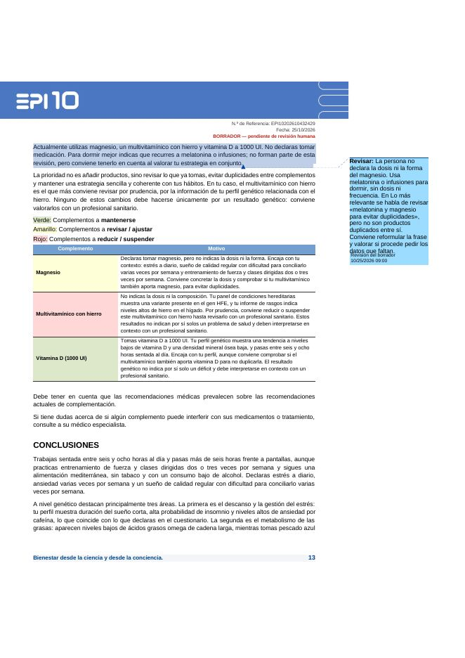
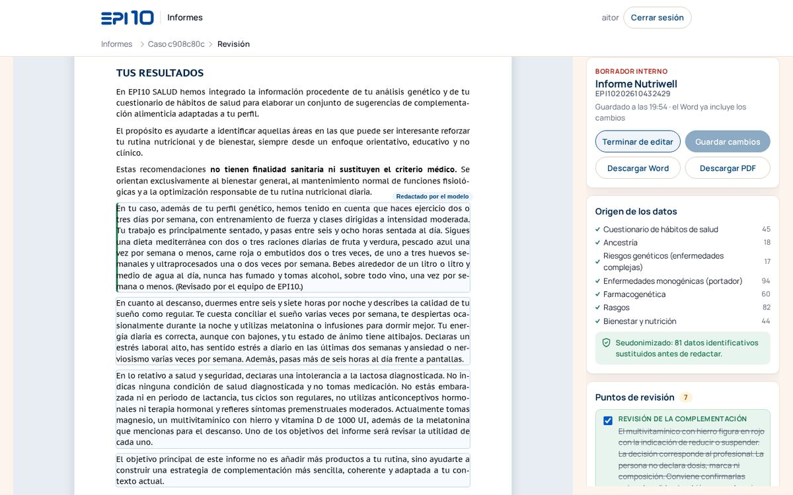
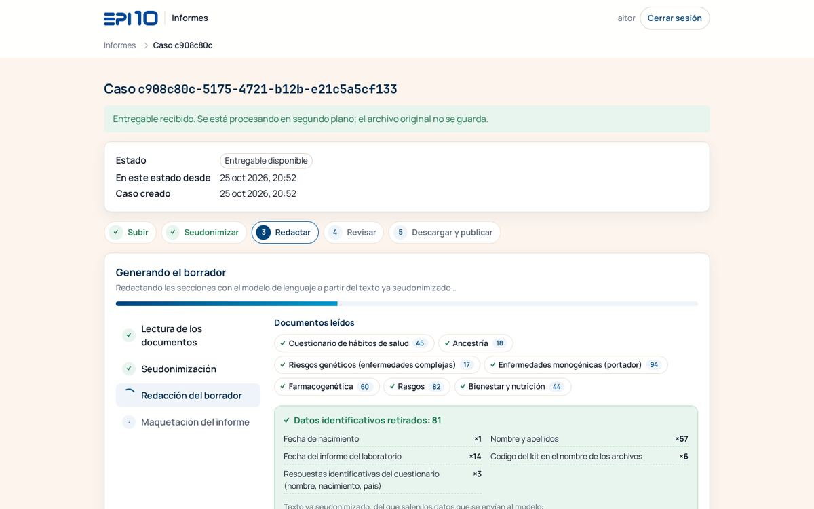

# Informe del carril 1 · Generador de borradores de informe (CON-461)

**PR:** <https://github.com/Skilland-ai/epi10-orquestador/pull/33> («CON-461: generador de borradores del Informe Nutriwell para la demo»), contra `master` y rebasado sobre 32ff045, que ya incluye el #32 del carril 2. Pendiente de fusionar por el orquestador: yo no lo fusiono.

## Qué está hecho

La pantalla de informes (`/informes`) recorre los cinco pasos de la demo con la estética EPI10 y sin ninguna mención a OpenEMR:

1. **Subir.** Se arrastran los 6 PDF de TellmeGen y el cuestionario de hábitos a la vez. La pantalla reconoce cada documento sin enseñar los nombres de archivo.
2. **Seudonimizar.** Se usan los datos de Odoo y los que traen los propios documentos: el nombre de la cabecera de TellmeGen, el nombre y la fecha de nacimiento del cuestionario y el código del kit. La pantalla enseña cuántos datos de cada tipo se han quitado y el texto ya seudonimizado. Si no se detecta ningún nombre, si los documentos son de dos personas o si queda algún residuo, el procesamiento se para.
3. **Redactar.** Se redactan 14 secciones con Claude Opus 5.5 siguiendo skills escritas a partir de los dos informes modelo y de las anotaciones de Aitor, con hasta 6 llamadas a la vez y el progreso en vivo, sección a sección. Si P44 es «No», el informe no lleva las secciones sensibles. Si el sexo al nacer es «Mujer», no lleva el linaje paterno.
4. **Revisar.** El borrador se ve maquetado como el informe modelo, en hojas A4: portada e índice de la plantilla, banda de cabecera, tablas EPI10, tablas de TellmeGen y semáforo de complementos. Los textos del modelo se editan en línea y los puntos de revisión se pueden resolver o añadir.
5. **Descargar y publicar.**
   - **Word editable**: estilos de Word, listas y tablas reales, y los puntos de revisión como **comentarios de Word** junto a su sección, que se borran de una vez.
   - **PDF de vista previa** desde el navegador.
   - **Listo para publicar**: la validación de siempre. Si quedan puntos sin resolver, hay que confirmarlo y queda registrado.

Además:

- Plantilla determinista derivada de la `.odt` y de los dos PDF anonimizados, con los textos fijos literales, los colores, la tipografía PT Sans Caption y las imágenes de la plantilla.
- Lector de los PDF de TellmeGen y del cuestionario. Lo he probado también con los 6 PDF reales anonimizados, en local y solo en lectura: no están en el repo y no se han enviado a ningún servicio.
- **2 casos de demo ficticios**, con 7 PDF por persona en el formato real, en `test/fixtures/informes/casos-demo/`:
  - **Caso A (Lucía)**: mujer, variante en HFE y multivitamínico con hierro, que sale en rojo en el semáforo.
  - **Caso B (Javier)**: hombre, P44 = «No», con estatina.
- Inventario y guion de 3–5 minutos en `docs/demo-informes.md`.

### El Word abierto en LibreOffice (hermes-node, headless)



Es la página 13 de 32 del caso A. Se ven texto real con estilos, la tabla del semáforo, la cabecera con la referencia, la fecha y la marca de borrador, y uno de los 7 comentarios de revisión al margen, anclado a su párrafo.

Revisión en pantalla y progreso:





## Evidencia (hermes-node; no hay CI)

| Comprobación | Resultado |
| --- | --- |
| `prettier --check`, `eslint .`, `tsc --noEmit` | sin errores |
| `npm run test:unit` | 78 archivos · 802 pruebas en verde, 1 omitida |
| `npm run test:int` | 29 archivos en verde, 1 omitido · 383 pruebas en verde, 3 omitidas |
| Pasada final con el modelo real (caso A, Playwright) | 1 min 45 s de punta a punta · 81 datos sustituidos · Word de 32 páginas con 7 comentarios |
| Caso B con el modelo real | sin secciones sensibles (P44 = «No») y con linaje paterno |
| Plan B (`falso`) | unos 10 s |
| Revisión independiente (subagente) | 4 bloqueantes y 9 importantes, corregidos con pruebas. De los 8 menores, M1–M7 corregidos y M8 cubierto |

## Cómo arrancar la demo

**Pila de demo (`epi10-demo`, del carril 2) con `master` y los dos PR fusionados.** La migración `0005_informes_contenido` se aplica sola al arrancar. Variables que necesita mi parte:

```
INFORMES_LLM_PROVIDER=anthropic
INFORMES_LLM_MODEL=claude-opus-5-5
INFORMES_LLM_EFFORT=medium
ANTHROPIC_API_KEY=$(cat ~/.config/epi10-demo/anthropic.key)   # nunca en el repo, un .env versionado ni un log
INFORMES_PERMITIR_FALSOS=true
# Plan B sin red: INFORMES_LLM_PROVIDER=falso e INFORMES_LLM_FALSO_RETARDO_MS=6000 (unos 20 s)
```

Los casos tienen que estar en «Entregable disponible», a donde los lleva el panel del carril 2. URL de la pantalla: `https://localhost:4893/informes` (con `hn open 4893`). Los PDF que se arrastran en directo están en el repo, en `test/fixtures/informes/casos-demo/caso-a-lucia/` (el principal) y `caso-b-javier/`.

**Mi entorno de pruebas** (no toca la pila de demo). App en `127.0.0.1:4900` con el modelo real y PostgreSQL en `4901`. Para usarlo:

- Abrirlo con `hn open 4900` → <http://localhost:4900/informes>.
- Usuario `aitor`. La contraseña está en el HP, en `~/.config/epi10-informes-dev/credenciales.txt`.
- Hay casos sembrados. Para sembrar más: `test/fixtures/informes/casos-demo/sembrar-caso.ts`.
- Los scripts `construir.sh`, `arrancar.sh` y `probar.sh` están en el HP, en `~/.config/epi10-informes-dev/`.

## Qué es real y qué es simulado

- **Real:**
  - Lectura de los PDF.
  - Seudonimización con comprobación de residuos y borrado de los originales.
  - Redacción con Claude Opus 5.5.
  - Maquetación de Word, pantalla y PDF.
  - Validación y avance en Odoo, con el flujo que ya existía.
- **Simulado o provisional:**
  - Los casos son ficticios.
  - El formato del cuestionario respondido es supuesto: EPI10 solo ha pasado el formulario en blanco.
  - El catálogo de complementos está copiado de los informes modelo, más el magnesio, y hay que validarlo.
  - El proveedor `falso` es el plan B.
  - El PDF se genera desde el navegador y no en el servidor.

## Pendiente

- **Validar con Aitor y Raúl:**
  - El catálogo de complementos.
  - El cambio de las guardas D7: ahora admiten recomendar complementos, pero solo los del catálogo.
  - Si P44 = «No» quita también «Vulnerabilidad genética».
  - Las erratas de los modelos que he corregido.
  - El formato real de exportación del cuestionario.
- Pasar la pantalla de informes a la capa común `src/ui/` (CON-460). Hoy usa su propia copia de los tokens EPI10; está anotado en `docs/demo-informes.md`.
- **No se generan:**
  - La analítica aportada.
  - Los textos de ancestría por región y los árboles de haplogrupos, porque no vienen en el PDF de TellmeGen.
- PDF generado en el servidor: hoy el Word es la salida y el PDF es una vista previa.
- Los dos entornos de prueba siguen arrancados en el HP: la app `epi10-informes` en 4900 y el contenedor `epi10-informes-dev-pg` en 4901. Se pueden parar después de la demo con `hn stop epi10-informes` y `docker stop epi10-informes-dev-pg`.
